# Buzzer Mu Rata Mlt 8530 SURFACE MOUNT

`electronic_buzzer_surface_mount_mu_rata_mlt_8530`

Buzzer Mu Rata Mlt 8530 SURFACE MOUNT is an OOMP electronic buzzer definition. It uses the surface mount package or form factor. Its nominal drawing size is 8.5 &#x00D7; 8.5 mm. The definition includes 2 documented pins.

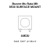

## At a glance

| Detail | Value |
| --- | --- |
| OOMP ID | `electronic_buzzer_surface_mount_mu_rata_mlt_8530` |
| Type | Buzzer |
| Package / style | surface mount |
| Nominal size | 8.5 &#x00D7; 8.5 mm |
| Documented pins | 2 |

## Classification

| Level | Value |
| --- | --- |
| 1 | `electronic` |
| 2 | `buzzer` |
| 3 | `surface_mount` |
| 14 | `mu_rata` |
| 15 | `mlt_8530` |

## Nominal dimensions

| Measurement | Value |
| --- | ---: |
| Length | 8.5 mm |
| Width | 8.5 mm |

## Pins

| Pin | Name | Type |
| ---: | --- | --- |
| 1 | 1 | signal |
| 2 | 2 | signal |

## Used in projects

[Browse confirmed project usage](https://oomlout.github.io/oomp_electronic_project_version_5/usage/index.html#electronic_buzzer_surface_mount_mu_rata_mlt_8530)

## Files

[KiCad symbol, machine-solder and hand-solder footprints](data/kicad/README.md) · [Availability and source masters](data/kicad/manifest.yaml)

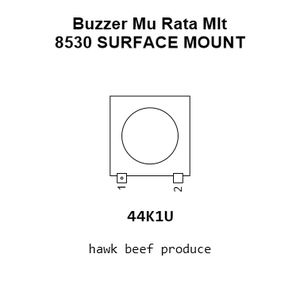

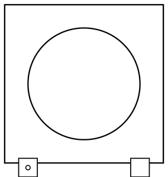

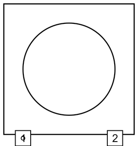

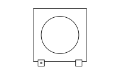

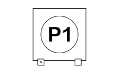

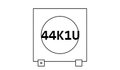

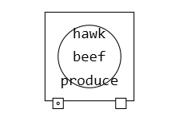

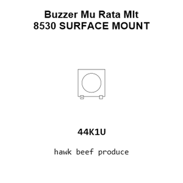

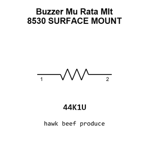

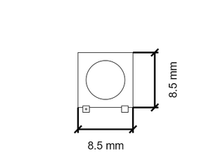

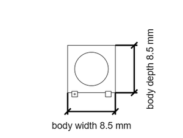

[View this part on GitHub](https://github.com/oomlout/oomp_electronic_version_5/tree/main/parts/electronic_buzzer_surface_mount_mu_rata_mlt_8530)

[Browse this category](../../navigation/electronic/buzzer/surface_mount/mu_rata/README.md)

---

This page is generated from the OOMP part definition by a Roboclick Jinja template. Edit the source taxonomy or template rather than this generated file.