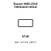
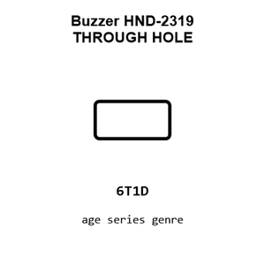
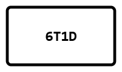
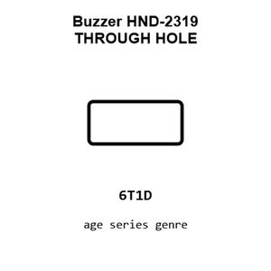
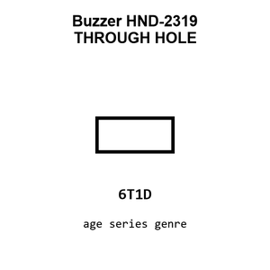
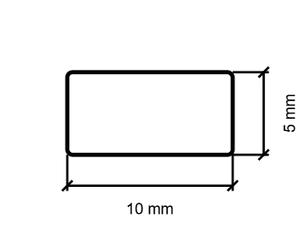
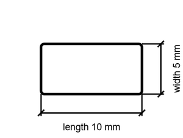

# Buzzer HND-2319 THROUGH HOLE

`electronic_buzzer_through_hole_jiangsu_huaneng_elec_hnd_2319`

Buzzer HND-2319 THROUGH HOLE is an OOMP electronic buzzer definition. It uses the through hole package or form factor. Its nominal drawing size is 10.0 &#x00D7; 5.0 mm.

## At a glance

| Detail | Value |
| --- | --- |
| OOMP ID | `electronic_buzzer_through_hole_jiangsu_huaneng_elec_hnd_2319` |
| Type | Buzzer |
| Package / style | through hole |
| Nominal size | 10.0 &#x00D7; 5.0 mm |

## Classification

| Level | Value |
| --- | --- |
| 1 | `electronic` |
| 2 | `buzzer` |
| 3 | `through_hole` |
| 14 | `jiangsu_huaneng_elec` |
| 15 | `hnd_2319` |

## Nominal dimensions

| Measurement | Value |
| --- | ---: |
| Length | 10.0 mm |
| Width | 5.0 mm |

## Identifiers

| Identifier | Value |
| --- | --- |
| Manufacturer part number | `HND-2319` |
| LCSC | [`C2878`](https://www.lcsc.com/product-detail/C2878.html) |
| JLCPCB | [`C2878`](https://jlcpcb.com/partdetail/Jiangsu_HuanengElec-HND2319/C2878) |

## Used in projects

[Browse confirmed project usage](https://oomlout.github.io/oomp_electronic_project_version_5/usage/index.html#electronic_buzzer_through_hole_jiangsu_huaneng_elec_hnd_2319)

## Files

[KiCad symbol, machine-solder and hand-solder footprints](data/kicad/README.md) · [Availability and source masters](data/kicad/manifest.yaml)

[View this part on GitHub](https://github.com/oomlout/oomp_electronic_version_5/tree/main/parts/electronic_buzzer_through_hole_jiangsu_huaneng_elec_hnd_2319)

[Browse this category](../../navigation/electronic/buzzer/through_hole/jiangsu_huaneng_elec/README.md)

---

This page is generated from the OOMP part definition by a Roboclick Jinja template. Edit the source taxonomy or template rather than this generated file.