# Capacitor 100 nF 0603

`electronic_capacitor_0603_100_nano_farad_samsung_electro_mechanics_cl10b104kb8nnnc`

Capacitor 100 nF 0603 is an OOMP electronic capacitor definition. It uses the 0603 package or form factor. Its nominal drawing size is 1.6 &#x00D7; 0.8 mm.

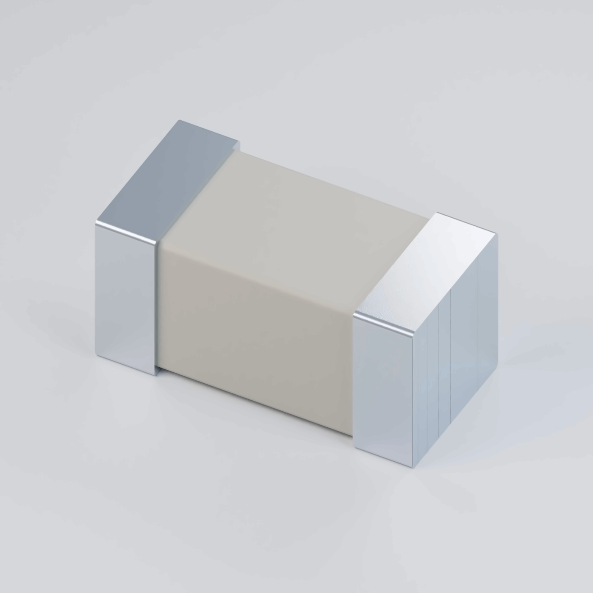

Generic KiCad nominal 0603 MLCC geometry, with illustrative ceramic colour and metallic terminations. Unmarked body is an illustration: this exact part&#x2019;s no-marking policy has not been verified.

[Render recipe and provenance](data/display_render/manifest.json) · [KiCad model](https://gitlab.com/kicad/libraries/kicad-packages3D/-/blob/master/Capacitor_SMD.3dshapes/C_0603_1608Metric.step)

Model credit: 2017 kicad StepUp. CC-BY-SA-4.0 with KiCad library exception; see original STEP header.

## At a glance

| Detail | Value |
| --- | --- |
| OOMP ID | `electronic_capacitor_0603_100_nano_farad_samsung_electro_mechanics_cl10b104kb8nnnc` |
| Type | Capacitor |
| Package / style | 0603 |
| Nominal size | 1.6 &#x00D7; 0.8 mm |

## Classification

| Level | Value |
| --- | --- |
| 1 | `electronic` |
| 2 | `capacitor` |
| 3 | `0603` |
| 4 | `100_nano_farad` |
| 5 | `samsung_electro_mechanics` |
| 6 | `cl10b104kb8nnnc` |

## Nominal dimensions

| Measurement | Value |
| --- | ---: |
| Length | 1.6 mm |
| Width | 0.8 mm |

## Identifiers

| Identifier | Value |
| --- | --- |
| Manufacturer part number | `CL10B104KB8NNNC` |
| LCSC | [`C1591`](https://www.lcsc.com/product-detail/C1591.html) |
| JLCPCB | [`C1591`](https://jlcpcb.com/partdetail/1943-CL10B104KB8NNNC/C1591) |

## Used in projects

[Browse confirmed project usage](https://oomlout.github.io/oomp_electronic_project_version_5/usage/index.html#electronic_capacitor_0603_100_nano_farad_samsung_electro_mechanics_cl10b104kb8nnnc)

## Files

[KiCad symbol, machine-solder and hand-solder footprints](data/kicad/README.md) · [Availability and source masters](data/kicad/manifest.yaml)

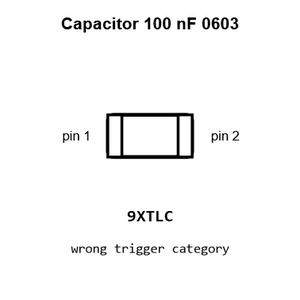

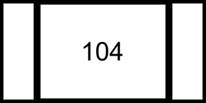

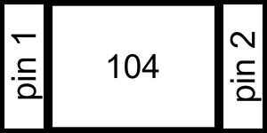

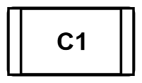

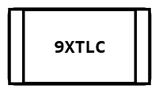

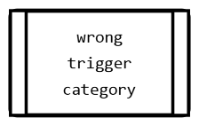

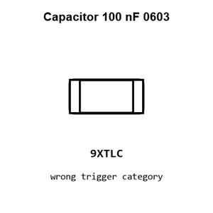

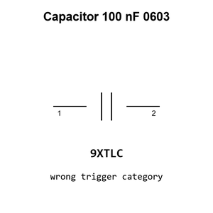

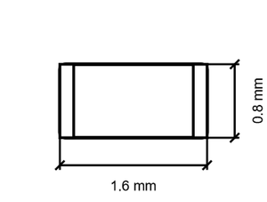

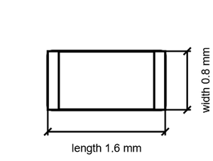

[View this part on GitHub](https://github.com/oomlout/oomp_electronic_version_5/tree/main/parts/electronic_capacitor_0603_100_nano_farad_samsung_electro_mechanics_cl10b104kb8nnnc)

[Browse this category](../../navigation/electronic/capacitor/0603/100_nano_farad/samsung_electro_mechanics/README.md)

---

This page is generated from the OOMP part definition by a Roboclick Jinja template. Edit the source taxonomy or template rather than this generated file.