# 2.1 &#x00D7; 5.5 mm Panel Mount DC Power Socket DC-022B

`electronic_connector_dc_power_jack_2_1_mm_x_5_5_mm_panel_mount_solder_lug_switch_electronics_dc_022b`

2.1 &#x00D7; 5.5 mm Panel Mount DC Power Socket DC-022B is an OOMP electronic connector definition. It uses the dc power jack package or form factor. Its nominal drawing size is 17.8 &#x00D7; 10.0 mm. The definition includes 2 documented pins.

Panel opening &#x00D8;8 mm, maximum panel thickness 4 mm, M8 &#x00D7; 1 thread. For anti-rotation, use a double-D opening based on &#x00D8;8 mm arcs and 6.8 mm across flats. These are nominal shaft dimensions. Check the actual socket and allow clearance before cutting. Rated 30 V DC / 0.5 A. The supplier lists 18.2 &#x00D7; &#x00D8;10.2 mm (length &#x00D7; body diameter). The mechanical drawing and model use the datasheet nominal 17.8 &#x00D7; &#x00D8;10.0 mm, excluding nut. Lug 4 is centre and lug 5 is sleeve. Circuit polarity is set by the wiring.

## At a glance

| Detail | Value |
| --- | --- |
| OOMP ID | `electronic_connector_dc_power_jack_2_1_mm_x_5_5_mm_panel_mount_solder_lug_switch_electronics_dc_022b` |
| Type | Connector |
| Package / style | dc power jack |
| Nominal size | 17.8 &#x00D7; 10.0 mm |
| Documented pins | 2 |

## Classification

| Level | Value |
| --- | --- |
| 1 | `electronic` |
| 2 | `connector` |
| 3 | `dc_power_jack` |
| 4 | `2_1_mm_x_5_5_mm` |
| 5 | `panel_mount` |
| 6 | `solder_lug` |
| 14 | `switch_electronics` |
| 15 | `dc_022b` |

## 3D reference model

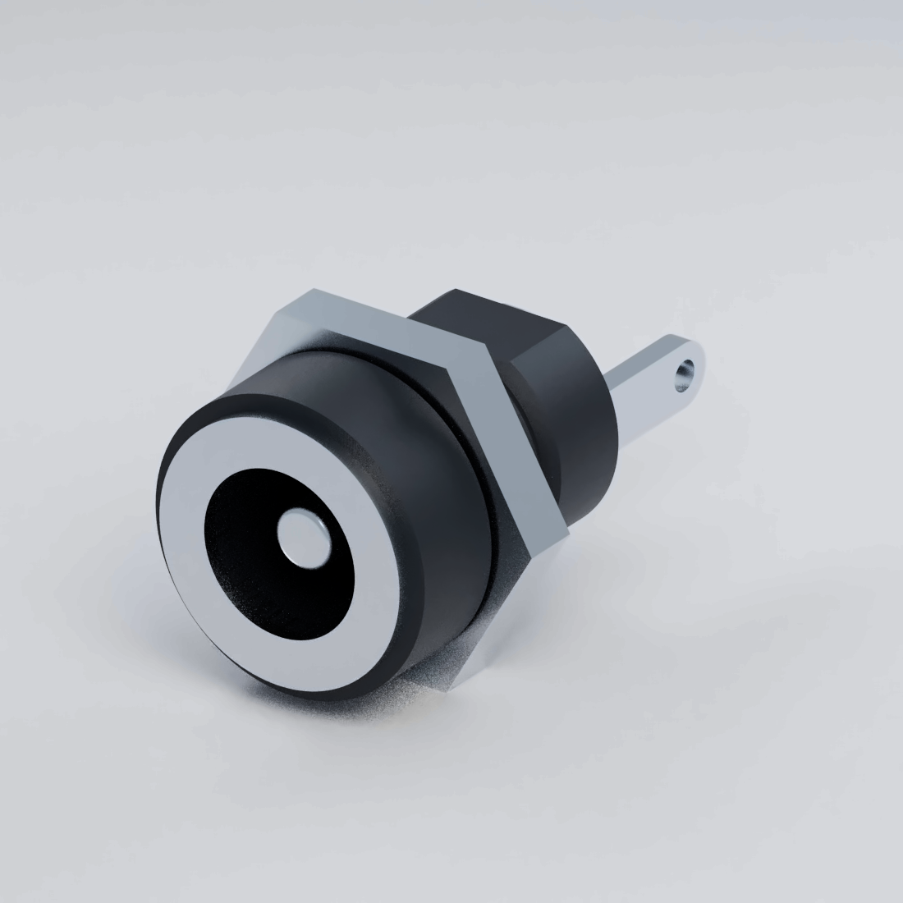

[Rear render](data/model_3d_rear.png) · [Model source and limitations](data/model_3d_source.json)

Display model based on the supplier drawing, with nominal outer dimensions and simplified thread and contact geometry.

## Mechanical drawing

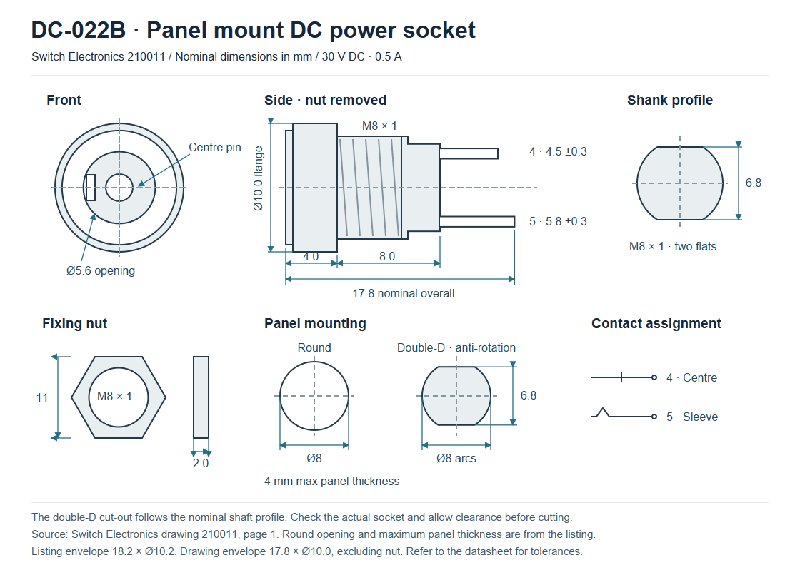

[Download drawing SVG](data/mechanical_drawing.svg)

## Connector details

| Detail | Value |
| --- | --- |
| Anti Rotation Cutout | Double-D, nominal &#x00D8;8 mm arcs &#x00D7; 6.8 mm across flats |
| Fixing Nut Included | True |
| Housing Material | PBT |
| Mating Plug | 2.1 mm ID &#x00D7; 5.5 mm OD |
| Mounting Thread | M8 &#x00D7; 1 |
| Panel Cutout Mm | 8.0 |
| Panel Thickness Max Mm | 4.0 |
| Shaft Across Flats Mm | 6.8 |
| Termination | Solder lug |

## Nominal dimensions

| Measurement | Value |
| --- | ---: |
| Height | 10.0 mm |
| Length | 17.8 mm |
| Width | 10.0 mm |

## Identifiers

| Identifier | Value |
| --- | --- |
| Manufacturer part number | `DC-022B` |
| Switch Electronics | [`210011`](https://www.switchelectronics.co.uk/products/2-1mm-x-5-5mm-panel-mount-dc-power-socket-dc-022b?variant=45365909750069) |

## Pins

| Pin | Name | Type |
| ---: | --- | --- |
| 4 | Centre contact | passive |
| 5 | Sleeve contact | passive |

## Datasheet

[View the datasheet](data/datasheet.pdf)
 · [Supplier page capture](data/supplier_page.jpg)

## Used in projects

[Browse confirmed project usage](https://oomlout.github.io/oomp_electronic_project_version_5/usage/index.html#electronic_connector_dc_power_jack_2_1_mm_x_5_5_mm_panel_mount_solder_lug_switch_electronics_dc_022b)

## Files

<!-- oomp-part-file-table -->

| Image type | Image | Link |
| --- | :---: | --- |
| **Pinout drawing** Pin names and positions on the part. | 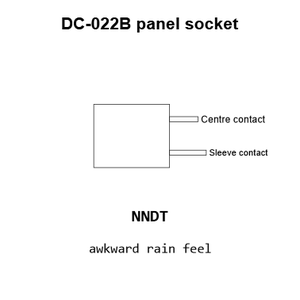 | [SVG](data/working_svg_square_pins.svg) · [PNG](data/working_svg_square_pins.png) · [Preview](data/working_svg_square_pins_300.png) |
| **Assembly** Component placement drawing. |  | [SVG](data/working_svg_assembly.svg) · [PNG](data/working_svg_assembly.png) · [Preview](data/working_svg_assembly_300.png) |
| **Assembly pinout** Placement drawing with the pins marked. | 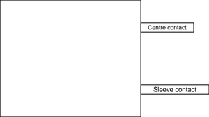 | [SVG](data/working_svg_assembly_pins.svg) · [PNG](data/working_svg_assembly_pins.png) · [Preview](data/working_svg_assembly_pins_300.png) |
| **Top view** Package seen from above. | 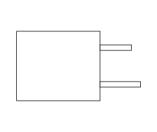 | [SVG](data/working_svg_top.svg) · [PNG](data/working_svg_top.png) · [Preview](data/working_svg_top_300.png) |
| **Bottom view** Package seen from below. | 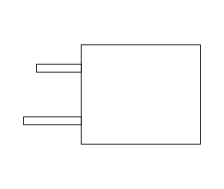 | [SVG](data/working_svg_bottom.svg) · [PNG](data/working_svg_bottom.png) · [Preview](data/working_svg_bottom_300.png) |
| **Side view** Package profile. | 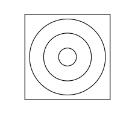 | [SVG](data/working_svg_side.svg) · [PNG](data/working_svg_side.png) · [Preview](data/working_svg_side_300.png) |
| **Outline** External shape of the part. | 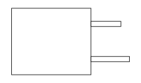 | [SVG](data/working_svg_outline.svg) · [PNG](data/working_svg_outline.png) · [Preview](data/working_svg_outline_300.png) |
| **Dimensions** Package outline with dimension arrows. | 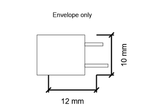 | [SVG](data/working_svg_dimensioned.svg) · [PNG](data/working_svg_dimensioned.png) · [Preview](data/working_svg_dimensioned_300.png) |
| **Dimensions with labels** Labelled package measurements. | 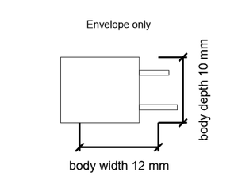 | [SVG](data/working_svg_dimensioned_titles.svg) · [PNG](data/working_svg_dimensioned_titles.png) · [Preview](data/working_svg_dimensioned_titles_300.png) |
| **Square summary** Component identification card. | 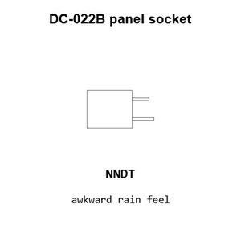 | [SVG](data/working_svg_square.svg) · [PNG](data/working_svg_square.png) · [Preview](data/working_svg_square_300.png) |
| **Part ID** Drawing labelled with the OOMP catalogue ID. | 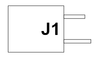 | [SVG](data/working_svg_part_id.svg) · [PNG](data/working_svg_part_id.png) · [Preview](data/working_svg_part_id_300.png) |
| **MD5 alpha** Drawing labelled with the short OOMP code. | 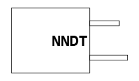 | [SVG](data/working_svg_md5_6_alpha.svg) · [PNG](data/working_svg_md5_6_alpha.png) · [Preview](data/working_svg_md5_6_alpha_300.png) |
| **BIP 39 words** Drawing labelled with the three-word identifier. | 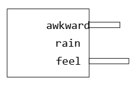 | [SVG](data/working_svg_bip_39_3_word.svg) · [PNG](data/working_svg_bip_39_3_word.png) · [Preview](data/working_svg_bip_39_3_word_300.png) |
| **Diagram contact sheet** Component drawings together in one image. | 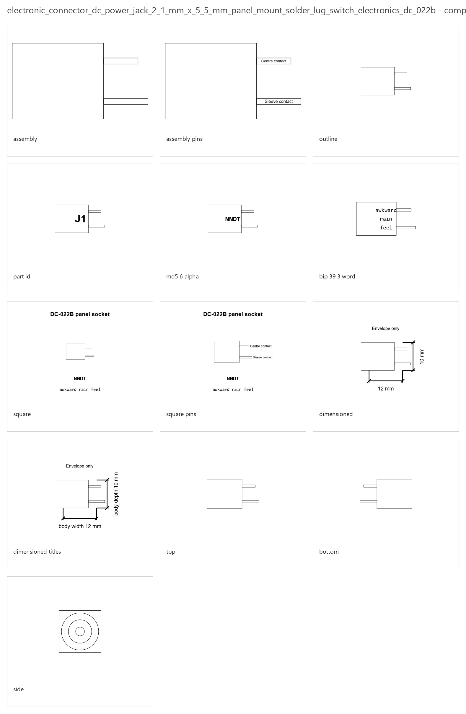 | [PNG](data/working_svg_contact_sheet.png) |
| **KiCad library guide** | — | [MD](data/kicad/README.md) |
| **KiCad availability and source masters** | — | [JSON](data/kicad/manifest.json) · [YAML](data/kicad/manifest.yaml) |
| **Model 3d rear** | 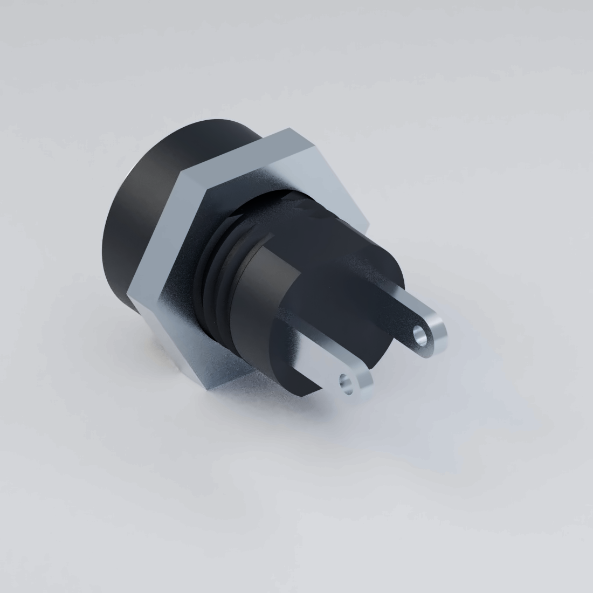 | [PNG](data/model_3d_rear.png) |
| **Reference model render** |  | [PNG](data/model_3d_render.png) |
| **Reference model sources** | — | [JSON](data/model_3d_source.json) |
| **Manufacturer or supplier datasheet** | — | [PDF](data/datasheet.pdf) |
| **Datasheet source** | — | [YAML](data/datasheet_source.yaml) |
| **Drawer label data** | — | [YAML](data/label_drawer.yaml) |
| **Mechanical drawing** |  | [SVG](data/mechanical_drawing.svg) · [PNG](data/mechanical_drawing.png) |
| **Supplier page** | 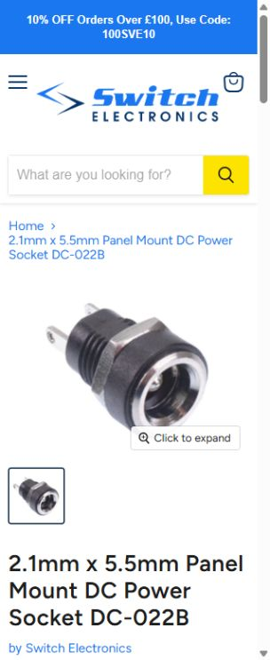 | [JPG](data/supplier_page.jpg) |
| **Small drawer label** | 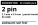 | [SVG](label_drawer_1_5x1.svg) |
| **Large drawer label** | 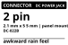 | [SVG](label_drawer_3x2.svg) |
| **Web catalogue file index** | — | [YAML](web.yaml) |
| **Part definition and build recipe** | — | [YAML](working.yaml) |

<!-- /oomp-part-file-table -->

[View this part on GitHub](https://github.com/oomlout/oomp_electronic_version_5/tree/main/parts/electronic_connector_dc_power_jack_2_1_mm_x_5_5_mm_panel_mount_solder_lug_switch_electronics_dc_022b)

[Browse this category](../../navigation/electronic/connector/dc_power_jack/2_1_mm_x_5_5_mm/panel_mount/solder_lug/switch_electronics/README.md)

---

This page is generated from the OOMP part definition by a Roboclick Jinja template. Edit the source taxonomy or template rather than this generated file.