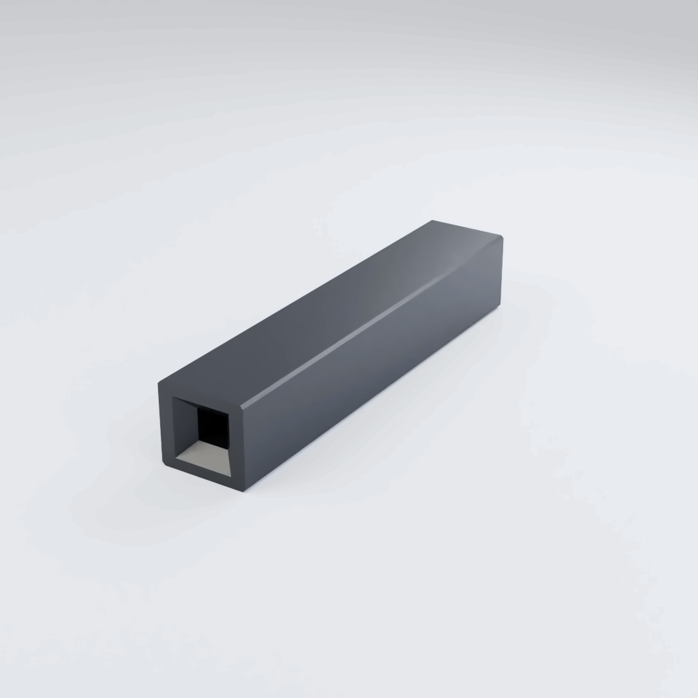
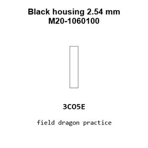
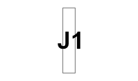
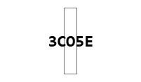
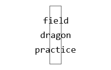
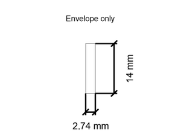
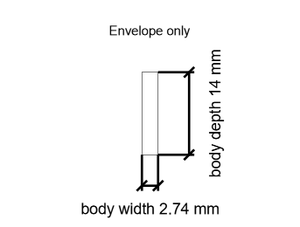
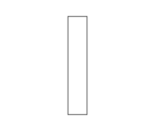

# Header housing 2.54 mm 1-position black (Harwin M20-1060100)

`electronic_connector_header_2_54_mm_pitch_housing_1_pin_black_harwin_m20_1060100`

Header housing 2.54 mm 1-position black (Harwin M20-1060100) is an OOMP electronic connector definition. It uses the header package or form factor. Its nominal drawing size is 2.74 &#x00D7; 14.0 mm.

Dimensioned envelope only: contact spring, crimp wings and housing cavities are not detailed. Not a PCB footprint or crimp-tool drawing.

## At a glance

| Detail | Value |
| --- | --- |
| OOMP ID | `electronic_connector_header_2_54_mm_pitch_housing_1_pin_black_harwin_m20_1060100` |
| Type | Connector |
| Package / style | header |
| Nominal size | 2.74 &#x00D7; 14.0 mm |

## Classification

| Level | Value |
| --- | --- |
| 1 | `electronic` |
| 2 | `connector` |
| 3 | `header` |
| 4 | `2_54_mm_pitch` |
| 5 | `housing` |
| 6 | `1_pin` |
| 7 | `black` |
| 14 | `harwin` |
| 15 | `m20_1060100` |

## 3D reference model

[Download STEP](data/model_3d.step) · [Model source and limitations](data/model_3d_source.yaml)

OOMP model based on the manufacturer drawing, with nominal outer dimensions and simplified internal geometry. Use it for layout and illustration.

## Connector details

| Detail | Value |
| --- | --- |
| Component Role | Empty insulating housing with contacts supplied separately |
| Contacts Required | 1, sold separately |
| Flammability | UL94V-1 |
| Housing Color | Black |
| Housing Material | PPE+PS |
| Mating Pin | 0.64 mm square |
| Mating Pin Length | 5.50 to 6.30 mm |
| Pitch | 2.54 mm |
| Polarised | No |
| Positions | 1, single row |
| Series | Harwin M20 |

## Compatible components

- **Contact option:** [Header crimp contact 2.54 mm socket 22-30 AWG gold (Harwin M20-1180042)](../electronic_connector_header_2_54_mm_pitch_crimp_1_pin_socket_22_to_30_awg_gold_harwin_m20_1180042/README.md) — quantity 1.
  Select the finish for the mating header. Quantity is for filling all positions with this option. [Manufacturer evidence](https://www.harwin.com/products/M20-1060100).

- **Contact option:** [Header crimp contact 2.54 mm socket 22-30 AWG tin (Harwin M20-1180046)](../electronic_connector_header_2_54_mm_pitch_crimp_1_pin_socket_22_to_30_awg_tin_harwin_m20_1180046/README.md) — quantity 1.
  Select the finish for the mating header. Quantity is for filling all positions with this option. [Manufacturer evidence](https://www.harwin.com/products/M20-1060100).

## Nominal dimensions

| Measurement | Value |
| --- | ---: |
| Height | 2.5 mm |
| Length | 2.74 mm |
| Width | 14.0 mm |

## Identifiers

| Identifier | Value |
| --- | --- |
| Manufacturer part number | `M20-1060100` |

## Datasheet

[View the datasheet](data/datasheet.pdf)

## Used in projects

[Browse confirmed project usage](https://oomlout.github.io/oomp_electronic_project_version_5/usage/index.html#electronic_connector_header_2_54_mm_pitch_housing_1_pin_black_harwin_m20_1060100)

## Files

[KiCad applicability: cable component, no PCB footprint](data/kicad/README.md) · [Applicability record](data/kicad/manifest.yaml)

[View this part on GitHub](https://github.com/oomlout/oomp_electronic_version_5/tree/main/parts/electronic_connector_header_2_54_mm_pitch_housing_1_pin_black_harwin_m20_1060100)

[Browse this category](../../navigation/electronic/connector/header/2_54_mm_pitch/housing/1_pin/black/harwin/README.md)

---

This page is generated from the OOMP part definition by a Roboclick Jinja template. Edit the source taxonomy or template rather than this generated file.