# Connector Header 2.54-1*20P直针

AI-generated CAD reference and instructions. Errors possible.

## Summary

Straight single-row 2.54 mm breakaway header. This reference model uses a 2.54 mm square insulator, 0.64 mm square contacts, 6.1 mm mating ends and 3 mm tails.

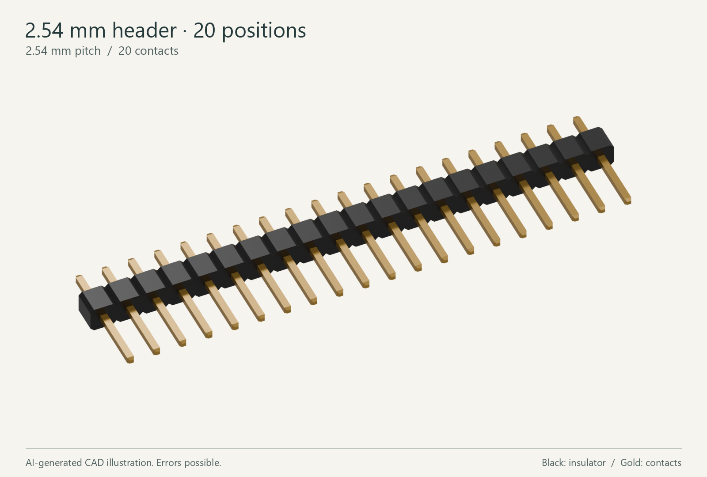

## Details

**OOMP ID:** `electronic_connector_header_2_54_mm_pitch_through_hole_20_pin`

[STEP model](data/model_3d.step) · [Plastic STL](data/model_3d_body.stl) · [Contact STL](data/model_3d_pins.stl) · [Model provenance](data/model_3d_source.json)

Nominal reference geometry derived from the [Harwin M20 six-position dimensions](https://www.harwin.com/products/M20-9990645) and extended at 2.54 mm pitch. The snap grooves are on the top and bottom of a horizontal strip. Existing KiCad models are retained separately. OOBB connectors use the separate `header_long` family.

## Parts

One full plastic strip with every contact populated. Separate material meshes are provided for assembly rendering.

## Assembly

Select the required strip length. For OOBB connectors, use the matching prepared-header definition to determine which pins to remove.

## Files

<!-- oomp-part-file-table -->

| Image type | Image | Link |
| --- | :---: | --- |
| **Pinout drawing** Pin names and positions on the part. | 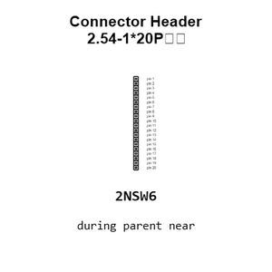 | [SVG](data/working_svg_square_pins.svg) · [PNG](data/working_svg_square_pins.png) · [Preview](data/working_svg_square_pins_300.png) |
| **Assembly** Component placement drawing. |  | [SVG](data/working_svg_assembly.svg) · [PNG](data/working_svg_assembly.png) · [Preview](data/working_svg_assembly_300.png) |
| **Assembly pinout** Placement drawing with the pins marked. |  | [SVG](data/working_svg_assembly_pins.svg) · [PNG](data/working_svg_assembly_pins.png) · [Preview](data/working_svg_assembly_pins_300.png) |
| **Top view** Package seen from above. | 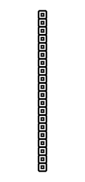 | [SVG](data/working_svg_top.svg) · [PNG](data/working_svg_top.png) · [Preview](data/working_svg_top_300.png) |
| **Bottom view** Package seen from below. | 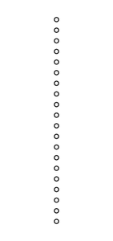 | [SVG](data/working_svg_bottom.svg) · [PNG](data/working_svg_bottom.png) · [Preview](data/working_svg_bottom_300.png) |
| **Side view** Package profile. | 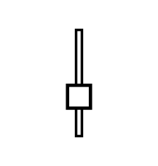 | [SVG](data/working_svg_side.svg) · [PNG](data/working_svg_side.png) · [Preview](data/working_svg_side_300.png) |
| **Outline** External shape of the part. | 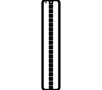 | [SVG](data/working_svg_outline.svg) · [PNG](data/working_svg_outline.png) · [Preview](data/working_svg_outline_300.png) |
| **Dimensions** Package outline with dimension arrows. | 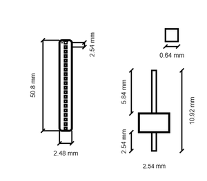 | [SVG](data/working_svg_dimensioned.svg) · [PNG](data/working_svg_dimensioned.png) · [Preview](data/working_svg_dimensioned_300.png) |
| **Dimensions with labels** Labelled package measurements. | 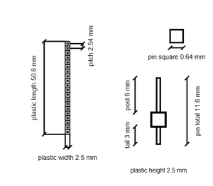 | [SVG](data/working_svg_dimensioned_titles.svg) · [PNG](data/working_svg_dimensioned_titles.png) · [Preview](data/working_svg_dimensioned_titles_300.png) |
| **Square summary** Component identification card. | 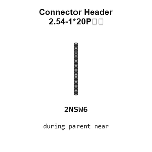 | [SVG](data/working_svg_square.svg) · [PNG](data/working_svg_square.png) · [Preview](data/working_svg_square_300.png) |
| **Square schematic** Schematic symbol on an identification card. | 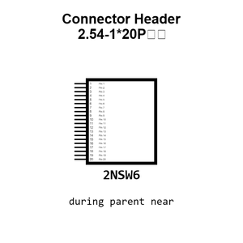 | [SVG](data/working_svg_square_schematic.svg) · [PNG](data/working_svg_square_schematic.png) · [Preview](data/working_svg_square_schematic_300.png) |
| **Part ID** Drawing labelled with the OOMP catalogue ID. | 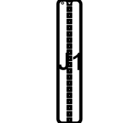 | [SVG](data/working_svg_part_id.svg) · [PNG](data/working_svg_part_id.png) · [Preview](data/working_svg_part_id_300.png) |
| **MD5 alpha** Drawing labelled with the short OOMP code. | 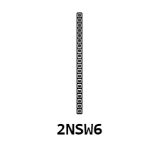 | [SVG](data/working_svg_md5_6_alpha.svg) · [PNG](data/working_svg_md5_6_alpha.png) · [Preview](data/working_svg_md5_6_alpha_300.png) |
| **BIP 39 words** Drawing labelled with the three-word identifier. | 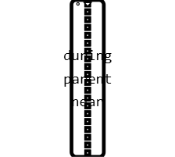 | [SVG](data/working_svg_bip_39_3_word.svg) · [PNG](data/working_svg_bip_39_3_word.png) · [Preview](data/working_svg_bip_39_3_word_300.png) |
| **Schematic** Electrical symbol for the part. | 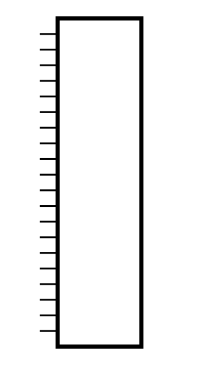 | [SVG](data/working_svg_schematic.svg) · [PNG](data/working_svg_schematic.png) |
| **Schematic pinout** Electrical symbol with pin labels. | 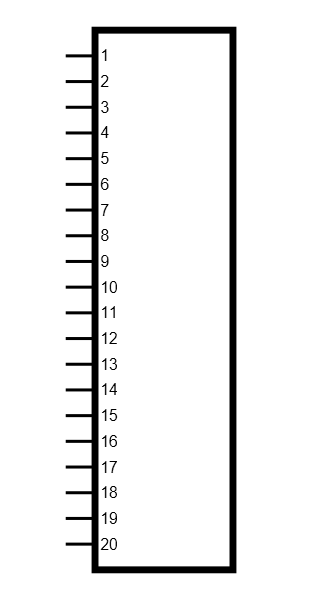 | [SVG](data/working_svg_schematic_pins.svg) · [PNG](data/working_svg_schematic_pins.png) |
| **Schematic with part ID** Symbol labelled with the OOMP catalogue ID. | 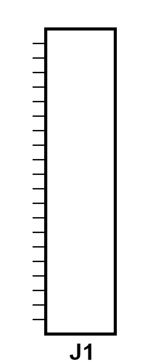 | [SVG](data/working_svg_schematic_part_id.svg) · [PNG](data/working_svg_schematic_part_id.png) |
| **Schematic with MD5 alpha** Symbol labelled with the short OOMP code. | 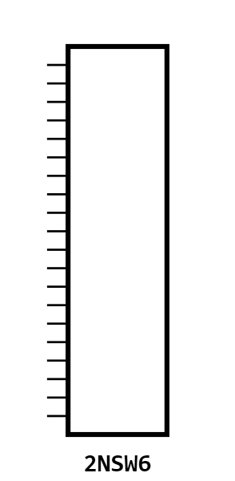 | [SVG](data/working_svg_schematic_md5_6_alpha.svg) · [PNG](data/working_svg_schematic_md5_6_alpha.png) |
| **Schematic with BIP 39 words** Symbol labelled with the three-word identifier. | 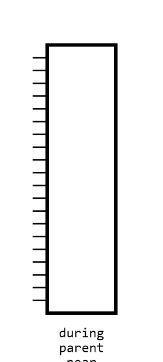 | [SVG](data/working_svg_schematic_bip_39_3_word.svg) · [PNG](data/working_svg_schematic_bip_39_3_word.png) |
| **KiCad asset licence** | — | [MD](data/kicad/LICENSE.md) |
| **KiCad library guide** | — | [MD](data/kicad/README.md) |
| **KiCad symbol and footprint overview** | 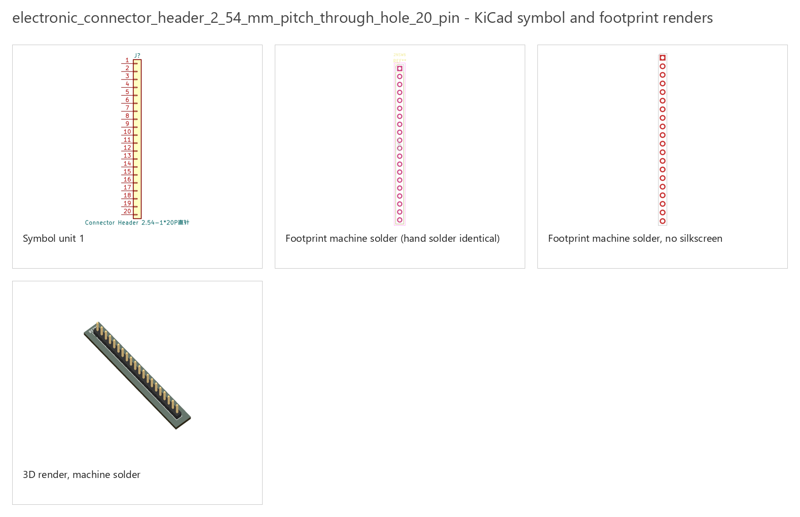 | [PNG](data/kicad/contact_sheet.png) |
| **KiCad symbol library** | — | [KICAD_SYM](data/kicad/electronic_connector_header_2_54_mm_pitch_through_hole_20_pin.kicad_sym) |
| **Hand-solder footprint guide** | — | [MD](data/kicad/hand_solder/README.md) |
| **Hand-solder footprint** | — | [KICAD_MOD](data/kicad/hand_solder/electronic_connector_header_2_54_mm_pitch_through_hole_20_pin.kicad_mod) |
| **Machine-solder footprint drawing** | 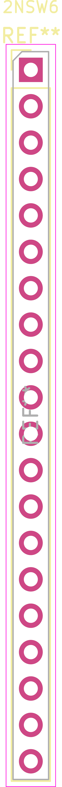 | [SVG](data/kicad/kicad_footprint_machine_solder.svg) · [PNG](data/kicad/kicad_footprint_machine_solder.png) · [STEP](data/kicad/kicad_footprint_machine_solder.step) |
| **Machine-solder footprint (3D view)** | 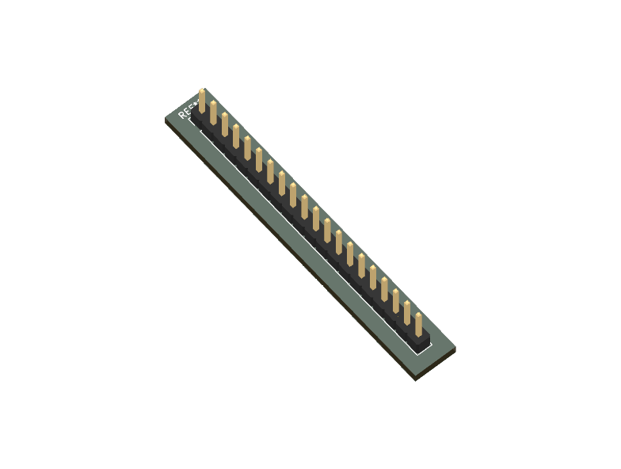 | [PNG](data/kicad/kicad_footprint_machine_solder_3d.png) |
| **Machine-solder footprint (without silkscreen)** |  | [SVG](data/kicad/kicad_footprint_machine_solder_bare.svg) · [PNG](data/kicad/kicad_footprint_machine_solder_bare.png) |
| **Machine-solder footprint (without silkscreen, square view)** | 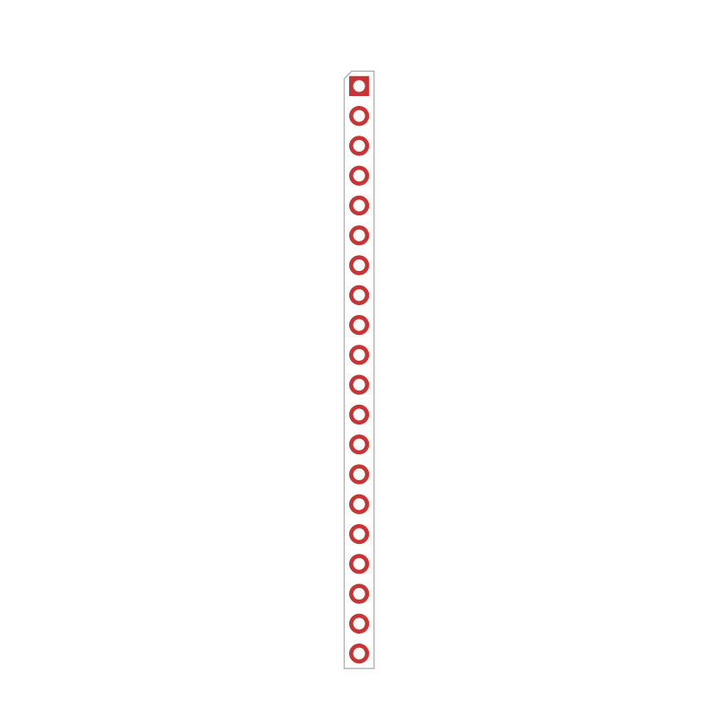 | [SVG](data/kicad/kicad_footprint_machine_solder_bare_square.svg) · [PNG](data/kicad/kicad_footprint_machine_solder_bare_square.png) |
| **Machine-solder footprint (square view)** | 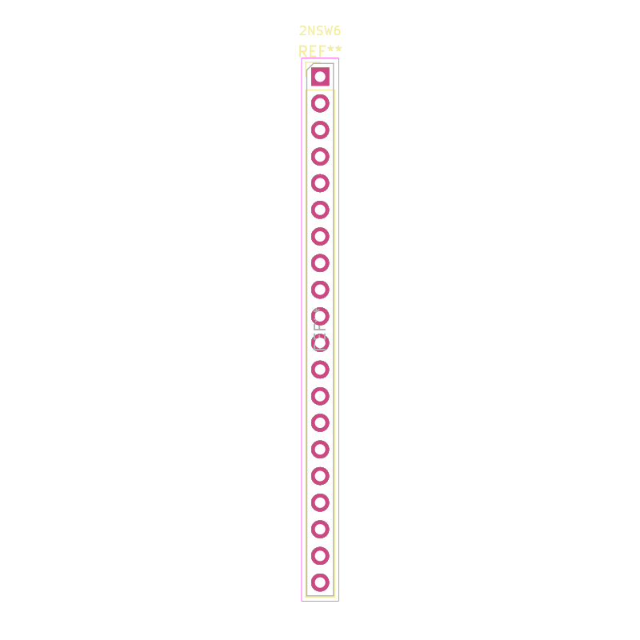 | [SVG](data/kicad/kicad_footprint_machine_solder_square.svg) · [PNG](data/kicad/kicad_footprint_machine_solder_square.png) |
| **KiCad symbol, unit 1** | 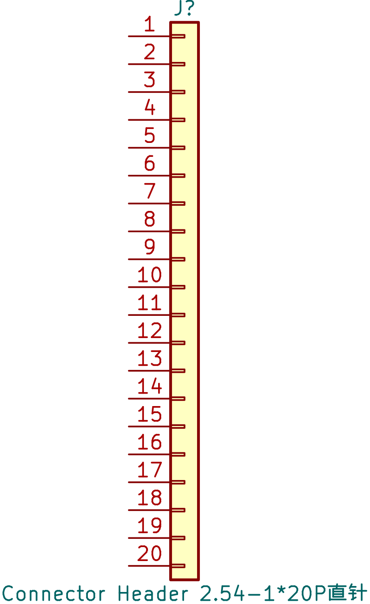 | [SVG](data/kicad/kicad_symbol_unit_1.svg) · [PNG](data/kicad/kicad_symbol_unit_1.png) |
| **KiCad symbol, unit 1 (square view)** | 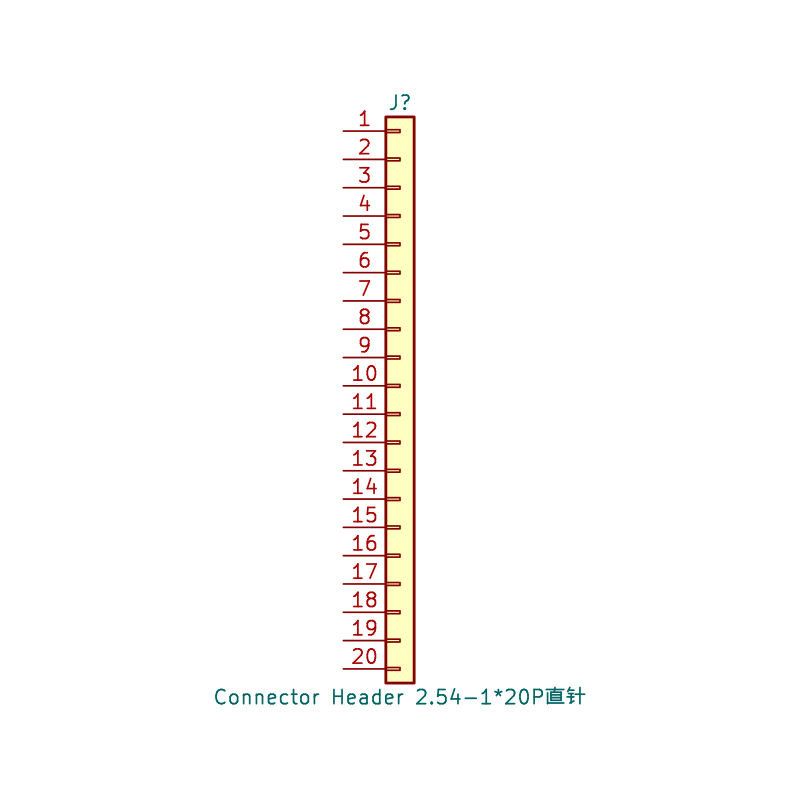 | [SVG](data/kicad/kicad_symbol_unit_1_square.svg) · [PNG](data/kicad/kicad_symbol_unit_1_square.png) |
| **Machine-solder footprint guide** | — | [MD](data/kicad/machine_solder/README.md) |
| **Machine-solder footprint** | — | [KICAD_MOD](data/kicad/machine_solder/electronic_connector_header_2_54_mm_pitch_through_hole_20_pin.kicad_mod) |
| **KiCad availability and source masters** | — | [JSON](data/kicad/manifest.json) · [YAML](data/kicad/manifest.yaml) |
| **Reference CAD model** | — | [STEP](data/model_3d.step) |
| **Insulator mesh** | — | [STL](data/model_3d_body.stl) |
| **Contact mesh** | — | [STL](data/model_3d_pins.stl) |
| **Reference model render** |  | [PNG](data/model_3d_render.png) |
| **Reference model sources** | — | [JSON](data/model_3d_source.json) |
| **Manufacturer or supplier datasheet** | — | [PDF](data/datasheet.pdf) |
| **Drawer label data** | — | [YAML](data/label_drawer.yaml) |
| **Generator label** |  | [SVG](generator_label.svg) · [JSON](generator_label.json) |
| **Small drawer label** |  | [SVG](label_drawer_1_5x1.svg) |
| **Large drawer label** | 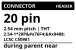 | [SVG](label_drawer_3x2.svg) |
| **Web catalogue file index** | — | [YAML](web.yaml) |
| **Part definition and build recipe** | — | [YAML](working.yaml) |

<!-- /oomp-part-file-table -->

Regenerate with `python -m kicad_agents.header_oobb_3d`. Renders are produced by `render_wire_catalogue.py` in the sibling OOBB electronic project. This page is generated from the header reference template.