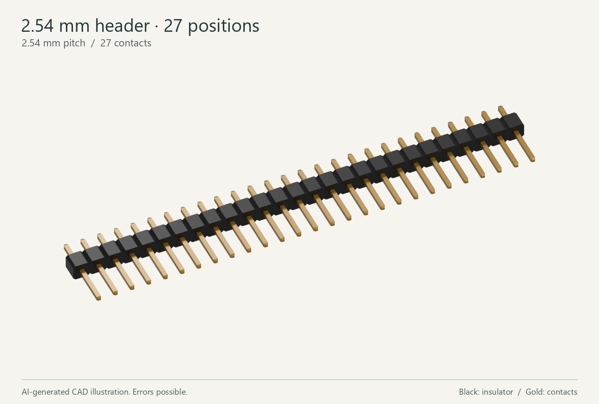

# Connector Header X6511WR-27H-C60D30R1

AI-generated CAD reference and instructions. Errors possible.

## Summary

Straight single-row 2.54 mm breakaway header. This reference model uses a 2.54 mm square insulator, 0.64 mm square contacts, 6.1 mm mating ends and 3 mm tails.

## Details

**OOMP ID:** `electronic_connector_header_2_54_mm_pitch_through_hole_27_pin`

[STEP model](data/model_3d.step) · [Plastic STL](data/model_3d_body.stl) · [Contact STL](data/model_3d_pins.stl) · [Model provenance](data/model_3d_source.json)

Nominal reference geometry derived from the [Harwin M20 six-position dimensions](https://www.harwin.com/products/M20-9990645) and extended at 2.54 mm pitch. The snap grooves are on the top and bottom of a horizontal strip. Existing KiCad models are retained separately. OOBB connectors use the separate `header_long` family.

## Parts

One full plastic strip with every contact populated. Separate material meshes are provided for assembly rendering.

## Assembly

Select the required strip length. For OOBB connectors, use the matching prepared-header definition to determine which pins to remove.

Regenerate with `python -m kicad_agents.header_oobb_3d`. Renders are produced by `render_wire_catalogue.py` in the sibling OOBB electronic project. This page is generated from the header reference template.