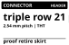

# Connector Header 2.54 mm pitch through-hole triple row 21 pin

`electronic_connector_header_2_54_mm_pitch_through_hole_triple_row_21_pin`

Connector Header 2.54 mm pitch through-hole triple row 21 pin is an OOMP electronic connector definition. It uses the header package or form factor. Its nominal drawing size is 53.34 &#x00D7; 2.48 mm.

## At a glance

| Detail | Value |
| --- | --- |
| OOMP ID | `electronic_connector_header_2_54_mm_pitch_through_hole_triple_row_21_pin` |
| Type | Connector |
| Package / style | header |
| Nominal size | 53.34 &#x00D7; 2.48 mm |

## Classification

| Level | Value |
| --- | --- |
| 1 | `electronic` |
| 2 | `connector` |
| 3 | `header` |
| 4 | `2_54_mm_pitch` |
| 5 | `through_hole` |
| 6 | `triple_row_21_pin` |

## Nominal dimensions

| Measurement | Value |
| --- | ---: |
| Length | 53.34 mm |
| Width | 2.48 mm |

## Used in projects

[Browse confirmed project usage](https://oomlout.github.io/oomp_electronic_project_version_5/usage/index.html#electronic_connector_header_2_54_mm_pitch_through_hole_triple_row_21_pin)

## Files

<!-- oomp-part-file-table -->

| Image type | Image | Link |
| --- | :---: | --- |
| **Drawer label data** | — | [YAML](data/label_drawer.yaml) |
| **Small drawer label** |  | [SVG](label_drawer_1_5x1.svg) |
| **Large drawer label** |  | [SVG](label_drawer_3x2.svg) |
| **Part definition and build recipe** | — | [YAML](working.yaml) |

<!-- /oomp-part-file-table -->

[View this part on GitHub](https://github.com/oomlout/oomp_electronic_version_5/tree/main/parts/electronic_connector_header_2_54_mm_pitch_through_hole_triple_row_21_pin)

[Browse this category](../../navigation/electronic/connector/header/2_54_mm_pitch/through_hole/README.md)

---

This page is generated from the OOMP part definition by a Roboclick Jinja template. Edit the source taxonomy or template rather than this generated file.