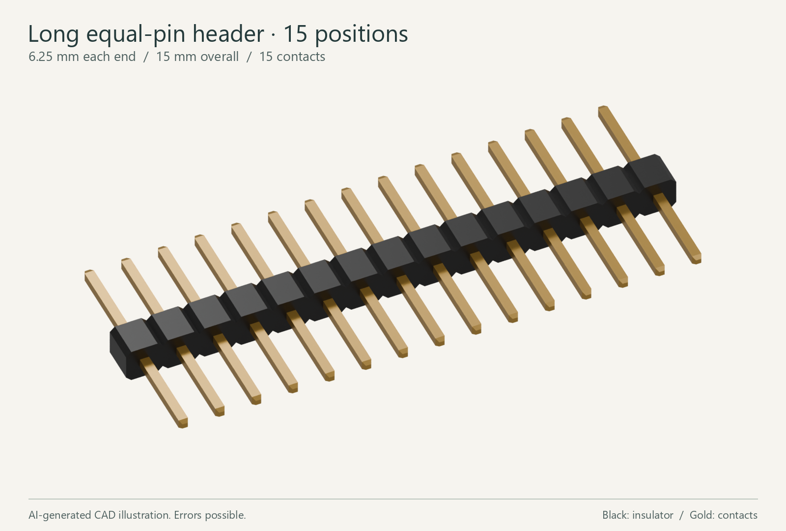

# Long equal-pin header, 15 positions, 2.54 mm pitch

AI-generated CAD reference and instructions. Errors possible.

## Summary

Long single-row 2.54 mm breakaway header with equal 6.25 mm exposed pins on both sides. The insulator is 2.5 mm thick and the pins are 15 mm long overall, with a 0.64 mm square section.

## Details

**OOMP ID:** `electronic_connector_header_long_2_54_mm_pitch_through_hole_15_pin`

[STEP model](data/model_3d.step) · [Plastic STL](data/model_3d_body.stl) · [Contact STL](data/model_3d_pins.stl) · [Model provenance](data/model_3d_source.json)

Nominal geometry follows the HOAUC drawing HYC-1812011115 supplied by [LCSC C343639](https://www.lcsc.com/product-detail/C343639.html), MPN 1625-1140CNG0S150001. [Local manufacturer datasheet](data/datasheet.pdf) · [LCSC-hosted PDF](https://atta.szlcsc.com/upload/public/pdf/source/20260917/9F655738B2D4F4FC500A9931BECCBD77.pdf).

The drawing specifies 1–40 positions, 2.54 mm pitch, 6.25 mm at each end, a 2.5 mm insulator and 15 mm overall pin length. Snap grooves and tip bevels are illustrative where the drawing gives no feature dimensions. The snap grooves remain on the top and bottom of a horizontal strip; vertical models rotate the same geometry.

| Detail | Value |
| --- | --- |
| Exposed Each End Mm | 6.25 |
| Insulator Mm | 2.5 |
| Overall Pin Mm | 15.0 |
| Pitch Mm | 2.54 |
| Positions | 15 |

LCSC C343639 supplies a **40-position strip**. The shorter generic `header_long` entries represent sections cut to length; they are not separate verified LCSC SKUs. Cut between plastic cells, keeping the pins centred so both exposed ends remain equal.

## Parts

One full plastic strip with every contact populated. Separate material meshes are provided for assembly rendering.

## Assembly

Select the required strip length. For OOBB connectors, use the matching prepared-header definition to determine which pins to remove.

## Files

<!-- oomp-part-file-table -->

| Image type | Image | Link |
| --- | :---: | --- |
| **Reference CAD model** | — | [STEP](data/model_3d.step) |
| **Insulator mesh** | — | [STL](data/model_3d_body.stl) |
| **Contact mesh** | — | [STL](data/model_3d_pins.stl) |
| **Reference model render** |  | [PNG](data/model_3d_render.png) |
| **Reference model sources** | — | [JSON](data/model_3d_source.json) |
| **Manufacturer or supplier datasheet** | — | [PDF](data/datasheet.pdf) |
| **Part definition and build recipe** | — | [YAML](working.yaml) |

<!-- /oomp-part-file-table -->

Regenerate with `python -m kicad_agents.header_oobb_3d`. Renders are produced by `render_wire_catalogue.py` in the sibling OOBB electronic project. This page is generated from the header reference template.