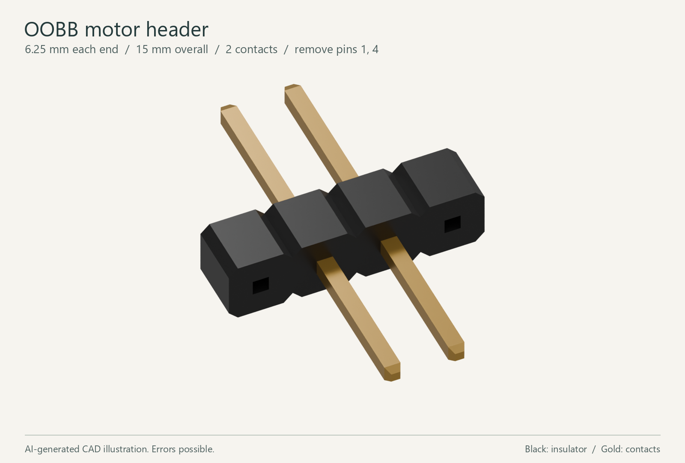

# OOBB motor header, 4 positions / 2 contacts

AI-generated CAD reference and instructions. Errors possible.

## Summary

Prepared `header_long` for a printed OOBB connector. Pins extend 6.25 mm from both faces of the 2.5 mm insulator, giving 15 mm overall length. The full plastic strip locates the contacts while selected pins are pushed out.

## Details

**OOMP ID:** `electronic_connector_header_oobb_2_54_mm_pitch_motor_4_position_2_contact`

[STEP model](data/model_3d.step) · [Plastic STL](data/model_3d_body.stl) · [Contact STL](data/model_3d_pins.stl) · [Model provenance](data/model_3d_source.json)

Nominal geometry follows the HOAUC drawing HYC-1812011115 supplied by [LCSC C343639](https://www.lcsc.com/product-detail/C343639.html), MPN 1625-1140CNG0S150001. [Local manufacturer datasheet](data/datasheet.pdf) · [LCSC-hosted PDF](https://atta.szlcsc.com/upload/public/pdf/source/20260917/9F655738B2D4F4FC500A9931BECCBD77.pdf).

The drawing specifies 1–40 positions, 2.54 mm pitch, 6.25 mm at each end, a 2.5 mm insulator and 15 mm overall pin length. Snap grooves and tip bevels are illustrative where the drawing gives no feature dimensions. The snap grooves remain on the top and bottom of a horizontal strip; vertical models rotate the same geometry.

| Detail | Value |
| --- | --- |
| Contacts | 2 |
| Orientation | horizontal, count from negative X |
| Positions | 4 |
| Removed | [1, 4] |

LCSC C343639 supplies a **40-position strip**. The shorter generic `header_long` entries represent sections cut to length; they are not separate verified LCSC SKUs. Cut between plastic cells, keeping the pins centred so both exposed ends remain equal.

## Parts

| Starting part | Quantity per prepared strip |
| --- | ---: |
| [electronic_connector_header_long_2_54_mm_pitch_through_hole_4_pin](../electronic_connector_header_long_2_54_mm_pitch_through_hole_4_pin/) | 1 |

The prepared header is the starting strip after modification, not an additional purchased item.

## Assembly

Push out pins **1, 4**. Retain pins **2, 3** and keep the plastic strip intact.

Count from negative X, the key side for the basic, power and I²C types. Motor variants remove both end contacts symmetrically. Seat the strip across the plate, with one set of 6.25 mm ends facing forward and the equal rear ends inside the socket housing.

Regenerate with `python -m kicad_agents.header_oobb_3d`. Renders are produced by `render_wire_catalogue.py` in the sibling OOBB electronic project. This page is generated from the header reference template.