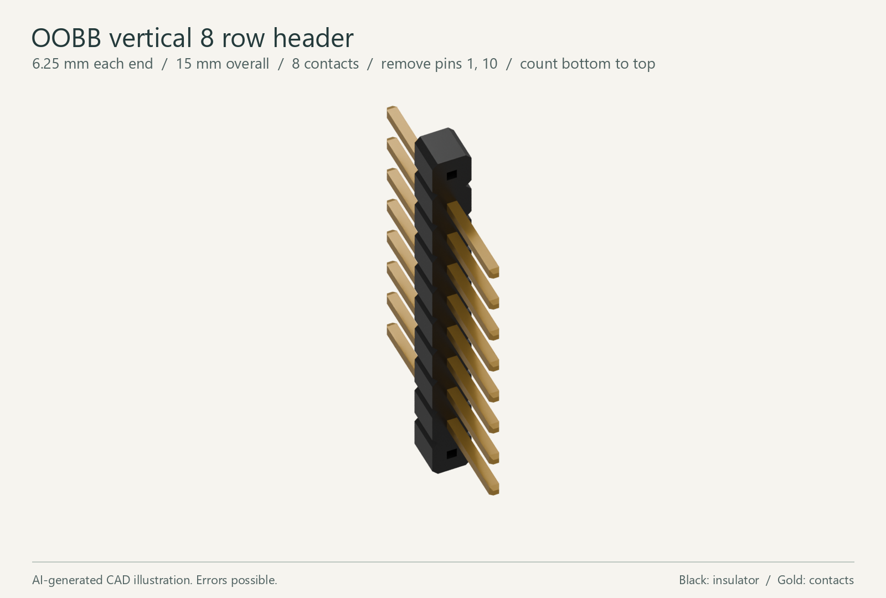
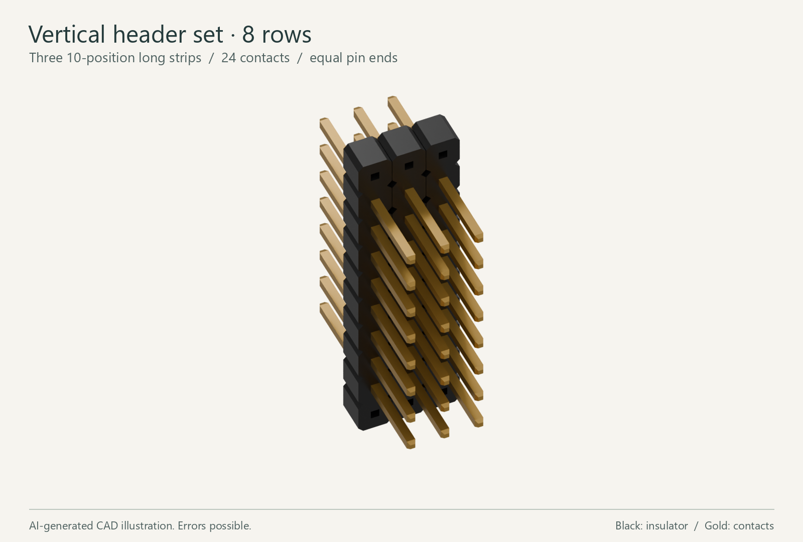

# OOBB vertical 8 row header, 10 positions / 8 contacts

AI-generated CAD reference and instructions. Errors possible.

## Summary

Prepared `header_long` for a printed OOBB connector. Pins extend 6.25 mm from both faces of the 2.5 mm insulator, giving 15 mm overall length. The full plastic strip locates the contacts while selected pins are pushed out.

## Details

**OOMP ID:** `electronic_connector_header_oobb_2_54_mm_pitch_vertical_8_row_10_position_8_contact`

[STEP model](data/model_3d.step) · [Plastic STL](data/model_3d_body.stl) · [Contact STL](data/model_3d_pins.stl) · [Model provenance](data/model_3d_source.json)

Nominal geometry follows the HOAUC drawing HYC-1812011115 supplied by [LCSC C343639](https://www.lcsc.com/product-detail/C343639.html), MPN 1625-1140CNG0S150001. [Local manufacturer datasheet](data/datasheet.pdf) · [LCSC-hosted PDF](https://atta.szlcsc.com/upload/public/pdf/source/20260917/9F655738B2D4F4FC500A9931BECCBD77.pdf).

The drawing specifies 1–40 positions, 2.54 mm pitch, 6.25 mm at each end, a 2.5 mm insulator and 15 mm overall pin length. Snap grooves and tip bevels are illustrative where the drawing gives no feature dimensions. The snap grooves remain on the top and bottom of a horizontal strip; vertical models rotate the same geometry.

| Detail | Value |
| --- | --- |
| Contacts | 8 |
| Orientation | vertical, count bottom to top |
| Positions | 10 |
| Removed | [1, 10] |

LCSC C343639 supplies a **40-position strip**. The shorter generic `header_long` entries represent sections cut to length; they are not separate verified LCSC SKUs. Cut between plastic cells, keeping the pins centred so both exposed ends remain equal.

[Three-strip arrangement STEP](data/model_3d_3_strip.step) · [Three insulators STL](data/model_3d_3_strip_body.stl) · [All retained contacts STL](data/model_3d_3_strip_pins.stl)

This arrangement contains three copies of the individual strip, spaced 2.54 mm apart. It uses three stock headers, with no extra purchased components.

## Parts

| Starting part | Quantity per prepared strip |
| --- | ---: |
| [electronic_connector_header_long_2_54_mm_pitch_through_hole_10_pin](../electronic_connector_header_long_2_54_mm_pitch_through_hole_10_pin/) | 1 |

The prepared header is the starting strip after modification, not an additional purchased item.

## Assembly

Push out pins **1, 10**. Retain pins **2, 3, 4, 5, 6, 7, 8, 9** and keep the plastic strip intact.

Count from the bottom. Use three identical vertical strips side by side, with the empty bottom and top cells captured by the base and its included top retainer. Mate one three-way socket housing to each active row.

## Files

<!-- oomp-part-file-table -->

| Image type | Image | Link |
| --- | :---: | --- |
| **Reference CAD model** | — | [STEP](data/model_3d.step) |
| **Three-strip assembly model** | — | [STEP](data/model_3d_3_strip.step) |
| **Three-strip insulator mesh** | — | [STL](data/model_3d_3_strip_body.stl) |
| **Three-strip contact mesh** | — | [STL](data/model_3d_3_strip_pins.stl) |
| **Three-strip assembly render** |  | [PNG](data/model_3d_arrangement.png) |
| **Insulator mesh** | — | [STL](data/model_3d_body.stl) |
| **Contact mesh** | — | [STL](data/model_3d_pins.stl) |
| **Reference model render** |  | [PNG](data/model_3d_render.png) |
| **Reference model sources** | — | [JSON](data/model_3d_source.json) |
| **Manufacturer or supplier datasheet** | — | [PDF](data/datasheet.pdf) |
| **Part definition and build recipe** | — | [YAML](working.yaml) |

<!-- /oomp-part-file-table -->

Regenerate with `python -m kicad_agents.header_oobb_3d`. Renders are produced by `render_wire_catalogue.py` in the sibling OOBB electronic project. This page is generated from the header reference template.