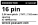

# Connector IC Socket IC-16PNarrow

`electronic_connector_ic_socket_2_54_mm_pitch_through_hole_16_pin_7_62_mm_row_spacing`

Connector IC Socket IC-16PNarrow is an OOMP electronic connector definition. It uses the ic socket package or form factor. Its nominal drawing size is 10.0 &#x00D7; 5.0 mm.

## At a glance

| Detail | Value |
| --- | --- |
| OOMP ID | `electronic_connector_ic_socket_2_54_mm_pitch_through_hole_16_pin_7_62_mm_row_spacing` |
| Type | Connector |
| Package / style | ic socket |
| Nominal size | 10.0 &#x00D7; 5.0 mm |

## Classification

| Level | Value |
| --- | --- |
| 1 | `electronic` |
| 2 | `connector` |
| 3 | `ic_socket` |
| 4 | `2_54_mm_pitch` |
| 5 | `through_hole` |
| 6 | `16_pin` |
| 7 | `7_62_mm_row_spacing` |

## Nominal dimensions

| Measurement | Value |
| --- | ---: |
| Length | 10.0 mm |
| Width | 5.0 mm |

## Identifiers

| Identifier | Value |
| --- | --- |
| Manufacturer part number | `IC-16PNarrow` |
| LCSC | [`C2326`](https://www.lcsc.com/product-detail/C2326.html) |
| JLCPCB | [`C2326`](https://jlcpcb.com/partdetail/2700-IC16PNarrow/C2326) |

## Used in projects

[Browse confirmed project usage](https://oomlout.github.io/oomp_electronic_project_version_5/usage/index.html#electronic_connector_ic_socket_2_54_mm_pitch_through_hole_16_pin_7_62_mm_row_spacing)

## Files

<!-- oomp-part-file-table -->

| Image type | Image | Link |
| --- | :---: | --- |
| **Drawer label data** | — | [YAML](data/label_drawer.yaml) |
| **Small drawer label** |  | [SVG](label_drawer_1_5x1.svg) |
| **Large drawer label** |  | [SVG](label_drawer_3x2.svg) |
| **Part definition and build recipe** | — | [YAML](working.yaml) |

<!-- /oomp-part-file-table -->

[View this part on GitHub](https://github.com/oomlout/oomp_electronic_version_5/tree/main/parts/electronic_connector_ic_socket_2_54_mm_pitch_through_hole_16_pin_7_62_mm_row_spacing)

[Browse this category](../../navigation/electronic/connector/ic_socket/2_54_mm_pitch/through_hole/16_pin/README.md)

---

This page is generated from the OOMP part definition by a Roboclick Jinja template. Edit the source taxonomy or template rather than this generated file.