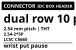

# Connector Idc Box Header 2.54-2*5P2.54 mm pitch 2&#x00D7;5 pin IDC box header

`electronic_connector_idc_box_header_2_54_mm_pitch_through_hole_dual_row_10_pin`

Connector Idc Box Header 2.54-2*5P2.54 mm pitch 2&#x00D7;5 pin IDC box header is an OOMP electronic connector definition. It uses the idc box header package or form factor. Its nominal drawing size is 10.0 &#x00D7; 5.0 mm.

## At a glance

| Detail | Value |
| --- | --- |
| OOMP ID | `electronic_connector_idc_box_header_2_54_mm_pitch_through_hole_dual_row_10_pin` |
| Type | Connector |
| Package / style | idc box header |
| Nominal size | 10.0 &#x00D7; 5.0 mm |

## Classification

| Level | Value |
| --- | --- |
| 1 | `electronic` |
| 2 | `connector` |
| 3 | `idc_box_header` |
| 4 | `2_54_mm_pitch` |
| 5 | `through_hole` |
| 6 | `dual_row_10_pin` |

## Nominal dimensions

| Measurement | Value |
| --- | ---: |
| Length | 10.0 mm |
| Width | 5.0 mm |

## Identifiers

| Identifier | Value |
| --- | --- |
| Manufacturer part number | `2.54-2*5P2.54 mm pitch 2&#x00D7;5 pin IDC box header` |
| LCSC | [`C5665`](https://www.lcsc.com/product-detail/C5665.html) |
| JLCPCB | [`C5665`](https://jlcpcb.com/partdetail/C5665) |

## Used in projects

[Browse confirmed project usage](https://oomlout.github.io/oomp_electronic_project_version_5/usage/index.html#electronic_connector_idc_box_header_2_54_mm_pitch_through_hole_dual_row_10_pin)

## Files

<!-- oomp-part-file-table -->

| Image type | Image | Link |
| --- | :---: | --- |
| **Drawer label data** | — | [YAML](data/label_drawer.yaml) |
| **Small drawer label** |  | [SVG](label_drawer_1_5x1.svg) |
| **Large drawer label** |  | [SVG](label_drawer_3x2.svg) |
| **Part definition and build recipe** | — | [YAML](working.yaml) |

<!-- /oomp-part-file-table -->

[View this part on GitHub](https://github.com/oomlout/oomp_electronic_version_5/tree/main/parts/electronic_connector_idc_box_header_2_54_mm_pitch_through_hole_dual_row_10_pin)

[Browse this category](../../navigation/electronic/connector/idc_box_header/2_54_mm_pitch/through_hole/README.md)

---

This page is generated from the OOMP part definition by a Roboclick Jinja template. Edit the source taxonomy or template rather than this generated file.