# JST GH crimp socket 30&#x2013;26 AWG, tin (SSHL-002T-P0.2)

`electronic_connector_jst_gh_1_25_mm_pitch_crimp_1_pin_socket_26_to_30_awg_tin_jst_sshl_002t_p0_2`

JST GH crimp socket 30&#x2013;26 AWG, tin (SSHL-002T-P0.2) is an OOMP electronic connector definition. It uses the jst gh package or form factor. Its nominal drawing size is 4.8 &#x00D7; 0.8 mm. The definition includes 1 documented pin.

Nominal drawing spans. See the manufacturer's drawing for feature dimensions and crimp tooling.

## At a glance

| Detail | Value |
| --- | --- |
| OOMP ID | `electronic_connector_jst_gh_1_25_mm_pitch_crimp_1_pin_socket_26_to_30_awg_tin_jst_sshl_002t_p0_2` |
| Type | Connector |
| Package / style | jst gh |
| Nominal size | 4.8 &#x00D7; 0.8 mm |
| Documented pins | 1 |

## Classification

| Level | Value |
| --- | --- |
| 1 | `electronic` |
| 2 | `connector` |
| 3 | `jst_gh` |
| 4 | `1_25_mm_pitch` |
| 5 | `crimp` |
| 6 | `1_pin` |
| 7 | `socket` |
| 8 | `26_to_30_awg` |
| 9 | `tin` |
| 14 | `jst` |
| 15 | `sshl_002t_p0_2` |

## 3D reference model

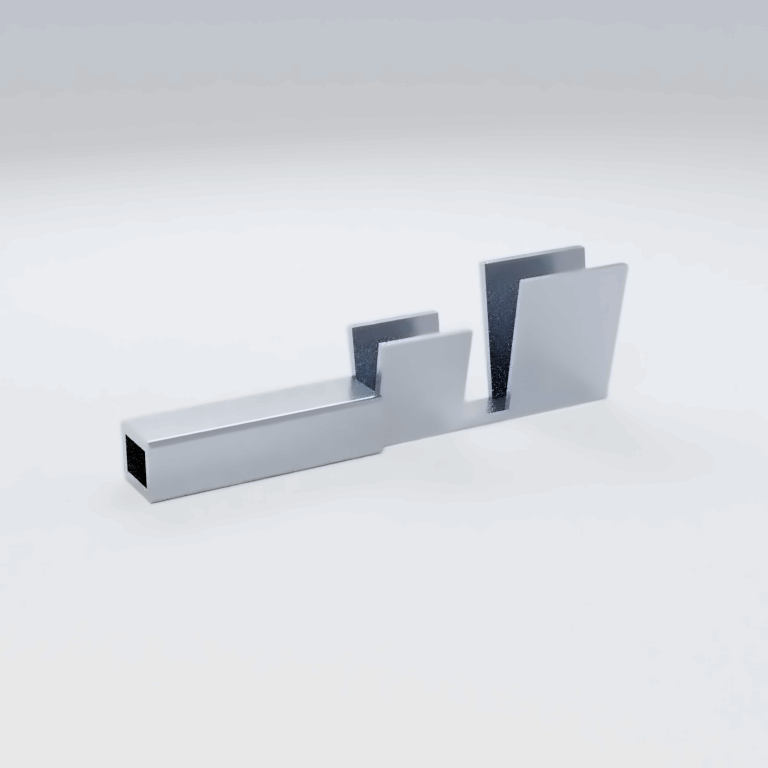

[Download STEP](data/model_3d.step) · [Model source and limitations](data/model_3d_source.yaml)

OOMP model based on the manufacturer drawing, with nominal outer dimensions and simplified internal geometry. Use it for layout and illustration.

## Connector details

| Detail | Value |
| --- | --- |
| Component Role | Female crimp contact with one conductive terminal |
| Contact Finish | Tin |
| Contact Material | Copper alloy |
| Insertion Force | Low insertion force |
| Insulation Outer Diameter | 0.76&#x2013;1.0 mm |
| Packaging | Reel |
| Pitch | 1.25 mm (housing pitch) |
| Series | JST GH |
| Wire Size | 30&#x2013;26 AWG |

## Compatible components

- **Fits housing:** [JST GH 1.25 mm 2-position white housing (GHR-02V-S)](../electronic_connector_jst_gh_1_25_mm_pitch_housing_2_pin_white_jst_ghr_02v_s/README.md).
  Order 2 contacts separately to fill the housing. [Manufacturer evidence](https://www.jst-mfg.com/product/pdf/eng/eGH.pdf).

- **Fits housing:** [JST GH 1.25 mm 3-position white housing (GHR-03V-S)](../electronic_connector_jst_gh_1_25_mm_pitch_housing_3_pin_white_jst_ghr_03v_s/README.md).
  Order 3 contacts separately to fill the housing. [Manufacturer evidence](https://www.jst-mfg.com/product/pdf/eng/eGH.pdf).

- **Fits housing:** [JST GH 1.25 mm 4-position white housing (GHR-04V-S)](../electronic_connector_jst_gh_1_25_mm_pitch_housing_4_pin_white_jst_ghr_04v_s/README.md).
  Order 4 contacts separately to fill the housing. [Manufacturer evidence](https://www.jst-mfg.com/product/pdf/eng/eGH.pdf).

- **Fits housing:** [JST GH 1.25 mm 5-position white housing (GHR-05V-S)](../electronic_connector_jst_gh_1_25_mm_pitch_housing_5_pin_white_jst_ghr_05v_s/README.md).
  Order 5 contacts separately to fill the housing. [Manufacturer evidence](https://www.jst-mfg.com/product/pdf/eng/eGH.pdf).

- **Fits housing:** [JST GH 1.25 mm 6-position white housing (GHR-06V-S)](../electronic_connector_jst_gh_1_25_mm_pitch_housing_6_pin_white_jst_ghr_06v_s/README.md).
  Order 6 contacts separately to fill the housing. [Manufacturer evidence](https://www.jst-mfg.com/product/pdf/eng/eGH.pdf).

- **Fits housing:** [JST GH 1.25 mm 7-position white housing (GHR-07V-S)](../electronic_connector_jst_gh_1_25_mm_pitch_housing_7_pin_white_jst_ghr_07v_s/README.md).
  Order 7 contacts separately to fill the housing. [Manufacturer evidence](https://www.jst-mfg.com/product/pdf/eng/eGH.pdf).

- **Fits housing:** [JST GH 1.25 mm 8-position white housing (GHR-08V-S)](../electronic_connector_jst_gh_1_25_mm_pitch_housing_8_pin_white_jst_ghr_08v_s/README.md).
  Order 8 contacts separately to fill the housing. [Manufacturer evidence](https://www.jst-mfg.com/product/pdf/eng/eGH.pdf).

- **Fits housing:** [JST GH 1.25 mm 9-position white housing (GHR-09V-S)](../electronic_connector_jst_gh_1_25_mm_pitch_housing_9_pin_white_jst_ghr_09v_s/README.md).
  Order 9 contacts separately to fill the housing. [Manufacturer evidence](https://www.jst-mfg.com/product/pdf/eng/eGH.pdf).

- **Fits housing:** [JST GH 1.25 mm 10-position white housing (GHR-10V-S)](../electronic_connector_jst_gh_1_25_mm_pitch_housing_10_pin_white_jst_ghr_10v_s/README.md).
  Order 10 contacts separately to fill the housing. [Manufacturer evidence](https://www.jst-mfg.com/product/pdf/eng/eGH.pdf).

- **Fits housing:** [JST GH 1.25 mm 11-position white housing (GHR-11V-S)](../electronic_connector_jst_gh_1_25_mm_pitch_housing_11_pin_white_jst_ghr_11v_s/README.md).
  Order 11 contacts separately to fill the housing. [Manufacturer evidence](https://www.jst-mfg.com/product/pdf/eng/eGH.pdf).

- **Fits housing:** [JST GH 1.25 mm 12-position white housing (GHR-12V-S)](../electronic_connector_jst_gh_1_25_mm_pitch_housing_12_pin_white_jst_ghr_12v_s/README.md).
  Order 12 contacts separately to fill the housing. [Manufacturer evidence](https://www.jst-mfg.com/product/pdf/eng/eGH.pdf).

- **Fits housing:** [JST GH 1.25 mm 13-position white housing (GHR-13V-S)](../electronic_connector_jst_gh_1_25_mm_pitch_housing_13_pin_white_jst_ghr_13v_s/README.md).
  Order 13 contacts separately to fill the housing. [Manufacturer evidence](https://www.jst-mfg.com/product/pdf/eng/eGH.pdf).

- **Fits housing:** [JST GH 1.25 mm 14-position white housing (GHR-14V-S)](../electronic_connector_jst_gh_1_25_mm_pitch_housing_14_pin_white_jst_ghr_14v_s/README.md).
  Order 14 contacts separately to fill the housing. [Manufacturer evidence](https://www.jst-mfg.com/product/pdf/eng/eGH.pdf).

- **Fits housing:** [JST GH 1.25 mm 15-position white housing (GHR-15V-S)](../electronic_connector_jst_gh_1_25_mm_pitch_housing_15_pin_white_jst_ghr_15v_s/README.md).
  Order 15 contacts separately to fill the housing. [Manufacturer evidence](https://www.jst-mfg.com/product/pdf/eng/eGH.pdf).

## Nominal dimensions

| Measurement | Value |
| --- | ---: |
| Height | 1.4 mm |
| Length | 4.8 mm |
| Width | 0.8 mm |

## Identifiers

| Identifier | Value |
| --- | --- |
| Manufacturer part number | `SSHL-002T-P0.2` |

## Pins

| Pin | Name | Type |
| ---: | --- | --- |
| 1 | contact | passive |

## Datasheet

[View the datasheet](data/datasheet.pdf)

## Used in projects

[Browse confirmed project usage](https://oomlout.github.io/oomp_electronic_project_version_5/usage/index.html#electronic_connector_jst_gh_1_25_mm_pitch_crimp_1_pin_socket_26_to_30_awg_tin_jst_sshl_002t_p0_2)

## Files

[KiCad applicability: cable component, no PCB footprint](data/kicad/README.md) · [Applicability record](data/kicad/manifest.yaml)

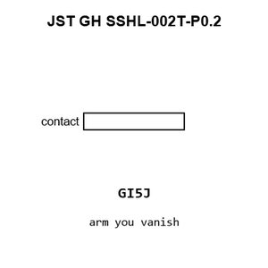

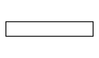

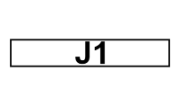

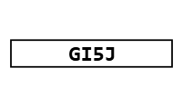

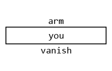

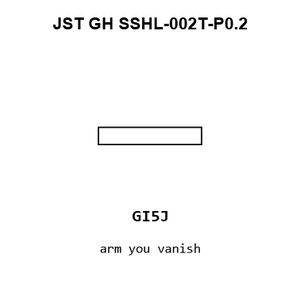

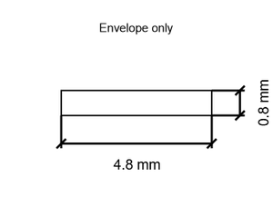

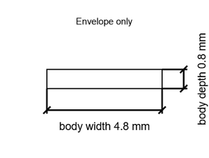

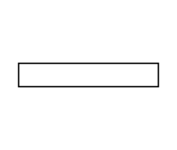

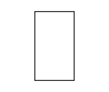

[View this part on GitHub](https://github.com/oomlout/oomp_electronic_version_5/tree/main/parts/electronic_connector_jst_gh_1_25_mm_pitch_crimp_1_pin_socket_26_to_30_awg_tin_jst_sshl_002t_p0_2)

[Browse this category](../../navigation/electronic/connector/jst_gh/1_25_mm_pitch/crimp/1_pin/socket/26_to_30_awg/tin/jst/README.md)

---

This page is generated from the OOMP part definition by a Roboclick Jinja template. Edit the source taxonomy or template rather than this generated file.