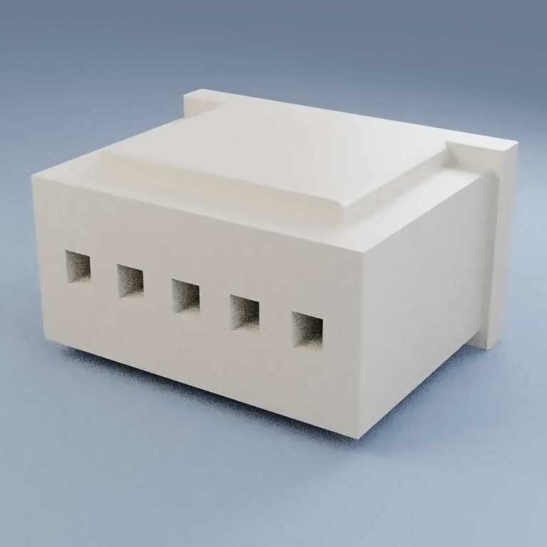
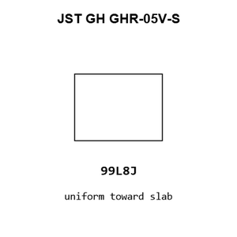
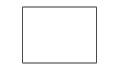
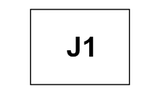
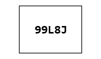
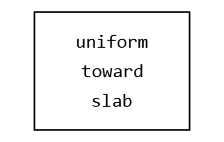
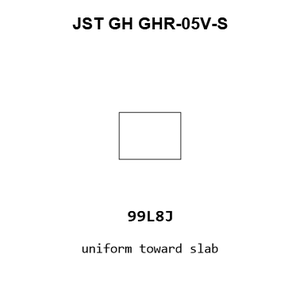
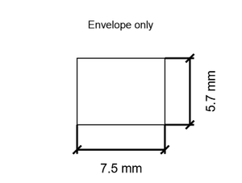
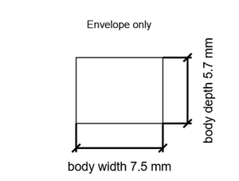
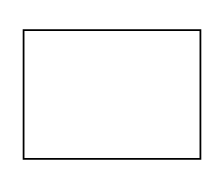

# JST GH 1.25 mm 5-position white housing (GHR-05V-S)

`electronic_connector_jst_gh_1_25_mm_pitch_housing_5_pin_white_jst_ghr_05v_s`

JST GH 1.25 mm 5-position white housing (GHR-05V-S) is an OOMP electronic connector definition. It uses the jst gh package or form factor. Its nominal drawing size is 7.5 &#x00D7; 5.7 mm.

Nominal drawing spans. See the manufacturer's drawing for feature dimensions and crimp tooling.

## At a glance

| Detail | Value |
| --- | --- |
| OOMP ID | `electronic_connector_jst_gh_1_25_mm_pitch_housing_5_pin_white_jst_ghr_05v_s` |
| Type | Connector |
| Package / style | jst gh |
| Nominal size | 7.5 &#x00D7; 5.7 mm |

## Classification

| Level | Value |
| --- | --- |
| 1 | `electronic` |
| 2 | `connector` |
| 3 | `jst_gh` |
| 4 | `1_25_mm_pitch` |
| 5 | `housing` |
| 6 | `5_pin` |
| 7 | `white` |
| 14 | `jst` |
| 15 | `ghr_05v_s` |

## 3D reference model

[Download STEP](data/model_3d.step) · [Model source and limitations](data/model_3d_source.yaml)

OOMP model based on the manufacturer drawing, with nominal outer dimensions and simplified internal geometry. Use it for layout and illustration.

## Connector details

| Detail | Value |
| --- | --- |
| Component Role | Empty insulating housing with contacts supplied separately |
| Contacts Required | 5, sold separately |
| Housing Color | Natural (white) |
| Housing Material | PBT |
| Locking Style | Positive latch, standard natural-white keying |
| Pitch | 1.25 mm |
| Positions | 5, single row |
| Series | JST GH |

## Compatible components

- **Contact option:** [JST GH crimp socket 30&#x2013;26 AWG, tin (SSHL-002T-P0.2)](../electronic_connector_jst_gh_1_25_mm_pitch_crimp_1_pin_socket_26_to_30_awg_tin_jst_sshl_002t_p0_2/README.md) — quantity 5.
  Quantity fills the active cavities. Select the contact for the wire gauge and insulation diameter. [Manufacturer evidence](https://www.jst-mfg.com/product/pdf/eng/eGH.pdf).

## Nominal dimensions

| Measurement | Value |
| --- | ---: |
| Height | 4.15 mm |
| Length | 7.5 mm |
| Width | 5.7 mm |

## Identifiers

| Identifier | Value |
| --- | --- |
| Manufacturer part number | `GHR-05V-S` |

## Datasheet

[View the datasheet](data/datasheet.pdf)

## Used in projects

[Browse confirmed project usage](https://oomlout.github.io/oomp_electronic_project_version_5/usage/index.html#electronic_connector_jst_gh_1_25_mm_pitch_housing_5_pin_white_jst_ghr_05v_s)

## Files

[KiCad applicability: cable component, no PCB footprint](data/kicad/README.md) · [Applicability record](data/kicad/manifest.yaml)

[View this part on GitHub](https://github.com/oomlout/oomp_electronic_version_5/tree/main/parts/electronic_connector_jst_gh_1_25_mm_pitch_housing_5_pin_white_jst_ghr_05v_s)

[Browse this category](../../navigation/electronic/connector/jst_gh/1_25_mm_pitch/housing/5_pin/white/jst/README.md)

---

This page is generated from the OOMP part definition by a Roboclick Jinja template. Edit the source taxonomy or template rather than this generated file.