# JST PH crimp socket 32&#x2013;28 AWG, tin (SPH-004T-P0.5S)

`electronic_connector_jst_ph_2_mm_pitch_crimp_1_pin_socket_28_to_32_awg_tin_jst_sph_004t_p0_5s`

JST PH crimp socket 32&#x2013;28 AWG, tin (SPH-004T-P0.5S) is an OOMP electronic connector definition. It uses the jst ph package or form factor. Its nominal drawing size is 5.7 &#x00D7; 1.5 mm. The definition includes 1 documented pin.

Nominal drawing spans. See the manufacturer's drawing for feature dimensions and crimp tooling.

## At a glance

| Detail | Value |
| --- | --- |
| OOMP ID | `electronic_connector_jst_ph_2_mm_pitch_crimp_1_pin_socket_28_to_32_awg_tin_jst_sph_004t_p0_5s` |
| Type | Connector |
| Package / style | jst ph |
| Nominal size | 5.7 &#x00D7; 1.5 mm |
| Documented pins | 1 |

## Classification

| Level | Value |
| --- | --- |
| 1 | `electronic` |
| 2 | `connector` |
| 3 | `jst_ph` |
| 4 | `2_mm_pitch` |
| 5 | `crimp` |
| 6 | `1_pin` |
| 7 | `socket` |
| 8 | `28_to_32_awg` |
| 9 | `tin` |
| 14 | `jst` |
| 15 | `sph_004t_p0_5s` |

## 3D reference model

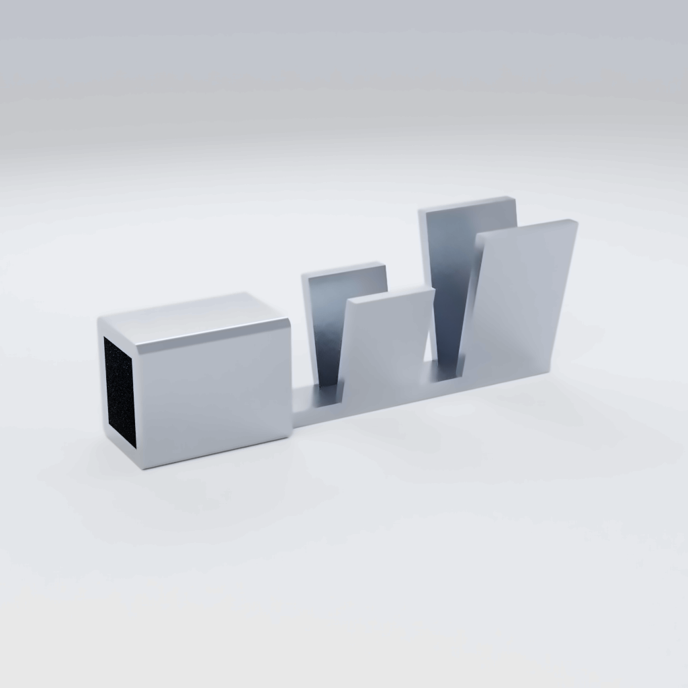

[Download STEP](data/model_3d.step) · [Model source and limitations](data/model_3d_source.yaml)

OOMP model based on the manufacturer drawing, with nominal outer dimensions and simplified internal geometry. Use it for layout and illustration.

## Connector details

| Detail | Value |
| --- | --- |
| Component Role | Female crimp contact with one conductive terminal |
| Contact Finish | Tin |
| Contact Material | Copper alloy |
| Insertion Force | Standard insertion force |
| Insulation Outer Diameter | 0.5&#x2013;0.9 mm |
| Packaging | Reel |
| Pitch | 2 mm (housing pitch) |
| Series | JST PH |
| Wire Size | 32&#x2013;28 AWG |

## Compatible components

- **Fits housing:** [JST PH 2 mm 2-position white housing (PHR-2)](../electronic_connector_jst_ph_2_mm_pitch_housing_2_pin_white_jst_phr_2/README.md).
  Order 2 contacts separately to fill the housing. [Manufacturer evidence](https://www.jst-mfg.com/product/pdf/eng/ePH.pdf).

- **Fits housing:** [JST PH 2 mm 3-position white housing (PHR-3)](../electronic_connector_jst_ph_2_mm_pitch_housing_3_pin_white_jst_phr_3/README.md).
  Order 3 contacts separately to fill the housing. [Manufacturer evidence](https://www.jst-mfg.com/product/pdf/eng/ePH.pdf).

- **Fits housing:** [JST PH 2 mm 4-position white housing (PHR-4)](../electronic_connector_jst_ph_2_mm_pitch_housing_4_pin_white_jst_phr_4/README.md).
  Order 4 contacts separately to fill the housing. [Manufacturer evidence](https://www.jst-mfg.com/product/pdf/eng/ePH.pdf).

- **Fits housing:** [JST PH 2 mm 5-position white housing (PHR-5)](../electronic_connector_jst_ph_2_mm_pitch_housing_5_pin_white_jst_phr_5/README.md).
  Order 5 contacts separately to fill the housing. [Manufacturer evidence](https://www.jst-mfg.com/product/pdf/eng/ePH.pdf).

- **Fits housing:** [JST PH 2 mm 6-position white housing (PHR-6)](../electronic_connector_jst_ph_2_mm_pitch_housing_6_pin_white_jst_phr_6/README.md).
  Order 6 contacts separately to fill the housing. [Manufacturer evidence](https://www.jst-mfg.com/product/pdf/eng/ePH.pdf).

- **Fits housing:** [JST PH 2 mm 7-position white housing (PHR-7)](../electronic_connector_jst_ph_2_mm_pitch_housing_7_pin_white_jst_phr_7/README.md).
  Order 7 contacts separately to fill the housing. [Manufacturer evidence](https://www.jst-mfg.com/product/pdf/eng/ePH.pdf).

- **Fits housing:** [JST PH 2 mm 8-position white housing (PHR-8)](../electronic_connector_jst_ph_2_mm_pitch_housing_8_pin_white_jst_phr_8/README.md).
  Order 8 contacts separately to fill the housing. [Manufacturer evidence](https://www.jst-mfg.com/product/pdf/eng/ePH.pdf).

- **Fits housing:** [JST PH 2 mm 9-position white housing (PHR-9)](../electronic_connector_jst_ph_2_mm_pitch_housing_9_pin_white_jst_phr_9/README.md).
  Order 9 contacts separately to fill the housing. [Manufacturer evidence](https://www.jst-mfg.com/product/pdf/eng/ePH.pdf).

- **Fits housing:** [JST PH 2 mm 10-position white housing (PHR-10)](../electronic_connector_jst_ph_2_mm_pitch_housing_10_pin_white_jst_phr_10/README.md).
  Order 10 contacts separately to fill the housing. [Manufacturer evidence](https://www.jst-mfg.com/product/pdf/eng/ePH.pdf).

- **Fits housing:** [JST PH 2 mm 11-position white housing (PHR-11)](../electronic_connector_jst_ph_2_mm_pitch_housing_11_pin_white_jst_phr_11/README.md).
  Order 11 contacts separately to fill the housing. [Manufacturer evidence](https://www.jst-mfg.com/product/pdf/eng/ePH.pdf).

- **Fits housing:** [JST PH 2 mm 12-position white housing (PHR-12)](../electronic_connector_jst_ph_2_mm_pitch_housing_12_pin_white_jst_phr_12/README.md).
  Order 12 contacts separately to fill the housing. [Manufacturer evidence](https://www.jst-mfg.com/product/pdf/eng/ePH.pdf).

- **Fits housing:** [JST PH 2 mm 13-position white housing (PHR-13)](../electronic_connector_jst_ph_2_mm_pitch_housing_13_pin_white_jst_phr_13/README.md).
  Order 13 contacts separately to fill the housing. [Manufacturer evidence](https://www.jst-mfg.com/product/pdf/eng/ePH.pdf).

- **Fits housing:** [JST PH 2 mm 14-position white housing (PHR-14)](../electronic_connector_jst_ph_2_mm_pitch_housing_14_pin_white_jst_phr_14/README.md).
  Order 14 contacts separately to fill the housing. [Manufacturer evidence](https://www.jst-mfg.com/product/pdf/eng/ePH.pdf).

- **Fits housing:** [JST PH 2 mm 15-position white housing (PHR-15)](../electronic_connector_jst_ph_2_mm_pitch_housing_15_pin_white_jst_phr_15/README.md).
  Order 15 contacts separately to fill the housing. [Manufacturer evidence](https://www.jst-mfg.com/product/pdf/eng/ePH.pdf).

- **Fits housing:** [JST PH 2 mm 16-position white housing (PHR-16)](../electronic_connector_jst_ph_2_mm_pitch_housing_16_pin_white_jst_phr_16/README.md).
  Order 16 contacts separately to fill the housing. [Manufacturer evidence](https://www.jst-mfg.com/product/pdf/eng/ePH.pdf).

## Nominal dimensions

| Measurement | Value |
| --- | ---: |
| Height | 2.08 mm |
| Length | 5.7 mm |
| Width | 1.5 mm |

## Identifiers

| Identifier | Value |
| --- | --- |
| Manufacturer part number | `SPH-004T-P0.5S` |

## Pins

| Pin | Name | Type |
| ---: | --- | --- |
| 1 | contact | passive |

## Datasheet

[View the datasheet](data/datasheet.pdf)

## Used in projects

[Browse confirmed project usage](https://oomlout.github.io/oomp_electronic_project_version_5/usage/index.html#electronic_connector_jst_ph_2_mm_pitch_crimp_1_pin_socket_28_to_32_awg_tin_jst_sph_004t_p0_5s)

## Files

[KiCad applicability: cable component, no PCB footprint](data/kicad/README.md) · [Applicability record](data/kicad/manifest.yaml)

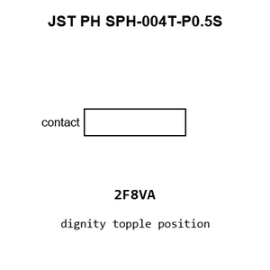

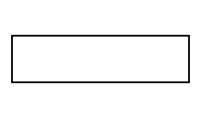

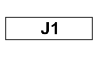

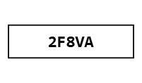

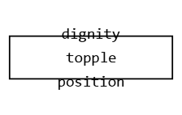

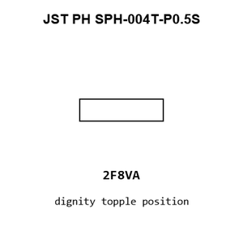

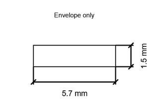

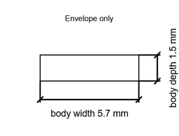

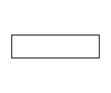

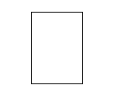

[View this part on GitHub](https://github.com/oomlout/oomp_electronic_version_5/tree/main/parts/electronic_connector_jst_ph_2_mm_pitch_crimp_1_pin_socket_28_to_32_awg_tin_jst_sph_004t_p0_5s)

[Browse this category](../../navigation/electronic/connector/jst_ph/2_mm_pitch/crimp/1_pin/socket/28_to_32_awg/tin/jst/README.md)

---

This page is generated from the OOMP part definition by a Roboclick Jinja template. Edit the source taxonomy or template rather than this generated file.