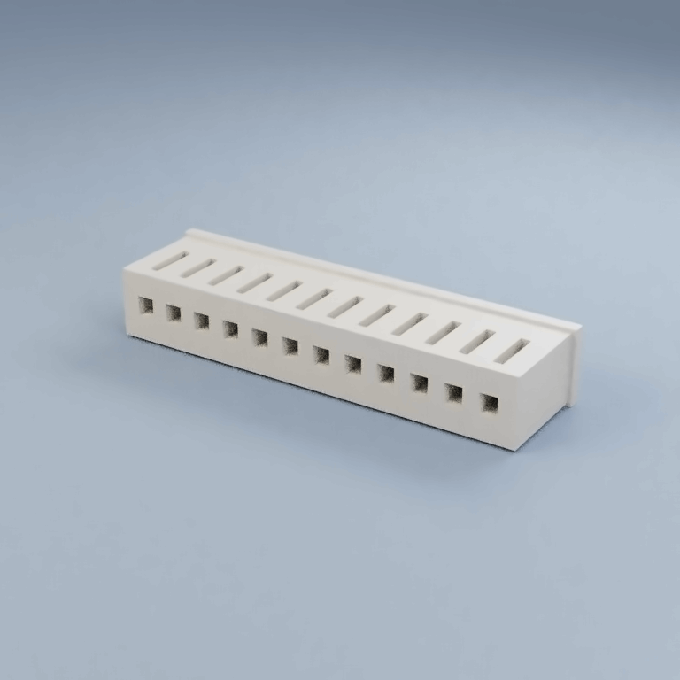
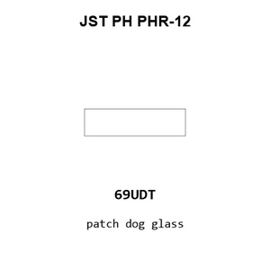
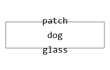
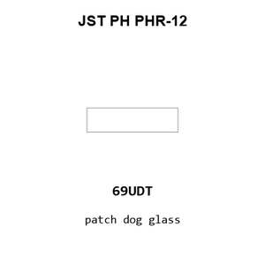
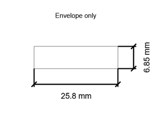
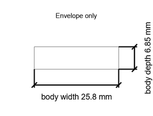
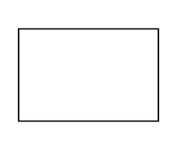

# JST PH 2 mm 12-position white housing (PHR-12)

`electronic_connector_jst_ph_2_mm_pitch_housing_12_pin_white_jst_phr_12`

JST PH 2 mm 12-position white housing (PHR-12) is an OOMP electronic connector definition. It uses the jst ph package or form factor. Its nominal drawing size is 25.8 &#x00D7; 6.85 mm.

Nominal drawing spans. See the manufacturer's drawing for feature dimensions and crimp tooling.

## At a glance

| Detail | Value |
| --- | --- |
| OOMP ID | `electronic_connector_jst_ph_2_mm_pitch_housing_12_pin_white_jst_phr_12` |
| Type | Connector |
| Package / style | jst ph |
| Nominal size | 25.8 &#x00D7; 6.85 mm |

## Classification

| Level | Value |
| --- | --- |
| 1 | `electronic` |
| 2 | `connector` |
| 3 | `jst_ph` |
| 4 | `2_mm_pitch` |
| 5 | `housing` |
| 6 | `12_pin` |
| 7 | `white` |
| 14 | `jst` |
| 15 | `phr_12` |

## 3D reference model

[Download STEP](data/model_3d.step) · [Model source and limitations](data/model_3d_source.yaml)

OOMP model based on the manufacturer drawing, with nominal outer dimensions and simplified internal geometry. Use it for layout and illustration.

## Connector details

| Detail | Value |
| --- | --- |
| Component Role | Empty insulating housing with contacts supplied separately |
| Contacts Required | 12, sold separately |
| Housing Color | Natural (white) |
| Housing Material | PA |
| Pitch | 2 mm |
| Positions | 12, single row |
| Series | JST PH |

## Compatible components

- **Contact option:** [JST PH crimp socket 32&#x2013;28 AWG, tin (SPH-004T-P0.5S)](../electronic_connector_jst_ph_2_mm_pitch_crimp_1_pin_socket_28_to_32_awg_tin_jst_sph_004t_p0_5s/README.md) — quantity 12.
  Quantity fills the active cavities. Select the contact for the wire gauge and insulation diameter. [Manufacturer evidence](https://www.jst-mfg.com/product/pdf/eng/ePH.pdf).

- **Contact option:** [JST PH crimp socket 30&#x2013;24 AWG, tin (SPH-002T-P0.5S)](../electronic_connector_jst_ph_2_mm_pitch_crimp_1_pin_socket_24_to_30_awg_tin_jst_sph_002t_p0_5s/README.md) — quantity 12.
  Quantity fills the active cavities. Select the contact for the wire gauge and insulation diameter. [Manufacturer evidence](https://www.jst-mfg.com/product/pdf/eng/ePH.pdf).

- **Contact option:** [JST PH crimp socket 28&#x2013;24 AWG, tin (SPH-002T-P0.5L)](../electronic_connector_jst_ph_2_mm_pitch_crimp_1_pin_socket_24_to_28_awg_tin_jst_sph_002t_p0_5l/README.md) — quantity 12.
  Quantity fills the active cavities. Select the contact for the wire gauge and insulation diameter. [Manufacturer evidence](https://www.jst-mfg.com/product/pdf/eng/ePH.pdf).

## Nominal dimensions

| Measurement | Value |
| --- | ---: |
| Height | 4.5 mm |
| Length | 25.8 mm |
| Width | 6.85 mm |

## Identifiers

| Identifier | Value |
| --- | --- |
| Manufacturer part number | `PHR-12` |

## Datasheet

[View the datasheet](data/datasheet.pdf)

## Used in projects

[Browse confirmed project usage](https://oomlout.github.io/oomp_electronic_project_version_5/usage/index.html#electronic_connector_jst_ph_2_mm_pitch_housing_12_pin_white_jst_phr_12)

## Files

[KiCad applicability: cable component, no PCB footprint](data/kicad/README.md) · [Applicability record](data/kicad/manifest.yaml)

[View this part on GitHub](https://github.com/oomlout/oomp_electronic_version_5/tree/main/parts/electronic_connector_jst_ph_2_mm_pitch_housing_12_pin_white_jst_phr_12)

[Browse this category](../../navigation/electronic/connector/jst_ph/2_mm_pitch/housing/12_pin/white/jst/README.md)

---

This page is generated from the OOMP part definition by a Roboclick Jinja template. Edit the source taxonomy or template rather than this generated file.