# JST PH 2 mm 4-position white housing (PHR-4)

`electronic_connector_jst_ph_2_mm_pitch_housing_4_pin_white_jst_phr_4`

JST PH 2 mm 4-position white housing (PHR-4) is an OOMP electronic connector definition. It uses the jst ph package or form factor. Its nominal drawing size is 9.8 &#x00D7; 6.85 mm.

Nominal drawing spans. See the manufacturer's drawing for feature dimensions and crimp tooling.

## At a glance

| Detail | Value |
| --- | --- |
| OOMP ID | `electronic_connector_jst_ph_2_mm_pitch_housing_4_pin_white_jst_phr_4` |
| Type | Connector |
| Package / style | jst ph |
| Nominal size | 9.8 &#x00D7; 6.85 mm |

## Classification

| Level | Value |
| --- | --- |
| 1 | `electronic` |
| 2 | `connector` |
| 3 | `jst_ph` |
| 4 | `2_mm_pitch` |
| 5 | `housing` |
| 6 | `4_pin` |
| 7 | `white` |
| 14 | `jst` |
| 15 | `phr_4` |

## 3D reference model

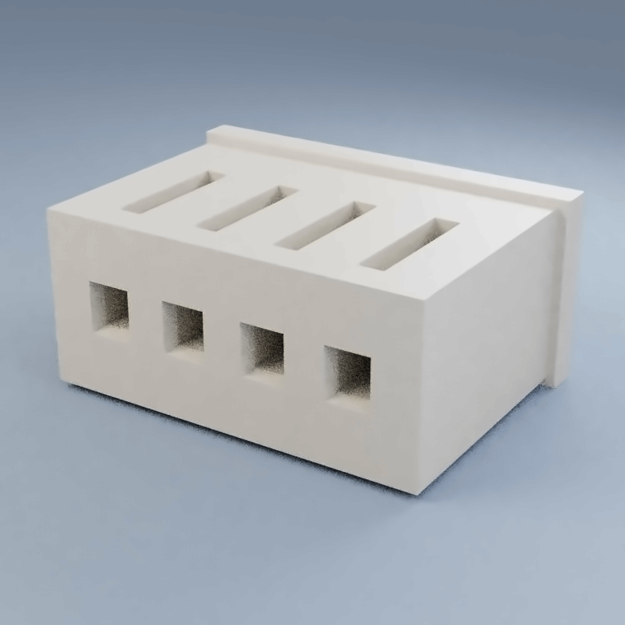

[Download STEP](data/model_3d.step) · [Model source and limitations](data/model_3d_source.yaml)

OOMP model based on the manufacturer drawing, with nominal outer dimensions and simplified internal geometry. Use it for layout and illustration.

## Connector details

| Detail | Value |
| --- | --- |
| Component Role | Empty insulating housing with contacts supplied separately |
| Contacts Required | 4, sold separately |
| Housing Color | Natural (white) |
| Housing Material | PA |
| Pitch | 2 mm |
| Positions | 4, single row |
| Series | JST PH |

## Compatible components

- **Contact option:** [JST PH crimp socket 32&#x2013;28 AWG, tin (SPH-004T-P0.5S)](../electronic_connector_jst_ph_2_mm_pitch_crimp_1_pin_socket_28_to_32_awg_tin_jst_sph_004t_p0_5s/README.md) — quantity 4.
  Quantity fills the active cavities. Select the contact for the wire gauge and insulation diameter. [Manufacturer evidence](https://www.jst-mfg.com/product/pdf/eng/ePH.pdf).

- **Contact option:** [JST PH crimp socket 30&#x2013;24 AWG, tin (SPH-002T-P0.5S)](../electronic_connector_jst_ph_2_mm_pitch_crimp_1_pin_socket_24_to_30_awg_tin_jst_sph_002t_p0_5s/README.md) — quantity 4.
  Quantity fills the active cavities. Select the contact for the wire gauge and insulation diameter. [Manufacturer evidence](https://www.jst-mfg.com/product/pdf/eng/ePH.pdf).

- **Contact option:** [JST PH crimp socket 28&#x2013;24 AWG, tin (SPH-002T-P0.5L)](../electronic_connector_jst_ph_2_mm_pitch_crimp_1_pin_socket_24_to_28_awg_tin_jst_sph_002t_p0_5l/README.md) — quantity 4.
  Quantity fills the active cavities. Select the contact for the wire gauge and insulation diameter. [Manufacturer evidence](https://www.jst-mfg.com/product/pdf/eng/ePH.pdf).

## Nominal dimensions

| Measurement | Value |
| --- | ---: |
| Height | 4.5 mm |
| Length | 9.8 mm |
| Width | 6.85 mm |

## Identifiers

| Identifier | Value |
| --- | --- |
| Manufacturer part number | `PHR-4` |

## Datasheet

[View the datasheet](data/datasheet.pdf)

## Used in projects

[Browse confirmed project usage](https://oomlout.github.io/oomp_electronic_project_version_5/usage/index.html#electronic_connector_jst_ph_2_mm_pitch_housing_4_pin_white_jst_phr_4)

## Files

<!-- oomp-part-file-table -->

| Image type | Image | Link |
| --- | :---: | --- |
| **Pinout drawing** Pin names and positions on the part. | 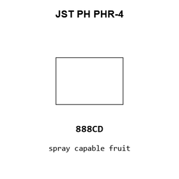 | [SVG](data/working_svg_square_pins.svg) · [PNG](data/working_svg_square_pins.png) · [Preview](data/working_svg_square_pins_300.png) |
| **Assembly** Component placement drawing. |  | [SVG](data/working_svg_assembly.svg) · [PNG](data/working_svg_assembly.png) · [Preview](data/working_svg_assembly_300.png) |
| **Assembly pinout** Placement drawing with the pins marked. |  | [SVG](data/working_svg_assembly_pins.svg) · [PNG](data/working_svg_assembly_pins.png) · [Preview](data/working_svg_assembly_pins_300.png) |
| **Top view** Package seen from above. |  | [SVG](data/working_svg_top.svg) · [PNG](data/working_svg_top.png) · [Preview](data/working_svg_top_300.png) |
| **Bottom view** Package seen from below. | 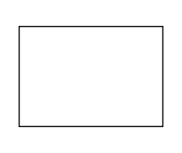 | [SVG](data/working_svg_bottom.svg) · [PNG](data/working_svg_bottom.png) · [Preview](data/working_svg_bottom_300.png) |
| **Side view** Package profile. |  | [SVG](data/working_svg_side.svg) · [PNG](data/working_svg_side.png) · [Preview](data/working_svg_side_300.png) |
| **Outline** External shape of the part. | 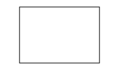 | [SVG](data/working_svg_outline.svg) · [PNG](data/working_svg_outline.png) · [Preview](data/working_svg_outline_300.png) |
| **Dimensions** Package outline with dimension arrows. | 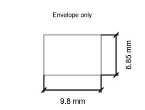 | [SVG](data/working_svg_dimensioned.svg) · [PNG](data/working_svg_dimensioned.png) · [Preview](data/working_svg_dimensioned_300.png) |
| **Dimensions with labels** Labelled package measurements. | 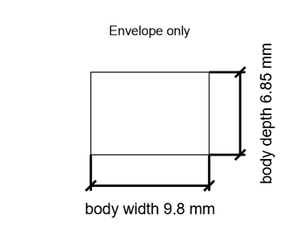 | [SVG](data/working_svg_dimensioned_titles.svg) · [PNG](data/working_svg_dimensioned_titles.png) · [Preview](data/working_svg_dimensioned_titles_300.png) |
| **Square summary** Component identification card. | 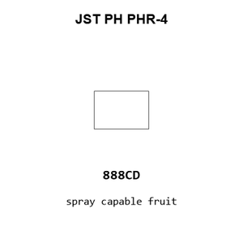 | [SVG](data/working_svg_square.svg) · [PNG](data/working_svg_square.png) · [Preview](data/working_svg_square_300.png) |
| **Part ID** Drawing labelled with the OOMP catalogue ID. | 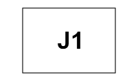 | [SVG](data/working_svg_part_id.svg) · [PNG](data/working_svg_part_id.png) · [Preview](data/working_svg_part_id_300.png) |
| **MD5 alpha** Drawing labelled with the short OOMP code. | 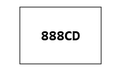 | [SVG](data/working_svg_md5_6_alpha.svg) · [PNG](data/working_svg_md5_6_alpha.png) · [Preview](data/working_svg_md5_6_alpha_300.png) |
| **BIP 39 words** Drawing labelled with the three-word identifier. | 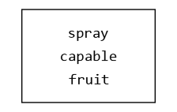 | [SVG](data/working_svg_bip_39_3_word.svg) · [PNG](data/working_svg_bip_39_3_word.png) · [Preview](data/working_svg_bip_39_3_word_300.png) |
| **Diagram contact sheet** Component drawings together in one image. | 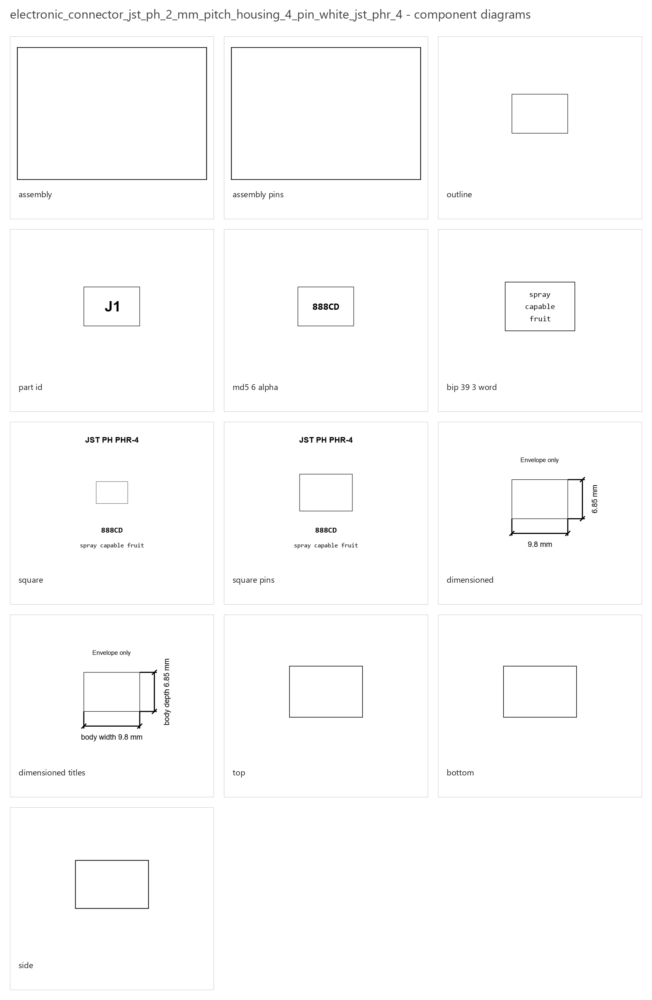 | [PNG](data/working_svg_contact_sheet.png) |
| **KiCad library guide** | — | [MD](data/kicad/README.md) |
| **KiCad availability and source masters** | — | [JSON](data/kicad/manifest.json) · [YAML](data/kicad/manifest.yaml) |
| **Reference CAD model** | — | [STEP](data/model_3d.step) |
| **Reference model render** |  | [PNG](data/model_3d_render.png) |
| **Reference model sources** | — | [YAML](data/model_3d_source.yaml) |
| **Manufacturer or supplier datasheet** | — | [PDF](data/datasheet.pdf) |
| **Drawer label data** | — | [YAML](data/label_drawer.yaml) |
| **Small drawer label** |  | [SVG](label_drawer_1_5x1.svg) |
| **Large drawer label** | 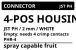 | [SVG](label_drawer_3x2.svg) |
| **Web catalogue file index** | — | [YAML](web.yaml) |
| **Part definition and build recipe** | — | [YAML](working.yaml) |

<!-- /oomp-part-file-table -->

[View this part on GitHub](https://github.com/oomlout/oomp_electronic_version_5/tree/main/parts/electronic_connector_jst_ph_2_mm_pitch_housing_4_pin_white_jst_phr_4)

[Browse this category](../../navigation/electronic/connector/jst_ph/2_mm_pitch/housing/4_pin/white/jst/README.md)

---

This page is generated from the OOMP part definition by a Roboclick Jinja template. Edit the source taxonomy or template rather than this generated file.