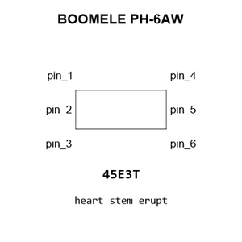
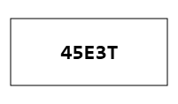
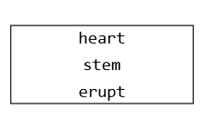
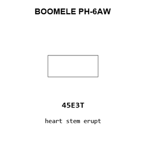
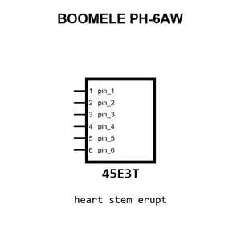
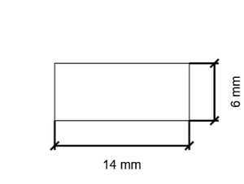
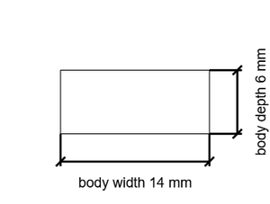
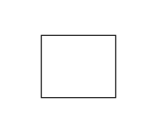

# BOOMELE PH 2 mm 6-position right-angle header (PH-6AW)

`electronic_connector_jst_ph_2_mm_pitch_through_hole_right_angle_6_pin_boomele_boom_precision_elec_ph_6aw`

BOOMELE PH 2 mm 6-position right-angle header (PH-6AW) is an OOMP electronic connector definition. It uses the jst ph package or form factor. Its nominal drawing size is 14.0 &#x00D7; 6.0 mm. The definition includes 6 documented pins.

Housing envelope from the distributor drawing. Refer to the drawing for PCB drilling and fit.

## At a glance

| Detail | Value |
| --- | --- |
| OOMP ID | `electronic_connector_jst_ph_2_mm_pitch_through_hole_right_angle_6_pin_boomele_boom_precision_elec_ph_6aw` |
| Type | Connector |
| Package / style | jst ph |
| Nominal size | 14.0 &#x00D7; 6.0 mm |
| Documented pins | 6 |

## Classification

| Level | Value |
| --- | --- |
| 1 | `electronic` |
| 2 | `connector` |
| 3 | `jst_ph` |
| 4 | `2_mm_pitch` |
| 5 | `through_hole_right_angle` |
| 6 | `6_pin` |
| 14 | `boomele_boom_precision_elec` |
| 15 | `ph_6aw` |

## Nominal dimensions

| Measurement | Value |
| --- | ---: |
| Height | 5.0 mm |
| Length | 14.0 mm |
| Width | 6.0 mm |

## Identifiers

| Identifier | Value |
| --- | --- |
| Manufacturer part number | `PH-6AW` |
| LCSC | [`C5662`](https://www.lcsc.com/product-detail/C5662.html) |
| JLCPCB | [`C5662`](https://jlcpcb.com/partdetail/BOOMELE_Boom_Precision_Elec-PH6AW/C5662) |

## Pins

| Pin | Name | Type |
| ---: | --- | --- |
| 1 | pin_1 | passive |
| 2 | pin_2 | passive |
| 3 | pin_3 | passive |
| 4 | pin_4 | passive |
| 5 | pin_5 | passive |
| 6 | pin_6 | passive |

## Datasheet

[View the datasheet](data/datasheet.pdf)

## Used in projects

[Browse confirmed project usage](https://oomlout.github.io/oomp_electronic_project_version_5/usage/index.html#electronic_connector_jst_ph_2_mm_pitch_through_hole_right_angle_6_pin_boomele_boom_precision_elec_ph_6aw)

## Files

[KiCad symbol, machine-solder and hand-solder footprints](data/kicad/README.md) · [Availability and source masters](data/kicad/manifest.yaml)

[View this part on GitHub](https://github.com/oomlout/oomp_electronic_version_5/tree/main/parts/electronic_connector_jst_ph_2_mm_pitch_through_hole_right_angle_6_pin_boomele_boom_precision_elec_ph_6aw)

[Browse this category](../../navigation/electronic/connector/jst_ph/2_mm_pitch/through_hole_right_angle/6_pin/boomele_boom_precision_elec/README.md)

---

This page is generated from the OOMP part definition by a Roboclick Jinja template. Edit the source taxonomy or template rather than this generated file.