# JST SH crimp socket 32&#x2013;28 AWG, tin (SSH-003T-P0.2-H)

`electronic_connector_jst_sh_1_mm_pitch_crimp_1_pin_socket_28_to_32_awg_tin_jst_ssh_003t_p0_2_h`

JST SH crimp socket 32&#x2013;28 AWG, tin (SSH-003T-P0.2-H) is an OOMP electronic connector definition. It uses the jst sh package or form factor. Its nominal drawing size is 3.9 &#x00D7; 0.8 mm. The definition includes 1 documented pin.

Nominal drawing spans. See the manufacturer's drawing for feature dimensions and crimp tooling.

## At a glance

| Detail | Value |
| --- | --- |
| OOMP ID | `electronic_connector_jst_sh_1_mm_pitch_crimp_1_pin_socket_28_to_32_awg_tin_jst_ssh_003t_p0_2_h` |
| Type | Connector |
| Package / style | jst sh |
| Nominal size | 3.9 &#x00D7; 0.8 mm |
| Documented pins | 1 |

## Classification

| Level | Value |
| --- | --- |
| 1 | `electronic` |
| 2 | `connector` |
| 3 | `jst_sh` |
| 4 | `1_mm_pitch` |
| 5 | `crimp` |
| 6 | `1_pin` |
| 7 | `socket` |
| 8 | `28_to_32_awg` |
| 9 | `tin` |
| 14 | `jst` |
| 15 | `ssh_003t_p0_2_h` |

## 3D reference model

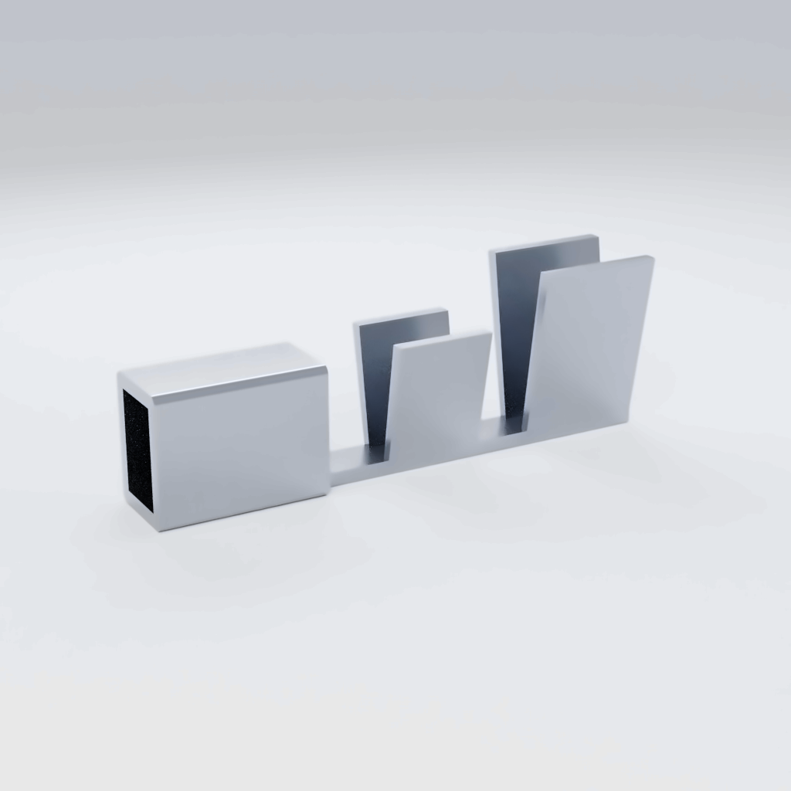

[Download STEP](data/model_3d.step) · [Model source and limitations](data/model_3d_source.yaml)

OOMP model based on the manufacturer drawing, with nominal outer dimensions and simplified internal geometry. Use it for layout and illustration.

## Connector details

| Detail | Value |
| --- | --- |
| Component Role | Female crimp contact with one conductive terminal |
| Contact Finish | Tin |
| Contact Material | Copper alloy |
| Insertion Force | Standard insertion force |
| Insulation Outer Diameter | 0.4&#x2013;0.8 mm |
| Packaging | Reel |
| Pitch | 1 mm (housing pitch) |
| Series | JST SH |
| Wire Size | 32&#x2013;28 AWG |

## Compatible components

- **Fits housing:** [JST SH 1 mm 2-position white housing (SHR-02V-S-B)](../electronic_connector_jst_sh_1_mm_pitch_housing_2_pin_white_with_protrusions_jst_shr_02v_s_b/README.md).
  Order 2 contacts separately to fill the housing. [Manufacturer evidence](https://www.jst-mfg.com/product/pdf/eng/eSH.pdf).

- **Fits housing:** [JST SH 1 mm 3-position white housing (SHR-03V-S-B)](../electronic_connector_jst_sh_1_mm_pitch_housing_3_pin_white_with_protrusions_jst_shr_03v_s_b/README.md).
  Order 3 contacts separately to fill the housing. [Manufacturer evidence](https://www.jst-mfg.com/product/pdf/eng/eSH.pdf).

- **Fits housing:** [JST SH 1 mm 4-position white housing (SHR-04V-S-B)](../electronic_connector_jst_sh_1_mm_pitch_housing_4_pin_white_with_protrusions_jst_shr_04v_s_b/README.md).
  Order 4 contacts separately to fill the housing. [Manufacturer evidence](https://www.jst-mfg.com/product/pdf/eng/eSH.pdf).

- **Fits housing:** [JST SH 1 mm 5-position white housing (SHR-05V-S-B)](../electronic_connector_jst_sh_1_mm_pitch_housing_5_pin_white_with_protrusions_jst_shr_05v_s_b/README.md).
  Order 5 contacts separately to fill the housing. [Manufacturer evidence](https://www.jst-mfg.com/product/pdf/eng/eSH.pdf).

- **Fits housing:** [JST SH 1 mm 6-position white housing (SHR-06V-S-B)](../electronic_connector_jst_sh_1_mm_pitch_housing_6_pin_white_with_protrusions_jst_shr_06v_s_b/README.md).
  Order 6 contacts separately to fill the housing. [Manufacturer evidence](https://www.jst-mfg.com/product/pdf/eng/eSH.pdf).

- **Fits housing:** [JST SH 1 mm 7-position white housing (SHR-07V-S-B)](../electronic_connector_jst_sh_1_mm_pitch_housing_7_pin_white_with_protrusions_jst_shr_07v_s_b/README.md).
  Order 7 contacts separately to fill the housing. [Manufacturer evidence](https://www.jst-mfg.com/product/pdf/eng/eSH.pdf).

- **Fits housing:** [JST SH 1 mm 8-position white housing (SHR-08V-S-B)](../electronic_connector_jst_sh_1_mm_pitch_housing_8_pin_white_with_protrusions_jst_shr_08v_s_b/README.md).
  Order 8 contacts separately to fill the housing. [Manufacturer evidence](https://www.jst-mfg.com/product/pdf/eng/eSH.pdf).

- **Fits housing:** [JST SH 1 mm 9-position white housing (SHR-09V-S-B)](../electronic_connector_jst_sh_1_mm_pitch_housing_9_pin_white_with_protrusions_jst_shr_09v_s_b/README.md).
  Order 9 contacts separately to fill the housing. [Manufacturer evidence](https://www.jst-mfg.com/product/pdf/eng/eSH.pdf).

- **Fits housing:** [JST SH 1 mm 10-position white housing (SHR-10V-S-B)](../electronic_connector_jst_sh_1_mm_pitch_housing_10_pin_white_with_protrusions_jst_shr_10v_s_b/README.md).
  Order 10 contacts separately to fill the housing. [Manufacturer evidence](https://www.jst-mfg.com/product/pdf/eng/eSH.pdf).

- **Fits housing:** [JST SH 1 mm 11-position white housing (SHR-11V-S-B)](../electronic_connector_jst_sh_1_mm_pitch_housing_11_pin_white_with_protrusions_jst_shr_11v_s_b/README.md).
  Order 11 contacts separately to fill the housing. [Manufacturer evidence](https://www.jst-mfg.com/product/pdf/eng/eSH.pdf).

- **Fits housing:** [JST SH 1 mm 12-position white housing (SHR-12V-S-B)](../electronic_connector_jst_sh_1_mm_pitch_housing_12_pin_white_with_protrusions_jst_shr_12v_s_b/README.md).
  Order 12 contacts separately to fill the housing. [Manufacturer evidence](https://www.jst-mfg.com/product/pdf/eng/eSH.pdf).

- **Fits housing:** [JST SH 1 mm 13-position white housing (SHR-13V-S-B)](../electronic_connector_jst_sh_1_mm_pitch_housing_13_pin_white_with_protrusions_jst_shr_13v_s_b/README.md).
  Order 13 contacts separately to fill the housing. [Manufacturer evidence](https://www.jst-mfg.com/product/pdf/eng/eSH.pdf).

- **Fits housing:** [JST SH 1 mm 14-position white housing (SHR-14V-S-B)](../electronic_connector_jst_sh_1_mm_pitch_housing_14_pin_white_with_protrusions_jst_shr_14v_s_b/README.md).
  Order 14 contacts separately to fill the housing. [Manufacturer evidence](https://www.jst-mfg.com/product/pdf/eng/eSH.pdf).

- **Fits housing:** [JST SH 1 mm 15-position white housing (SHR-15V-S-B)](../electronic_connector_jst_sh_1_mm_pitch_housing_15_pin_white_with_protrusions_jst_shr_15v_s_b/README.md).
  Order 15 contacts separately to fill the housing. [Manufacturer evidence](https://www.jst-mfg.com/product/pdf/eng/eSH.pdf).

- **Fits housing:** [JST SH 1 mm 16-position white housing (SHR-16V-S-B)](../electronic_connector_jst_sh_1_mm_pitch_housing_16_pin_white_with_protrusions_jst_shr_16v_s_b/README.md).
  Order 16 contacts separately to fill the housing. [Manufacturer evidence](https://www.jst-mfg.com/product/pdf/eng/eSH.pdf).

- **Fits housing:** [JST SH 1 mm 20-position white housing (SHR-20V-S-B)](../electronic_connector_jst_sh_1_mm_pitch_housing_20_pin_white_with_protrusions_jst_shr_20v_s_b/README.md).
  Order 20 contacts separately to fill the housing. [Manufacturer evidence](https://www.jst-mfg.com/product/pdf/eng/eSH.pdf).

- **Fits housing:** [JST SH 1 mm 2-position white housing (SHR-02V-S)](../electronic_connector_jst_sh_1_mm_pitch_housing_2_pin_white_without_protrusions_jst_shr_02v_s/README.md).
  Order 2 contacts separately to fill the housing. [Manufacturer evidence](https://www.jst-mfg.com/product/pdf/eng/eSH.pdf).

- **Fits housing:** [JST SH 1 mm 3-position white housing (SHR-03V-S)](../electronic_connector_jst_sh_1_mm_pitch_housing_3_pin_white_without_protrusions_jst_shr_03v_s/README.md).
  Order 3 contacts separately to fill the housing. [Manufacturer evidence](https://www.jst-mfg.com/product/pdf/eng/eSH.pdf).

- **Fits housing:** [JST SH 1 mm 4-position white housing (SHR-04V-S)](../electronic_connector_jst_sh_1_mm_pitch_housing_4_pin_white_without_protrusions_jst_shr_04v_s/README.md).
  Order 4 contacts separately to fill the housing. [Manufacturer evidence](https://www.jst-mfg.com/product/pdf/eng/eSH.pdf).

- **Fits housing:** [JST SH 1 mm 5-position white housing (SHR-05V-S)](../electronic_connector_jst_sh_1_mm_pitch_housing_5_pin_white_without_protrusions_jst_shr_05v_s/README.md).
  Order 5 contacts separately to fill the housing. [Manufacturer evidence](https://www.jst-mfg.com/product/pdf/eng/eSH.pdf).

- **Fits housing:** [JST SH 1 mm 6-position white housing (SHR-06V-S)](../electronic_connector_jst_sh_1_mm_pitch_housing_6_pin_white_without_protrusions_jst_shr_06v_s/README.md).
  Order 6 contacts separately to fill the housing. [Manufacturer evidence](https://www.jst-mfg.com/product/pdf/eng/eSH.pdf).

- **Fits housing:** [JST SH 1 mm 7-position white housing (SHR-07V-S)](../electronic_connector_jst_sh_1_mm_pitch_housing_7_pin_white_without_protrusions_jst_shr_07v_s/README.md).
  Order 7 contacts separately to fill the housing. [Manufacturer evidence](https://www.jst-mfg.com/product/pdf/eng/eSH.pdf).

- **Fits housing:** [JST SH 1 mm 8-position white housing (SHR-08V-S)](../electronic_connector_jst_sh_1_mm_pitch_housing_8_pin_white_without_protrusions_jst_shr_08v_s/README.md).
  Order 8 contacts separately to fill the housing. [Manufacturer evidence](https://www.jst-mfg.com/product/pdf/eng/eSH.pdf).

- **Fits housing:** [JST SH 1 mm 9-position white housing (SHR-09V-S)](../electronic_connector_jst_sh_1_mm_pitch_housing_9_pin_white_without_protrusions_jst_shr_09v_s/README.md).
  Order 9 contacts separately to fill the housing. [Manufacturer evidence](https://www.jst-mfg.com/product/pdf/eng/eSH.pdf).

- **Fits housing:** [JST SH 1 mm 10-position white housing (SHR-10V-S)](../electronic_connector_jst_sh_1_mm_pitch_housing_10_pin_white_without_protrusions_jst_shr_10v_s/README.md).
  Order 10 contacts separately to fill the housing. [Manufacturer evidence](https://www.jst-mfg.com/product/pdf/eng/eSH.pdf).

- **Fits housing:** [JST SH 1 mm 11-position white housing (SHR-11V-S)](../electronic_connector_jst_sh_1_mm_pitch_housing_11_pin_white_without_protrusions_jst_shr_11v_s/README.md).
  Order 11 contacts separately to fill the housing. [Manufacturer evidence](https://www.jst-mfg.com/product/pdf/eng/eSH.pdf).

- **Fits housing:** [JST SH 1 mm 12-position white housing (SHR-12V-S)](../electronic_connector_jst_sh_1_mm_pitch_housing_12_pin_white_without_protrusions_jst_shr_12v_s/README.md).
  Order 12 contacts separately to fill the housing. [Manufacturer evidence](https://www.jst-mfg.com/product/pdf/eng/eSH.pdf).

- **Fits housing:** [JST SH 1 mm 13-position white housing (SHR-13V-S)](../electronic_connector_jst_sh_1_mm_pitch_housing_13_pin_white_without_protrusions_jst_shr_13v_s/README.md).
  Order 13 contacts separately to fill the housing. [Manufacturer evidence](https://www.jst-mfg.com/product/pdf/eng/eSH.pdf).

- **Fits housing:** [JST SH 1 mm 14-position white housing (SHR-14V-S)](../electronic_connector_jst_sh_1_mm_pitch_housing_14_pin_white_without_protrusions_jst_shr_14v_s/README.md).
  Order 14 contacts separately to fill the housing. [Manufacturer evidence](https://www.jst-mfg.com/product/pdf/eng/eSH.pdf).

- **Fits housing:** [JST SH 1 mm 15-position white housing (SHR-15V-S)](../electronic_connector_jst_sh_1_mm_pitch_housing_15_pin_white_without_protrusions_jst_shr_15v_s/README.md).
  Order 15 contacts separately to fill the housing. [Manufacturer evidence](https://www.jst-mfg.com/product/pdf/eng/eSH.pdf).

## Nominal dimensions

| Measurement | Value |
| --- | ---: |
| Height | 1.35 mm |
| Length | 3.9 mm |
| Width | 0.8 mm |

## Identifiers

| Identifier | Value |
| --- | --- |
| Manufacturer part number | `SSH-003T-P0.2-H` |

## Pins

| Pin | Name | Type |
| ---: | --- | --- |
| 1 | contact | passive |

## Datasheet

[View the datasheet](data/datasheet.pdf)

## Used in projects

[Browse confirmed project usage](https://oomlout.github.io/oomp_electronic_project_version_5/usage/index.html#electronic_connector_jst_sh_1_mm_pitch_crimp_1_pin_socket_28_to_32_awg_tin_jst_ssh_003t_p0_2_h)

## Files

[KiCad applicability: cable component, no PCB footprint](data/kicad/README.md) · [Applicability record](data/kicad/manifest.yaml)

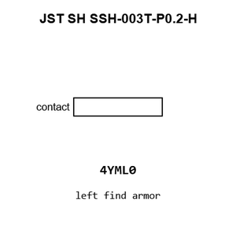

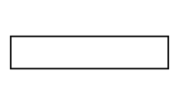

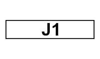

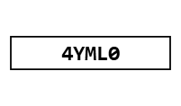

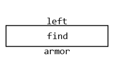

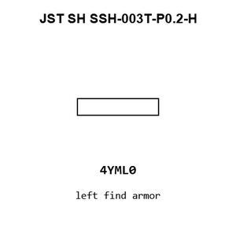

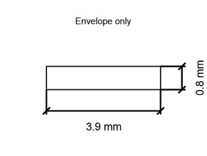

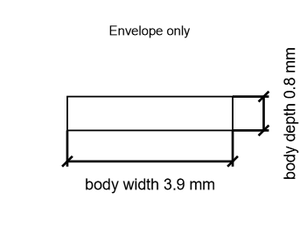

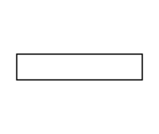

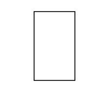

[View this part on GitHub](https://github.com/oomlout/oomp_electronic_version_5/tree/main/parts/electronic_connector_jst_sh_1_mm_pitch_crimp_1_pin_socket_28_to_32_awg_tin_jst_ssh_003t_p0_2_h)

[Browse this category](../../navigation/electronic/connector/jst_sh/1_mm_pitch/crimp/1_pin/socket/28_to_32_awg/tin/jst/README.md)

---

This page is generated from the OOMP part definition by a Roboclick Jinja template. Edit the source taxonomy or template rather than this generated file.