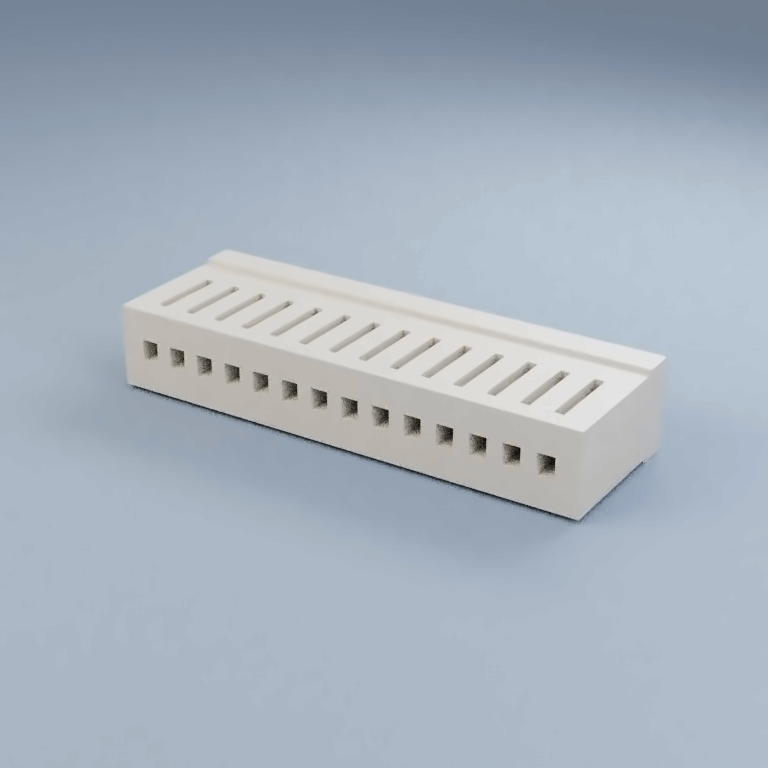
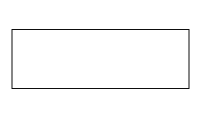
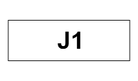
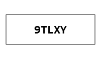
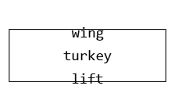
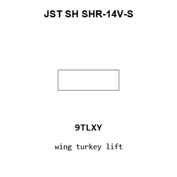
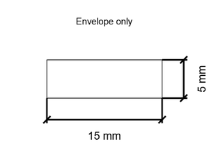
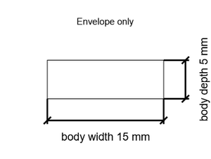
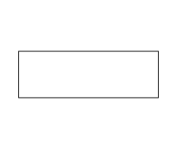
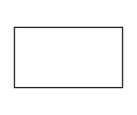

# JST SH 1 mm 14-position white housing (SHR-14V-S)

`electronic_connector_jst_sh_1_mm_pitch_housing_14_pin_white_without_protrusions_jst_shr_14v_s`

JST SH 1 mm 14-position white housing (SHR-14V-S) is an OOMP electronic connector definition. It uses the jst sh package or form factor. Its nominal drawing size is 15 &#x00D7; 5 mm.

Nominal drawing spans. See the manufacturer's drawing for feature dimensions and crimp tooling.

## At a glance

| Detail | Value |
| --- | --- |
| OOMP ID | `electronic_connector_jst_sh_1_mm_pitch_housing_14_pin_white_without_protrusions_jst_shr_14v_s` |
| Type | Connector |
| Package / style | jst sh |
| Nominal size | 15 &#x00D7; 5 mm |

## Classification

| Level | Value |
| --- | --- |
| 1 | `electronic` |
| 2 | `connector` |
| 3 | `jst_sh` |
| 4 | `1_mm_pitch` |
| 5 | `housing` |
| 6 | `14_pin` |
| 7 | `white` |
| 8 | `without_protrusions` |
| 14 | `jst` |
| 15 | `shr_14v_s` |

## 3D reference model

[Download STEP](data/model_3d.step) · [Model source and limitations](data/model_3d_source.yaml)

OOMP model based on the manufacturer drawing, with nominal outer dimensions and simplified internal geometry. Use it for layout and illustration.

## Connector details

| Detail | Value |
| --- | --- |
| Component Role | Empty insulating housing with contacts supplied separately |
| Contacts Required | 14, sold separately |
| End Protrusions | Absent |
| Housing Color | Natural (white) |
| Housing Material | PBT |
| Pitch | 1 mm |
| Positions | 14, single row |
| Series | JST SH |

## Compatible components

- **Contact option:** [JST SH crimp socket 32&#x2013;28 AWG, tin (SSH-003T-P0.2-H)](../electronic_connector_jst_sh_1_mm_pitch_crimp_1_pin_socket_28_to_32_awg_tin_jst_ssh_003t_p0_2_h/README.md) — quantity 14.
  Quantity fills the active cavities. Select the contact for the wire gauge and insulation diameter. [Manufacturer evidence](https://www.jst-mfg.com/product/pdf/eng/eSH.pdf).

## Nominal dimensions

| Measurement | Value |
| --- | ---: |
| Height | 2.8 mm |
| Length | 15 mm |
| Width | 5 mm |

## Identifiers

| Identifier | Value |
| --- | --- |
| Manufacturer part number | `SHR-14V-S` |

## Datasheet

[View the datasheet](data/datasheet.pdf)

## Used in projects

[Browse confirmed project usage](https://oomlout.github.io/oomp_electronic_project_version_5/usage/index.html#electronic_connector_jst_sh_1_mm_pitch_housing_14_pin_white_without_protrusions_jst_shr_14v_s)

## Files

[KiCad applicability: cable component, no PCB footprint](data/kicad/README.md) · [Applicability record](data/kicad/manifest.yaml)

[View this part on GitHub](https://github.com/oomlout/oomp_electronic_version_5/tree/main/parts/electronic_connector_jst_sh_1_mm_pitch_housing_14_pin_white_without_protrusions_jst_shr_14v_s)

[Browse this category](../../navigation/electronic/connector/jst_sh/1_mm_pitch/housing/14_pin/white/without_protrusions/jst/README.md)

---

This page is generated from the OOMP part definition by a Roboclick Jinja template. Edit the source taxonomy or template rather than this generated file.