# JST XH crimp socket 30&#x2013;26 AWG, tin (SXH-002T-P0.6)

`electronic_connector_jst_xh_2_5_mm_pitch_crimp_1_pin_socket_26_to_30_awg_tin_jst_sxh_002t_p0_6`

JST XH crimp socket 30&#x2013;26 AWG, tin (SXH-002T-P0.6) is an OOMP electronic connector definition. It uses the jst xh package or form factor. Its nominal drawing size is 6.1 &#x00D7; 1.95 mm. The definition includes 1 documented pin.

Nominal drawing spans. See the manufacturer's drawing for feature dimensions and crimp tooling.

## At a glance

| Detail | Value |
| --- | --- |
| OOMP ID | `electronic_connector_jst_xh_2_5_mm_pitch_crimp_1_pin_socket_26_to_30_awg_tin_jst_sxh_002t_p0_6` |
| Type | Connector |
| Package / style | jst xh |
| Nominal size | 6.1 &#x00D7; 1.95 mm |
| Documented pins | 1 |

## Classification

| Level | Value |
| --- | --- |
| 1 | `electronic` |
| 2 | `connector` |
| 3 | `jst_xh` |
| 4 | `2_5_mm_pitch` |
| 5 | `crimp` |
| 6 | `1_pin` |
| 7 | `socket` |
| 8 | `26_to_30_awg` |
| 9 | `tin` |
| 14 | `jst` |
| 15 | `sxh_002t_p0_6` |

## 3D reference model

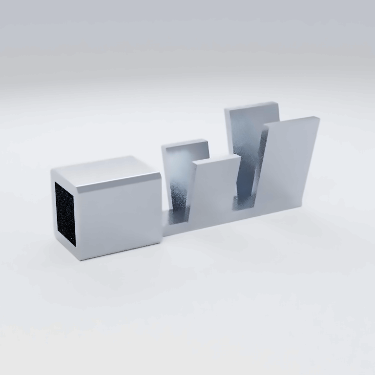

[Download STEP](data/model_3d.step) · [Model source and limitations](data/model_3d_source.yaml)

OOMP model based on the manufacturer drawing, with nominal outer dimensions and simplified internal geometry. Use it for layout and illustration.

## Connector details

| Detail | Value |
| --- | --- |
| Component Role | Female crimp contact with one conductive terminal |
| Contact Finish | Tin |
| Contact Material | Phosphor bronze |
| Insertion Force | Standard insertion force |
| Insulation Outer Diameter | 0.9&#x2013;1.3 mm |
| Packaging | Reel |
| Pitch | 2.5 mm (housing pitch) |
| Series | JST XH |
| Wire Size | 30&#x2013;26 AWG |

## Compatible components

- **Fits housing:** [JST XH 2.5 mm 1-position white housing (XHP-1)](../electronic_connector_jst_xh_2_5_mm_pitch_housing_1_pin_white_jst_xhp_1/README.md).
  Order 1 contacts separately to fill the housing. [Manufacturer evidence](https://www.jst-mfg.com/product/pdf/eng/eXH.pdf).

- **Fits housing:** [JST XH 2.5 mm 2-position white housing (XHP-2)](../electronic_connector_jst_xh_2_5_mm_pitch_housing_2_pin_white_jst_xhp_2/README.md).
  Order 2 contacts separately to fill the housing. [Manufacturer evidence](https://www.jst-mfg.com/product/pdf/eng/eXH.pdf).

- **Fits housing:** [JST XH 2.5 mm 3-position white housing (XHP-3)](../electronic_connector_jst_xh_2_5_mm_pitch_housing_3_pin_white_jst_xhp_3/README.md).
  Order 3 contacts separately to fill the housing. [Manufacturer evidence](https://www.jst-mfg.com/product/pdf/eng/eXH.pdf).

- **Fits housing:** [JST XH 2.5 mm 4-position white housing (XHP-4)](../electronic_connector_jst_xh_2_5_mm_pitch_housing_4_pin_white_jst_xhp_4/README.md).
  Order 4 contacts separately to fill the housing. [Manufacturer evidence](https://www.jst-mfg.com/product/pdf/eng/eXH.pdf).

- **Fits housing:** [JST XH 2.5 mm 5-position white housing (XHP-5)](../electronic_connector_jst_xh_2_5_mm_pitch_housing_5_pin_white_jst_xhp_5/README.md).
  Order 5 contacts separately to fill the housing. [Manufacturer evidence](https://www.jst-mfg.com/product/pdf/eng/eXH.pdf).

- **Fits housing:** [JST XH 2.5 mm 6-position white housing (XHP-6)](../electronic_connector_jst_xh_2_5_mm_pitch_housing_6_pin_white_jst_xhp_6/README.md).
  Order 6 contacts separately to fill the housing. [Manufacturer evidence](https://www.jst-mfg.com/product/pdf/eng/eXH.pdf).

- **Fits housing:** [JST XH 2.5 mm 7-position white housing (XHP-7)](../electronic_connector_jst_xh_2_5_mm_pitch_housing_7_pin_white_jst_xhp_7/README.md).
  Order 7 contacts separately to fill the housing. [Manufacturer evidence](https://www.jst-mfg.com/product/pdf/eng/eXH.pdf).

- **Fits housing:** [JST XH 2.5 mm 8-position white housing (XHP-8)](../electronic_connector_jst_xh_2_5_mm_pitch_housing_8_pin_white_jst_xhp_8/README.md).
  Order 8 contacts separately to fill the housing. [Manufacturer evidence](https://www.jst-mfg.com/product/pdf/eng/eXH.pdf).

- **Fits housing:** [JST XH 2.5 mm 9-position white housing (XHP-9)](../electronic_connector_jst_xh_2_5_mm_pitch_housing_9_pin_white_jst_xhp_9/README.md).
  Order 9 contacts separately to fill the housing. [Manufacturer evidence](https://www.jst-mfg.com/product/pdf/eng/eXH.pdf).

- **Fits housing:** [JST XH 2.5 mm 10-position white housing (XHP-10)](../electronic_connector_jst_xh_2_5_mm_pitch_housing_10_pin_white_jst_xhp_10/README.md).
  Order 10 contacts separately to fill the housing. [Manufacturer evidence](https://www.jst-mfg.com/product/pdf/eng/eXH.pdf).

- **Fits housing:** [JST XH 2.5 mm 11-position white housing (XHP-11)](../electronic_connector_jst_xh_2_5_mm_pitch_housing_11_pin_white_jst_xhp_11/README.md).
  Order 11 contacts separately to fill the housing. [Manufacturer evidence](https://www.jst-mfg.com/product/pdf/eng/eXH.pdf).

- **Fits housing:** [JST XH 2.5 mm 12-position white housing (XHP-12)](../electronic_connector_jst_xh_2_5_mm_pitch_housing_12_pin_white_jst_xhp_12/README.md).
  Order 12 contacts separately to fill the housing. [Manufacturer evidence](https://www.jst-mfg.com/product/pdf/eng/eXH.pdf).

- **Fits housing:** [JST XH 2.5 mm 13-position white housing (XHP-13)](../electronic_connector_jst_xh_2_5_mm_pitch_housing_13_pin_white_jst_xhp_13/README.md).
  Order 13 contacts separately to fill the housing. [Manufacturer evidence](https://www.jst-mfg.com/product/pdf/eng/eXH.pdf).

- **Fits housing:** [JST XH 2.5 mm 14-position white housing (XHP-14)](../electronic_connector_jst_xh_2_5_mm_pitch_housing_14_pin_white_jst_xhp_14/README.md).
  Order 14 contacts separately to fill the housing. [Manufacturer evidence](https://www.jst-mfg.com/product/pdf/eng/eXH.pdf).

- **Fits housing:** [JST XH 2.5 mm 15-position white housing (XHP-15)](../electronic_connector_jst_xh_2_5_mm_pitch_housing_15_pin_white_jst_xhp_15/README.md).
  Order 15 contacts separately to fill the housing. [Manufacturer evidence](https://www.jst-mfg.com/product/pdf/eng/eXH.pdf).

- **Fits housing:** [JST XH 2.5 mm 16-position white housing (XHP-16)](../electronic_connector_jst_xh_2_5_mm_pitch_housing_16_pin_white_jst_xhp_16/README.md).
  Order 16 contacts separately to fill the housing. [Manufacturer evidence](https://www.jst-mfg.com/product/pdf/eng/eXH.pdf).

- **Fits housing:** [JST XH 2.5 mm 20-position white housing (XHP-20)](../electronic_connector_jst_xh_2_5_mm_pitch_housing_20_pin_white_jst_xhp_20/README.md).
  Order 20 contacts separately to fill the housing. [Manufacturer evidence](https://www.jst-mfg.com/product/pdf/eng/eXH.pdf).

- **Fits housing:** [JST XH 10 mm 2-position white housing (XHP-2(10.0)-U)](../electronic_connector_jst_xh_10_mm_pitch_housing_2_pin_white_plugged_cavities_jst_xhp_2_10_0_u/README.md).
  Order 2 contacts separately to fill the housing. [Manufacturer evidence](https://www.jst-mfg.com/product/pdf/eng/eXH.pdf).

- **Fits housing:** [JST XH 5 mm 6-position white housing (XHP-6(5.0)-U)](../electronic_connector_jst_xh_5_mm_pitch_housing_6_pin_white_plugged_cavities_jst_xhp_6_5_0_u/README.md).
  Order 6 contacts separately to fill the housing. [Manufacturer evidence](https://www.jst-mfg.com/product/pdf/eng/eXH.pdf).

## Nominal dimensions

| Measurement | Value |
| --- | ---: |
| Height | 2.4 mm |
| Length | 6.1 mm |
| Width | 1.95 mm |

## Identifiers

| Identifier | Value |
| --- | --- |
| Manufacturer part number | `SXH-002T-P0.6` |

## Pins

| Pin | Name | Type |
| ---: | --- | --- |
| 1 | contact | passive |

## Datasheet

[View the datasheet](data/datasheet.pdf)

## Used in projects

[Browse confirmed project usage](https://oomlout.github.io/oomp_electronic_project_version_5/usage/index.html#electronic_connector_jst_xh_2_5_mm_pitch_crimp_1_pin_socket_26_to_30_awg_tin_jst_sxh_002t_p0_6)

## Files

[KiCad applicability: cable component, no PCB footprint](data/kicad/README.md) · [Applicability record](data/kicad/manifest.yaml)

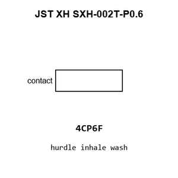

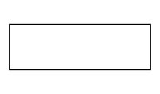

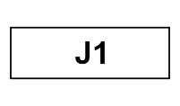

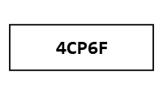

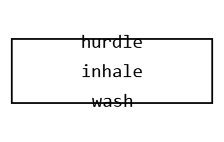

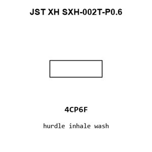

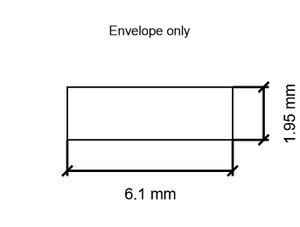

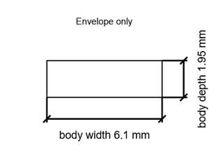

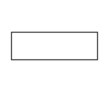

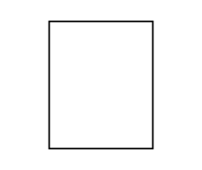

[View this part on GitHub](https://github.com/oomlout/oomp_electronic_version_5/tree/main/parts/electronic_connector_jst_xh_2_5_mm_pitch_crimp_1_pin_socket_26_to_30_awg_tin_jst_sxh_002t_p0_6)

[Browse this category](../../navigation/electronic/connector/jst_xh/2_5_mm_pitch/crimp/1_pin/socket/26_to_30_awg/tin/jst/README.md)

---

This page is generated from the OOMP part definition by a Roboclick Jinja template. Edit the source taxonomy or template rather than this generated file.