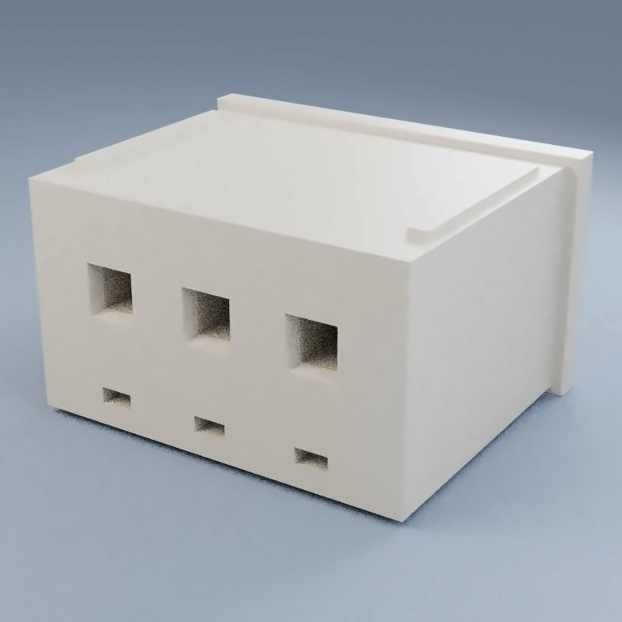
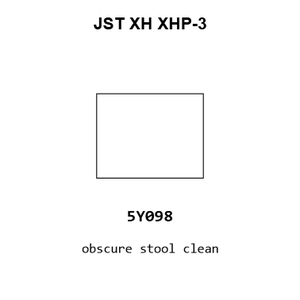
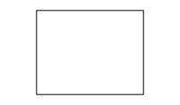
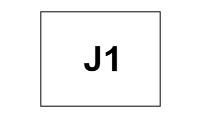
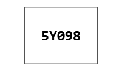
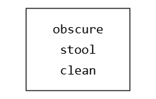
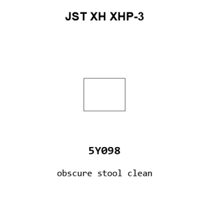
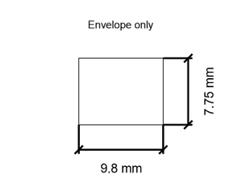
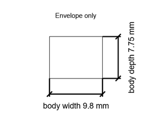
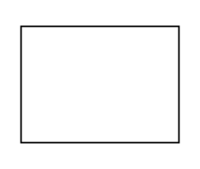

# JST XH 2.5 mm 3-position white housing (XHP-3)

`electronic_connector_jst_xh_2_5_mm_pitch_housing_3_pin_white_jst_xhp_3`

JST XH 2.5 mm 3-position white housing (XHP-3) is an OOMP electronic connector definition. It uses the jst xh package or form factor. Its nominal drawing size is 9.8 &#x00D7; 7.75 mm.

Nominal drawing spans. See the manufacturer's drawing for feature dimensions and crimp tooling.

## At a glance

| Detail | Value |
| --- | --- |
| OOMP ID | `electronic_connector_jst_xh_2_5_mm_pitch_housing_3_pin_white_jst_xhp_3` |
| Type | Connector |
| Package / style | jst xh |
| Nominal size | 9.8 &#x00D7; 7.75 mm |

## Classification

| Level | Value |
| --- | --- |
| 1 | `electronic` |
| 2 | `connector` |
| 3 | `jst_xh` |
| 4 | `2_5_mm_pitch` |
| 5 | `housing` |
| 6 | `3_pin` |
| 7 | `white` |
| 14 | `jst` |
| 15 | `xhp_3` |

## 3D reference model

[Download STEP](data/model_3d.step) · [Model source and limitations](data/model_3d_source.yaml)

OOMP model based on the manufacturer drawing, with nominal outer dimensions and simplified internal geometry. Use it for layout and illustration.

## Connector details

| Detail | Value |
| --- | --- |
| Component Role | Empty insulating housing with contacts supplied separately |
| Contacts Required | 3, sold separately |
| Housing Color | Natural (white) |
| Housing Material | PA 6 |
| Pitch | 2.5 mm |
| Positions | 3, single row |
| Series | JST XH |

## Compatible components

- **Contact option:** [JST XH crimp socket 26&#x2013;22 AWG, tin (SXH-001T-P0.6N)](../electronic_connector_jst_xh_2_5_mm_pitch_crimp_1_pin_socket_22_to_26_awg_tin_jst_sxh_001t_p0_6n/README.md) — quantity 3.
  Quantity fills the active cavities. Select the contact for the wire gauge and insulation diameter. [Manufacturer evidence](https://www.jst-mfg.com/product/pdf/eng/eXH.pdf).

- **Contact option:** [JST XH crimp socket 30&#x2013;26 AWG, tin (SXH-002T-P0.6)](../electronic_connector_jst_xh_2_5_mm_pitch_crimp_1_pin_socket_26_to_30_awg_tin_jst_sxh_002t_p0_6/README.md) — quantity 3.
  Quantity fills the active cavities. Select the contact for the wire gauge and insulation diameter. [Manufacturer evidence](https://www.jst-mfg.com/product/pdf/eng/eXH.pdf).

- **Contact option:** [JST XH crimp socket 28&#x2013;22 AWG, tin (SXH-001T-P0.6)](../electronic_connector_jst_xh_2_5_mm_pitch_crimp_1_pin_socket_22_to_28_awg_tin_jst_sxh_001t_p0_6/README.md) — quantity 3.
  Quantity fills the active cavities. Select the contact for the wire gauge and insulation diameter. [Manufacturer evidence](https://www.jst-mfg.com/product/pdf/eng/eXH.pdf).

## Nominal dimensions

| Measurement | Value |
| --- | ---: |
| Height | 5.7 mm |
| Length | 9.8 mm |
| Width | 7.75 mm |

## Identifiers

| Identifier | Value |
| --- | --- |
| Manufacturer part number | `XHP-3` |

## Datasheet

[View the datasheet](data/datasheet.pdf)

## Used in projects

[Browse confirmed project usage](https://oomlout.github.io/oomp_electronic_project_version_5/usage/index.html#electronic_connector_jst_xh_2_5_mm_pitch_housing_3_pin_white_jst_xhp_3)

## Files

[KiCad applicability: cable component, no PCB footprint](data/kicad/README.md) · [Applicability record](data/kicad/manifest.yaml)

[View this part on GitHub](https://github.com/oomlout/oomp_electronic_version_5/tree/main/parts/electronic_connector_jst_xh_2_5_mm_pitch_housing_3_pin_white_jst_xhp_3)

[Browse this category](../../navigation/electronic/connector/jst_xh/2_5_mm_pitch/housing/3_pin/white/jst/README.md)

---

This page is generated from the OOMP part definition by a Roboclick Jinja template. Edit the source taxonomy or template rather than this generated file.