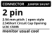

# Connector Jumper Shunt 2.54Short Circuit Cap Opening

`electronic_connector_jumper_shunt_2_54_mm_pitch_open_style_2_pin_boomele_boom_precision_elec_2_54short_circuit_cap_opening`

Connector Jumper Shunt 2.54Short Circuit Cap Opening is an OOMP electronic connector definition. It uses the jumper shunt package or form factor. Its nominal drawing size is 10.0 &#x00D7; 5.0 mm.

## At a glance

| Detail | Value |
| --- | --- |
| OOMP ID | `electronic_connector_jumper_shunt_2_54_mm_pitch_open_style_2_pin_boomele_boom_precision_elec_2_54short_circuit_cap_opening` |
| Type | Connector |
| Package / style | jumper shunt |
| Nominal size | 10.0 &#x00D7; 5.0 mm |

## Classification

| Level | Value |
| --- | --- |
| 1 | `electronic` |
| 2 | `connector` |
| 3 | `jumper_shunt` |
| 4 | `2_54_mm_pitch` |
| 5 | `open_style` |
| 6 | `2_pin` |
| 14 | `boomele_boom_precision_elec` |
| 15 | `2_54short_circuit_cap_opening` |

## Nominal dimensions

| Measurement | Value |
| --- | ---: |
| Length | 10.0 mm |
| Width | 5.0 mm |

## Identifiers

| Identifier | Value |
| --- | --- |
| Manufacturer part number | `2.54Short Circuit Cap Opening` |
| LCSC | [`C5305`](https://www.lcsc.com/product-detail/C5305.html) |
| JLCPCB | [`C5305`](https://jlcpcb.com/partdetail/5732-2_54Short_Circuit_CapOpening/C5305) |

## Used in projects

[Browse confirmed project usage](https://oomlout.github.io/oomp_electronic_project_version_5/usage/index.html#electronic_connector_jumper_shunt_2_54_mm_pitch_open_style_2_pin_boomele_boom_precision_elec_2_54short_circuit_cap_opening)

## Files

<!-- oomp-part-file-table -->

| Image type | Image | Link |
| --- | :---: | --- |
| **Drawer label data** | — | [YAML](data/label_drawer.yaml) |
| **Small drawer label** |  | [SVG](label_drawer_1_5x1.svg) |
| **Large drawer label** |  | [SVG](label_drawer_3x2.svg) |
| **Part definition and build recipe** | — | [YAML](working.yaml) |

<!-- /oomp-part-file-table -->

[View this part on GitHub](https://github.com/oomlout/oomp_electronic_version_5/tree/main/parts/electronic_connector_jumper_shunt_2_54_mm_pitch_open_style_2_pin_boomele_boom_precision_elec_2_54short_circuit_cap_opening)

[Browse this category](../../navigation/electronic/connector/jumper_shunt/2_54_mm_pitch/open_style/2_pin/boomele_boom_precision_elec/README.md)

---

This page is generated from the OOMP part definition by a Roboclick Jinja template. Edit the source taxonomy or template rather than this generated file.