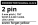
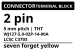

# Connector Terminal Block WJ127-5.0-02P-14-00A

`electronic_connector_terminal_block_5_mm_pitch_through_hole_2_pin`

Connector Terminal Block WJ127-5.0-02P-14-00A is an OOMP electronic connector definition. It uses the terminal block package or form factor. Its nominal drawing size is 10.0 &#x00D7; 5.0 mm. The definition includes 2 documented pins.

## At a glance

| Detail | Value |
| --- | --- |
| OOMP ID | `electronic_connector_terminal_block_5_mm_pitch_through_hole_2_pin` |
| Type | Connector |
| Package / style | terminal block |
| Nominal size | 10.0 &#x00D7; 5.0 mm |
| Documented pins | 2 |

## Classification

| Level | Value |
| --- | --- |
| 1 | `electronic` |
| 2 | `connector` |
| 3 | `terminal_block` |
| 4 | `5_mm_pitch` |
| 5 | `through_hole` |
| 6 | `2_pin` |

## Nominal dimensions

| Measurement | Value |
| --- | ---: |
| Length | 10.0 mm |
| Width | 5.0 mm |

## Identifiers

| Identifier | Value |
| --- | --- |
| Manufacturer part number | `WJ127-5.0-02P-14-00A` |
| LCSC | [`C3703`](https://www.lcsc.com/product-detail/C3703.html) |
| JLCPCB | [`C3703`](https://jlcpcb.com/partdetail/4105-WJ127_5_0_02P_1400A/C3703) |

## Pins

| Pin | Name | Type |
| ---: | --- | --- |
| 1 | 1 | passive |
| 2 | 2 | passive |

## Used in projects

[Browse confirmed project usage](https://oomlout.github.io/oomp_electronic_project_version_5/usage/index.html#electronic_connector_terminal_block_5_mm_pitch_through_hole_2_pin)

## Files

<!-- oomp-part-file-table -->

| Image type | Image | Link |
| --- | :---: | --- |
| **Drawer label data** | — | [YAML](data/label_drawer.yaml) |
| **Small drawer label** |  | [SVG](label_drawer_1_5x1.svg) |
| **Large drawer label** |  | [SVG](label_drawer_3x2.svg) |
| **Part definition and build recipe** | — | [YAML](working.yaml) |

<!-- /oomp-part-file-table -->

[View this part on GitHub](https://github.com/oomlout/oomp_electronic_version_5/tree/main/parts/electronic_connector_terminal_block_5_mm_pitch_through_hole_2_pin)

[Browse this category](../../navigation/electronic/connector/terminal_block/5_mm_pitch/through_hole/README.md)

---

This page is generated from the OOMP part definition by a Roboclick Jinja template. Edit the source taxonomy or template rather than this generated file.