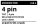
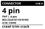

# Connector USB-A 903-232A1011D10100

`electronic_connector_usb_a_through_hole_4_pin_right_angle_jing_extension_of_the_electronic_co_903_232a1011d10100`

Connector USB-A 903-232A1011D10100 is an OOMP electronic connector definition. It uses the usb a package or form factor. Its nominal drawing size is 14.3 &#x00D7; 10.6 mm.

## At a glance

| Detail | Value |
| --- | --- |
| OOMP ID | `electronic_connector_usb_a_through_hole_4_pin_right_angle_jing_extension_of_the_electronic_co_903_232a1011d10100` |
| Type | Connector |
| Package / style | usb a |
| Nominal size | 14.3 &#x00D7; 10.6 mm |

## Classification

| Level | Value |
| --- | --- |
| 1 | `electronic` |
| 2 | `connector` |
| 3 | `usb_a` |
| 4 | `through_hole` |
| 5 | `4_pin` |
| 6 | `right_angle` |
| 14 | `jing_extension_of_the_electronic_co` |
| 15 | `903_232a1011d10100` |

## Nominal dimensions

| Measurement | Value |
| --- | ---: |
| Length | 14.3 mm |
| Width | 10.6 mm |

## Identifiers

| Identifier | Value |
| --- | --- |
| Manufacturer part number | `903-232A1011D10100` |
| LCSC | [`C5393`](https://www.lcsc.com/product-detail/C5393.html) |
| JLCPCB | [`C5393`](https://jlcpcb.com/partdetail/5830-903232A1011D10100/C5393) |

## Used in projects

[Browse confirmed project usage](https://oomlout.github.io/oomp_electronic_project_version_5/usage/index.html#electronic_connector_usb_a_through_hole_4_pin_right_angle_jing_extension_of_the_electronic_co_903_232a1011d10100)

## Files

<!-- oomp-part-file-table -->

| Image type | Image | Link |
| --- | :---: | --- |
| **Drawer label data** | — | [YAML](data/label_drawer.yaml) |
| **Small drawer label** |  | [SVG](label_drawer_1_5x1.svg) |
| **Large drawer label** |  | [SVG](label_drawer_3x2.svg) |
| **Part definition and build recipe** | — | [YAML](working.yaml) |

<!-- /oomp-part-file-table -->

[View this part on GitHub](https://github.com/oomlout/oomp_electronic_version_5/tree/main/parts/electronic_connector_usb_a_through_hole_4_pin_right_angle_jing_extension_of_the_electronic_co_903_232a1011d10100)

[Browse this category](../../navigation/electronic/connector/usb_a/through_hole/4_pin/right_angle/jing_extension_of_the_electronic_co/README.md)

---

This page is generated from the OOMP part definition by a Roboclick Jinja template. Edit the source taxonomy or template rather than this generated file.