# Crystal 8 MHz 20 pF 5032 2-pin

`electronic_crystal_5032_surface_mount_2_pin_8_mhz_20_pf`

Crystal 8 MHz 20 pF 5032 2-pin is an OOMP electronic crystal definition. It uses the 5032 package or form factor. Its nominal drawing size is 5.0 &#x00D7; 3.2 mm. The definition includes 2 documented pins.

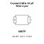

## At a glance

| Detail | Value |
| --- | --- |
| OOMP ID | `electronic_crystal_5032_surface_mount_2_pin_8_mhz_20_pf` |
| Type | Crystal |
| Package / style | 5032 |
| Nominal size | 5.0 &#x00D7; 3.2 mm |
| Documented pins | 2 |

## Classification

| Level | Value |
| --- | --- |
| 1 | `electronic` |
| 2 | `crystal` |
| 3 | `5032` |
| 4 | `surface_mount` |
| 5 | `2_pin` |
| 6 | `8_mhz` |
| 7 | `20_pf` |

## Nominal dimensions

| Measurement | Value |
| --- | ---: |
| Length | 5.0 mm |
| Width | 3.2 mm |

## Identifiers

| Identifier | Value |
| --- | --- |
| Manufacturer part number | `X50328MSB2GI` |
| LCSC | [`C115962`](https://www.lcsc.com/product-detail/C115962.html) |
| JLCPCB | [`C115962`](https://jlcpcb.com/partdetail/YXC_CrystalOscillators-X50328MSB2GI/C115962) |

## Pins

| Pin | Name | Type |
| ---: | --- | --- |
| 1 | 1 | signal |
| 2 | 2 | signal |

## Datasheet

[View the datasheet](data/datasheet.pdf)

## Used in projects

[Browse confirmed project usage](https://oomlout.github.io/oomp_electronic_project_version_5/usage/index.html#electronic_crystal_5032_surface_mount_2_pin_8_mhz_20_pf)

## Files

[KiCad symbol, machine-solder and hand-solder footprints](data/kicad/README.md) · [Availability and source masters](data/kicad/manifest.yaml)

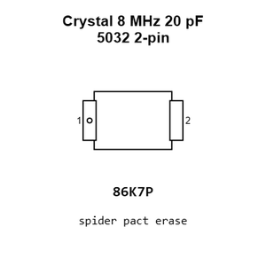

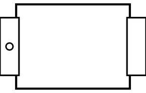

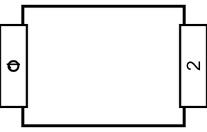

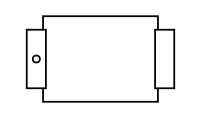

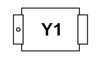

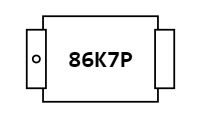

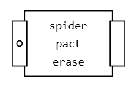

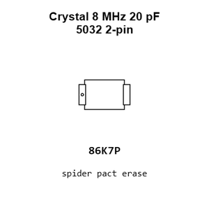

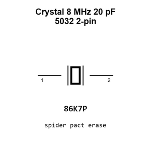

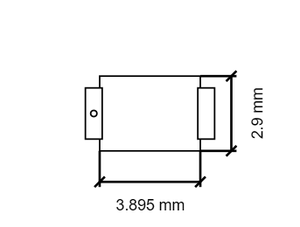

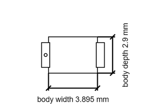

[View this part on GitHub](https://github.com/oomlout/oomp_electronic_version_5/tree/main/parts/electronic_crystal_5032_surface_mount_2_pin_8_mhz_20_pf)

[Browse this category](../../navigation/electronic/crystal/5032/surface_mount/2_pin/8_mhz/README.md)

---

This page is generated from the OOMP part definition by a Roboclick Jinja template. Edit the source taxonomy or template rather than this generated file.