# Crystal 32.768 kHz 12.5 pF DT_26 2-pin

`electronic_crystal_dt_26_through_hole_2_pin_32_768_khz_12_5_pf_50000_ohm_esr`

Crystal 32.768 kHz 12.5 pF DT_26 2-pin is an OOMP electronic crystal definition. It uses the dt 26 package or form factor. Its nominal drawing size is 6.0 &#x00D7; 2.1 mm. The definition includes 2 documented pins.

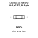

## At a glance

| Detail | Value |
| --- | --- |
| OOMP ID | `electronic_crystal_dt_26_through_hole_2_pin_32_768_khz_12_5_pf_50000_ohm_esr` |
| Type | Crystal |
| Package / style | dt 26 |
| Nominal size | 6.0 &#x00D7; 2.1 mm |
| Documented pins | 2 |

## Classification

| Level | Value |
| --- | --- |
| 1 | `electronic` |
| 2 | `crystal` |
| 3 | `dt_26` |
| 4 | `through_hole` |
| 5 | `2_pin` |
| 6 | `32_768_khz` |
| 7 | `12_5_pf` |
| 8 | `50000_ohm_esr` |

## Nominal dimensions

| Measurement | Value |
| --- | ---: |
| Height | 5.5 mm |
| Length | 6.0 mm |
| Width | 2.1 mm |

## Identifiers

| Identifier | Value |
| --- | --- |
| Manufacturer part number | `X206032768KGB2SC` |
| LCSC | [`C2236`](https://www.lcsc.com/product-detail/C2236.html) |
| JLCPCB | [`C2236`](https://jlcpcb.com/partdetail/2605-X206032768KGB2SC/C2236) |

## Pins

| Pin | Name | Type |
| ---: | --- | --- |
| 1 | 1 | passive |
| 2 | 2 | passive |

## Datasheet

[View the datasheet](data/datasheet.pdf)

## Files

[KiCad symbol, machine-solder and hand-solder footprints](data/kicad/README.md) · [Availability and source masters](data/kicad/manifest.yaml)

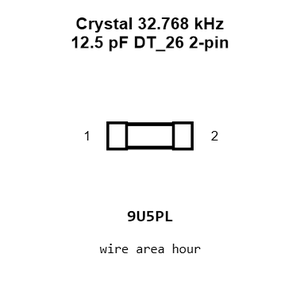

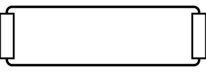

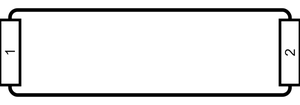

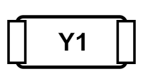

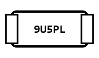

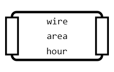

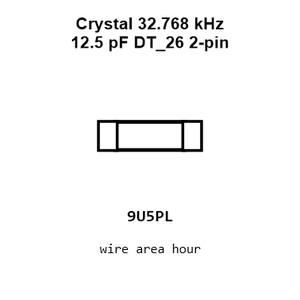

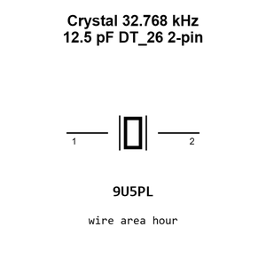

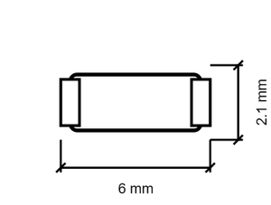

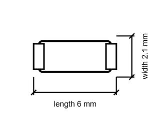

[View this part on GitHub](https://github.com/oomlout/oomp_electronic_version_5/tree/main/parts/electronic_crystal_dt_26_through_hole_2_pin_32_768_khz_12_5_pf_50000_ohm_esr)

[Browse this category](../../navigation/electronic/crystal/dt_26/through_hole/2_pin/32_768_khz/12_5_pf/README.md)

---

This page is generated from the OOMP part definition by a Roboclick Jinja template. Edit the source taxonomy or template rather than this generated file.