# Crystal 3.6864 MHz 20 pF HC_49S_SMD 2-pin

`electronic_crystal_hc_49s_smd_surface_mount_2_pin_3_6864_mhz_20_pf_160_ohm_esr`

Crystal 3.6864 MHz 20 pF HC_49S_SMD 2-pin is an OOMP electronic crystal definition. It uses the hc 49s smd package or form factor. Its nominal drawing size is 11.4 &#x00D7; 4.8 mm. The definition includes 2 documented pins.

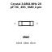

## At a glance

| Detail | Value |
| --- | --- |
| OOMP ID | `electronic_crystal_hc_49s_smd_surface_mount_2_pin_3_6864_mhz_20_pf_160_ohm_esr` |
| Type | Crystal |
| Package / style | hc 49s smd |
| Nominal size | 11.4 &#x00D7; 4.8 mm |
| Documented pins | 2 |

## Classification

| Level | Value |
| --- | --- |
| 1 | `electronic` |
| 2 | `crystal` |
| 3 | `hc_49s_smd` |
| 4 | `surface_mount` |
| 5 | `2_pin` |
| 6 | `3_6864_mhz` |
| 7 | `20_pf` |
| 8 | `160_ohm_esr` |

## Nominal dimensions

| Measurement | Value |
| --- | ---: |
| Height | 3.8 mm |
| Length | 11.4 mm |
| Width | 4.8 mm |

## Identifiers

| Identifier | Value |
| --- | --- |
| Manufacturer part number | `X49SM36864MSD2SC-1` |
| LCSC | [`C2238`](https://www.lcsc.com/product-detail/C2238.html) |
| JLCPCB | [`C2238`](https://jlcpcb.com/partdetail/2607-X49SM36864MSD2SC1/C2238) |

## Pins

| Pin | Name | Type |
| ---: | --- | --- |
| 1 | 1 | passive |
| 2 | 2 | passive |

## Datasheet

[View the datasheet](data/datasheet.pdf)

## Files

[KiCad symbol, machine-solder and hand-solder footprints](data/kicad/README.md) · [Availability and source masters](data/kicad/manifest.yaml)

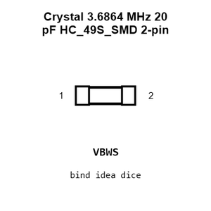

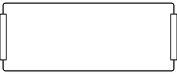

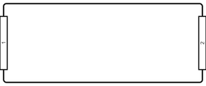

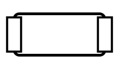

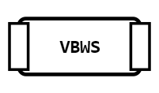

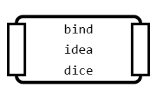

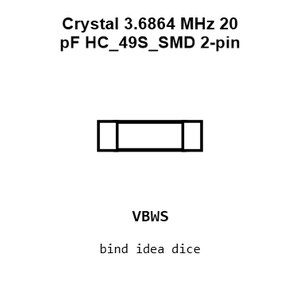

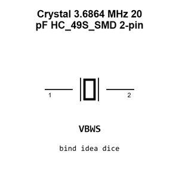

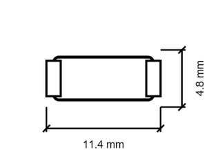

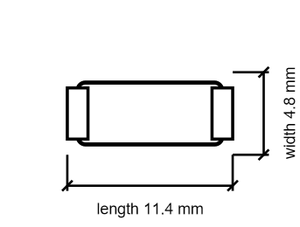

[View this part on GitHub](https://github.com/oomlout/oomp_electronic_version_5/tree/main/parts/electronic_crystal_hc_49s_smd_surface_mount_2_pin_3_6864_mhz_20_pf_160_ohm_esr)

[Browse this category](../../navigation/electronic/crystal/hc_49s_smd/surface_mount/2_pin/3_6864_mhz/20_pf/README.md)

---

This page is generated from the OOMP part definition by a Roboclick Jinja template. Edit the source taxonomy or template rather than this generated file.