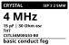

# Crystal 4 MHz 15 pF SIP_3_2_5MM

`electronic_crystal_sip_3_2_5mm_through_hole_ceramic_resonator_4_mhz_15_pf_30_ohm_esr_murata_electronics_cstls4m00g53_b0`

Crystal 4 MHz 15 pF SIP_3_2_5MM is an OOMP electronic crystal definition. It uses the sip 3 2 5mm package or form factor. Its nominal drawing size is 10.0 &#x00D7; 5.0 mm.

## At a glance

| Detail | Value |
| --- | --- |
| OOMP ID | `electronic_crystal_sip_3_2_5mm_through_hole_ceramic_resonator_4_mhz_15_pf_30_ohm_esr_murata_electronics_cstls4m00g53_b0` |
| Type | Crystal |
| Package / style | sip 3 2 5mm |
| Nominal size | 10.0 &#x00D7; 5.0 mm |

## Classification

| Level | Value |
| --- | --- |
| 1 | `electronic` |
| 2 | `crystal` |
| 3 | `sip_3_2_5mm` |
| 4 | `through_hole` |
| 5 | `ceramic_resonator` |
| 6 | `4_mhz` |
| 7 | `15_pf` |
| 8 | `30_ohm_esr` |
| 14 | `murata_electronics` |
| 15 | `cstls4m00g53_b0` |

## Nominal dimensions

| Measurement | Value |
| --- | ---: |
| Length | 10.0 mm |
| Width | 5.0 mm |

## Identifiers

| Identifier | Value |
| --- | --- |
| Manufacturer part number | `CSTLS4M00G53-B0` |
| LCSC | [`C2284`](https://www.lcsc.com/product-detail/C2284.html) |
| JLCPCB | [`C2284`](https://jlcpcb.com/partdetail/MurataElectronics-CSTLS4M00G53B0/C2284) |

## Used in projects

[Browse confirmed project usage](https://oomlout.github.io/oomp_electronic_project_version_5/usage/index.html#electronic_crystal_sip_3_2_5mm_through_hole_ceramic_resonator_4_mhz_15_pf_30_ohm_esr_murata_electronics_cstls4m00g53_b0)

## Files

<!-- oomp-part-file-table -->

| Image type | Image | Link |
| --- | :---: | --- |
| **Drawer label data** | — | [YAML](data/label_drawer.yaml) |
| **Small drawer label** |  | [SVG](label_drawer_1_5x1.svg) |
| **Large drawer label** |  | [SVG](label_drawer_3x2.svg) |
| **Part definition and build recipe** | — | [YAML](working.yaml) |

<!-- /oomp-part-file-table -->

[View this part on GitHub](https://github.com/oomlout/oomp_electronic_version_5/tree/main/parts/electronic_crystal_sip_3_2_5mm_through_hole_ceramic_resonator_4_mhz_15_pf_30_ohm_esr_murata_electronics_cstls4m00g53_b0)

[Browse this category](../../navigation/electronic/crystal/sip_3_2_5mm/through_hole/ceramic_resonator/4_mhz/15_pf/30_ohm_esr/murata_electronics/README.md)

---

This page is generated from the OOMP part definition by a Roboclick Jinja template. Edit the source taxonomy or template rather than this generated file.