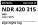
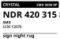

# Crystal SMD_5050_8P

`electronic_crystal_smd_5050_8p_surface_mount_saw_resonator_made_in_china_ndr_420_315_8p`

Crystal SMD_5050_8P is an OOMP electronic crystal definition. It uses the smd 5050 8p package or form factor. Its nominal drawing size is 10.0 &#x00D7; 5.0 mm.

## At a glance

| Detail | Value |
| --- | --- |
| OOMP ID | `electronic_crystal_smd_5050_8p_surface_mount_saw_resonator_made_in_china_ndr_420_315_8p` |
| Type | Crystal |
| Package / style | smd 5050 8p |
| Nominal size | 10.0 &#x00D7; 5.0 mm |

## Classification

| Level | Value |
| --- | --- |
| 1 | `electronic` |
| 2 | `crystal` |
| 3 | `smd_5050_8p` |
| 4 | `surface_mount` |
| 5 | `saw_resonator` |
| 14 | `made_in_china` |
| 15 | `ndr_420_315_8p` |

## Nominal dimensions

| Measurement | Value |
| --- | ---: |
| Length | 10.0 mm |
| Width | 5.0 mm |

## Identifiers

| Identifier | Value |
| --- | --- |
| Manufacturer part number | `NDR 420 315 8P` |
| LCSC | [`C2275`](https://www.lcsc.com/product-detail/C2275.html) |
| JLCPCB | [`C2275`](https://jlcpcb.com/partdetail/Made_inChina-NDR_420_3158P/C2275) |

## Used in projects

[Browse confirmed project usage](https://oomlout.github.io/oomp_electronic_project_version_5/usage/index.html#electronic_crystal_smd_5050_8p_surface_mount_saw_resonator_made_in_china_ndr_420_315_8p)

## Files

<!-- oomp-part-file-table -->

| Image type | Image | Link |
| --- | :---: | --- |
| **Drawer label data** | — | [YAML](data/label_drawer.yaml) |
| **Small drawer label** |  | [SVG](label_drawer_1_5x1.svg) |
| **Large drawer label** |  | [SVG](label_drawer_3x2.svg) |
| **Part definition and build recipe** | — | [YAML](working.yaml) |

<!-- /oomp-part-file-table -->

[View this part on GitHub](https://github.com/oomlout/oomp_electronic_version_5/tree/main/parts/electronic_crystal_smd_5050_8p_surface_mount_saw_resonator_made_in_china_ndr_420_315_8p)

[Browse this category](../../navigation/electronic/crystal/smd_5050_8p/surface_mount/saw_resonator/made_in_china/README.md)

---

This page is generated from the OOMP part definition by a Roboclick Jinja template. Edit the source taxonomy or template rather than this generated file.