# Diode BZT52C5V1S W8 SOD-323

`electronic_diode_zener_sod_323_jiangsu_changjing_electronics_technology_co_ltd_bzt52c5v1s_w8`

Diode BZT52C5V1S W8 SOD-323 is an OOMP electronic diode definition. It uses the sod 323 package or form factor. Its nominal drawing size is 10.0 &#x00D7; 5.0 mm.

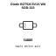

## At a glance

| Detail | Value |
| --- | --- |
| OOMP ID | `electronic_diode_zener_sod_323_jiangsu_changjing_electronics_technology_co_ltd_bzt52c5v1s_w8` |
| Type | Diode |
| Package / style | sod 323 |
| Nominal size | 10.0 &#x00D7; 5.0 mm |

## Classification

| Level | Value |
| --- | --- |
| 1 | `electronic` |
| 2 | `diode` |
| 3 | `zener` |
| 4 | `sod_323` |
| 14 | `jiangsu_changjing_electronics_technology_co_ltd` |
| 15 | `bzt52c5v1s_w8` |

## Nominal dimensions

| Measurement | Value |
| --- | ---: |
| Length | 10.0 mm |
| Width | 5.0 mm |

## Identifiers

| Identifier | Value |
| --- | --- |
| Manufacturer part number | `BZT52C5V1S W8` |
| LCSC | [`C2118`](https://www.lcsc.com/product-detail/C2118.html) |
| JLCPCB | [`C2118`](https://jlcpcb.com/partdetail/2475-BZT52C5V1SW8/C2118) |

## Datasheet

[View the datasheet](data/datasheet.pdf)

## Used in projects

[Browse confirmed project usage](https://oomlout.github.io/oomp_electronic_project_version_5/usage/index.html#electronic_diode_zener_sod_323_jiangsu_changjing_electronics_technology_co_ltd_bzt52c5v1s_w8)

## Files

[KiCad symbol, machine-solder and hand-solder footprints](data/kicad/README.md) · [Availability and source masters](data/kicad/manifest.yaml)

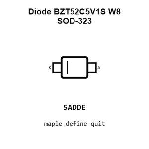

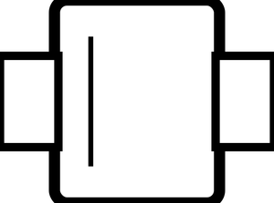

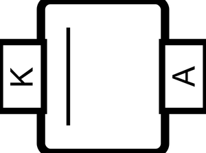

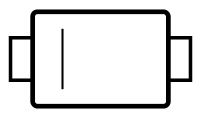

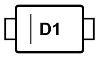

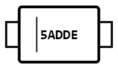

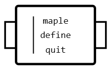

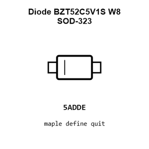

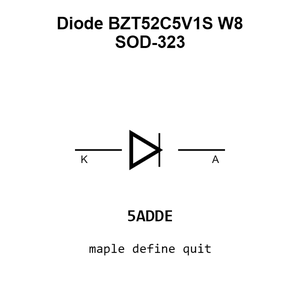

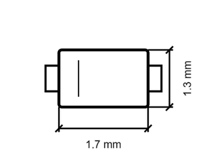

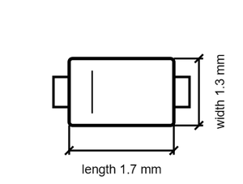

[View this part on GitHub](https://github.com/oomlout/oomp_electronic_version_5/tree/main/parts/electronic_diode_zener_sod_323_jiangsu_changjing_electronics_technology_co_ltd_bzt52c5v1s_w8)

[Browse this category](../../navigation/electronic/diode/zener/sod_323/jiangsu_changjing_electronics_technology_co_ltd/README.md)

---

This page is generated from the OOMP part definition by a Roboclick Jinja template. Edit the source taxonomy or template rather than this generated file.