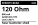
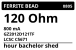

# Ferrite Bead GZ2012D121TF 0805

`electronic_ferrite_bead_0805_120_ohm_800_milliamp_sunlord_gz2012d121tf`

Ferrite Bead GZ2012D121TF 0805 is an OOMP electronic ferrite bead definition. It uses the 0805 package or form factor. Its nominal drawing size is 2.0 &#x00D7; 1.25 mm.

## At a glance

| Detail | Value |
| --- | --- |
| OOMP ID | `electronic_ferrite_bead_0805_120_ohm_800_milliamp_sunlord_gz2012d121tf` |
| Type | Ferrite Bead |
| Package / style | 0805 |
| Nominal size | 2.0 &#x00D7; 1.25 mm |

## Classification

| Level | Value |
| --- | --- |
| 1 | `electronic` |
| 2 | `ferrite_bead` |
| 3 | `0805` |
| 4 | `120_ohm` |
| 5 | `800_milliamp` |
| 14 | `sunlord` |
| 15 | `gz2012d121tf` |

## Nominal dimensions

| Measurement | Value |
| --- | ---: |
| Length | 2.0 mm |
| Width | 1.25 mm |

## Identifiers

| Identifier | Value |
| --- | --- |
| Manufacturer part number | `GZ2012D121TF` |
| LCSC | [`C5671`](https://www.lcsc.com/product-detail/C5671.html) |
| JLCPCB | [`C5671`](https://jlcpcb.com/partdetail/Sunlord-GZ2012D121TF/C5671) |

## Used in projects

[Browse confirmed project usage](https://oomlout.github.io/oomp_electronic_project_version_5/usage/index.html#electronic_ferrite_bead_0805_120_ohm_800_milliamp_sunlord_gz2012d121tf)

## Files

<!-- oomp-part-file-table -->

| Image type | Image | Link |
| --- | :---: | --- |
| **Drawer label data** | — | [YAML](data/label_drawer.yaml) |
| **Small drawer label** |  | [SVG](label_drawer_1_5x1.svg) |
| **Large drawer label** |  | [SVG](label_drawer_3x2.svg) |
| **Part definition and build recipe** | — | [YAML](working.yaml) |

<!-- /oomp-part-file-table -->

[View this part on GitHub](https://github.com/oomlout/oomp_electronic_version_5/tree/main/parts/electronic_ferrite_bead_0805_120_ohm_800_milliamp_sunlord_gz2012d121tf)

[Browse this category](../../navigation/electronic/ferrite_bead/0805/120_ohm/800_milliamp/sunlord/README.md)

---

This page is generated from the OOMP part definition by a Roboclick Jinja template. Edit the source taxonomy or template rather than this generated file.