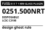

# Fuse 0251.500NRT1L 2 8 X 7 1 MM GLASS PLUGIN

`electronic_fuse_2_8_x_7_1_mm_glass_plugin_disposable_littelfuse_0251_500nrt1l`

Fuse 0251.500NRT1L 2 8 X 7 1 MM GLASS PLUGIN is an OOMP electronic fuse definition. It uses the 2 8 x 7 1 mm glass plugin package or form factor. Its nominal drawing size is 10.0 &#x00D7; 5.0 mm.

## At a glance

| Detail | Value |
| --- | --- |
| OOMP ID | `electronic_fuse_2_8_x_7_1_mm_glass_plugin_disposable_littelfuse_0251_500nrt1l` |
| Type | Fuse |
| Package / style | 2 8 x 7 1 mm glass plugin |
| Nominal size | 10.0 &#x00D7; 5.0 mm |

## Classification

| Level | Value |
| --- | --- |
| 1 | `electronic` |
| 2 | `fuse` |
| 3 | `2_8_x_7_1_mm_glass_plugin` |
| 4 | `disposable` |
| 14 | `littelfuse` |
| 15 | `0251_500nrt1l` |

## Nominal dimensions

| Measurement | Value |
| --- | ---: |
| Length | 10.0 mm |
| Width | 5.0 mm |

## Identifiers

| Identifier | Value |
| --- | --- |
| Manufacturer part number | `0251.500NRT1L` |
| LCSC | [`C3108`](https://www.lcsc.com/product-detail/C3108.html) |
| JLCPCB | [`C3108`](https://jlcpcb.com/partdetail/Littelfuse-0251500NRT1L/C3108) |

## Used in projects

[Browse confirmed project usage](https://oomlout.github.io/oomp_electronic_project_version_5/usage/index.html#electronic_fuse_2_8_x_7_1_mm_glass_plugin_disposable_littelfuse_0251_500nrt1l)

## Files

<!-- oomp-part-file-table -->

| Image type | Image | Link |
| --- | :---: | --- |
| **Drawer label data** | — | [YAML](data/label_drawer.yaml) |
| **Small drawer label** |  | [SVG](label_drawer_1_5x1.svg) |
| **Large drawer label** |  | [SVG](label_drawer_3x2.svg) |
| **Part definition and build recipe** | — | [YAML](working.yaml) |

<!-- /oomp-part-file-table -->

[View this part on GitHub](https://github.com/oomlout/oomp_electronic_version_5/tree/main/parts/electronic_fuse_2_8_x_7_1_mm_glass_plugin_disposable_littelfuse_0251_500nrt1l)

[Browse this category](../../navigation/electronic/fuse/2_8_x_7_1_mm_glass_plugin/disposable/littelfuse/README.md)

---

This page is generated from the OOMP part definition by a Roboclick Jinja template. Edit the source taxonomy or template rather than this generated file.