# Fuse 5F.2000210000R1 5 2 X 20 MM GLASS PLUGIN

`electronic_fuse_5_2_x_20_mm_glass_plugin_disposable_xucheng_elec_5f_2000210000r1`

Fuse 5F.2000210000R1 5 2 X 20 MM GLASS PLUGIN is an OOMP electronic fuse definition. It uses the 5 2 x 20 mm glass plugin package or form factor. Its nominal drawing size is 20.0 &#x00D7; 5.2 mm. The definition includes 2 documented pins.

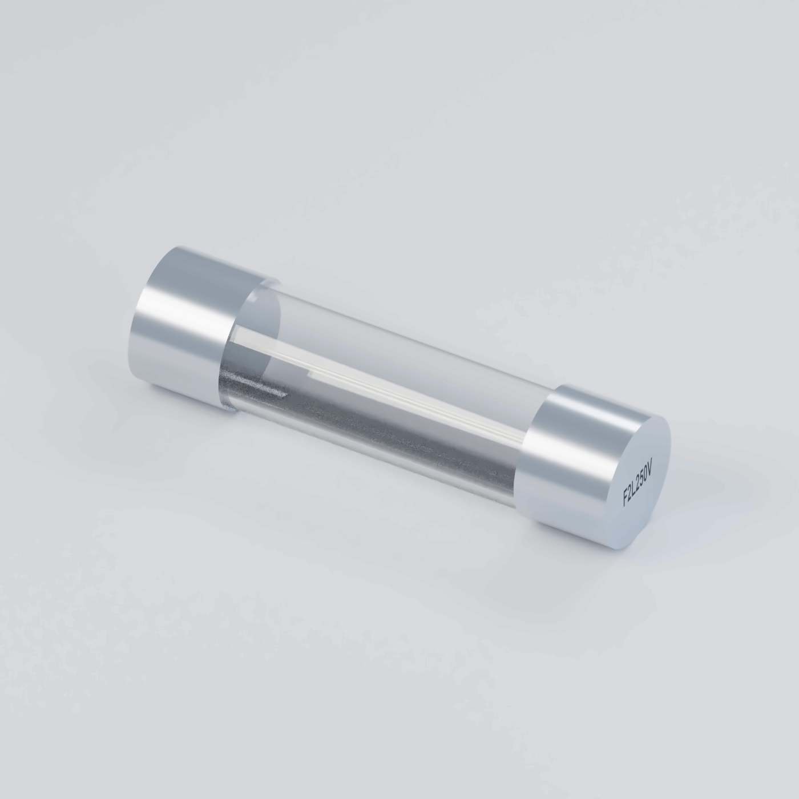

Transparent hollow glass fuse with visible alloy element and nickel-coloured caps, nominal 20 x 5.2 mm drawing dimensions. Source height 6.5 mm exceeds drawing diameter maximum 5.4 mm. Cap lengths, glass wall, wire size, finish and cap-mark placement are illustrative; logo and approval marks omitted. Display illustration only; not manufacturer CAD or a PCB footprint. Manufacturer cap marking F2L250V; typeface and placement illustrative; logo and approval marks omitted.

[Render recipe and provenance](data/display_render/manifest.json) · [KiCad model](https://github.com/oomlout/oomp_electronic_version_5/blob/main/kicad_agents/display_model_xucheng_5f_2a.py)

Model credit: Procedural model generated in this repository. Project source; procedural display geometry.

## At a glance

| Detail | Value |
| --- | --- |
| OOMP ID | `electronic_fuse_5_2_x_20_mm_glass_plugin_disposable_xucheng_elec_5f_2000210000r1` |
| Type | Fuse |
| Package / style | 5 2 x 20 mm glass plugin |
| Nominal size | 20.0 &#x00D7; 5.2 mm |
| Documented pins | 2 |

## Classification

| Level | Value |
| --- | --- |
| 1 | `electronic` |
| 2 | `fuse` |
| 3 | `5_2_x_20_mm_glass_plugin` |
| 4 | `disposable` |
| 14 | `xucheng_elec` |
| 15 | `5f_2000210000r1` |

## Nominal dimensions

| Measurement | Value |
| --- | ---: |
| Height | 6.5 mm |
| Length | 20.0 mm |
| Width | 5.2 mm |

## Identifiers

| Identifier | Value |
| --- | --- |
| Manufacturer part number | `5F.2000210000R1` |
| LCSC | [`C3117`](https://www.lcsc.com/product-detail/C3117.html) |
| JLCPCB | [`C3117`](https://jlcpcb.com/partdetail/XuchengElec-5F2000210000R1/C3117) |

## Pins

| Pin | Name | Type |
| ---: | --- | --- |
| 1 | 1 | passive |
| 2 | 2 | passive |

## Datasheet

[View the datasheet](data/datasheet.pdf)

## Used in projects

[Browse confirmed project usage](https://oomlout.github.io/oomp_electronic_project_version_5/usage/index.html#electronic_fuse_5_2_x_20_mm_glass_plugin_disposable_xucheng_elec_5f_2000210000r1)

## Files

<!-- oomp-part-file-table -->

| Image type | Image | Link |
| --- | :---: | --- |
| **Studio render** | 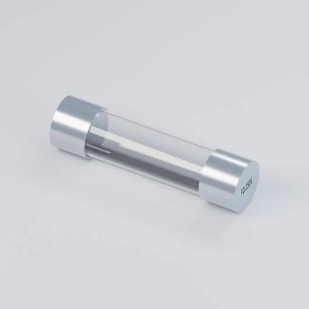 | [PNG](data/display_render/render.png) · [Preview](data/display_render/preview.webp) |
| **Pinout drawing** Pin names and positions on the part. | 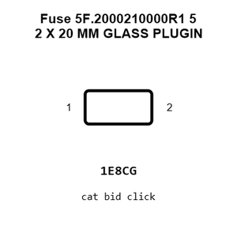 | [SVG](data/working_svg_square_pins.svg) · [PNG](data/working_svg_square_pins.png) · [Preview](data/working_svg_square_pins_300.png) |
| **Assembly** Component placement drawing. |  | [SVG](data/working_svg_assembly.svg) · [PNG](data/working_svg_assembly.png) · [Preview](data/working_svg_assembly_300.png) |
| **Assembly pinout** Placement drawing with the pins marked. |  | [SVG](data/working_svg_assembly_pins.svg) · [PNG](data/working_svg_assembly_pins.png) · [Preview](data/working_svg_assembly_pins_300.png) |
| **Outline** External shape of the part. | 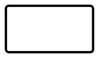 | [SVG](data/working_svg_outline.svg) · [PNG](data/working_svg_outline.png) · [Preview](data/working_svg_outline_300.png) |
| **Dimensions** Package outline with dimension arrows. | 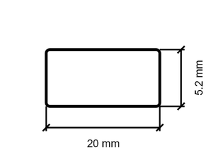 | [SVG](data/working_svg_dimensioned.svg) · [PNG](data/working_svg_dimensioned.png) · [Preview](data/working_svg_dimensioned_300.png) |
| **Dimensions with labels** Labelled package measurements. | 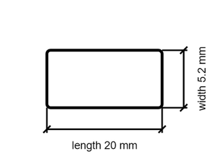 | [SVG](data/working_svg_dimensioned_titles.svg) · [PNG](data/working_svg_dimensioned_titles.png) · [Preview](data/working_svg_dimensioned_titles_300.png) |
| **Square summary** Component identification card. | 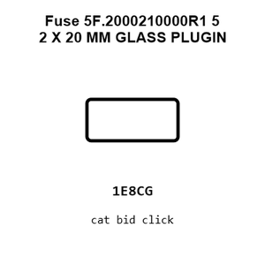 | [SVG](data/working_svg_square.svg) · [PNG](data/working_svg_square.png) · [Preview](data/working_svg_square_300.png) |
| **Square schematic** Schematic symbol on an identification card. | 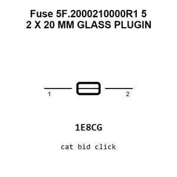 | [SVG](data/working_svg_square_schematic.svg) · [PNG](data/working_svg_square_schematic.png) · [Preview](data/working_svg_square_schematic_300.png) |
| **Part ID** Drawing labelled with the OOMP catalogue ID. | 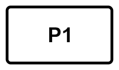 | [SVG](data/working_svg_part_id.svg) · [PNG](data/working_svg_part_id.png) · [Preview](data/working_svg_part_id_300.png) |
| **MD5 alpha** Drawing labelled with the short OOMP code. | 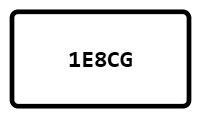 | [SVG](data/working_svg_md5_6_alpha.svg) · [PNG](data/working_svg_md5_6_alpha.png) · [Preview](data/working_svg_md5_6_alpha_300.png) |
| **BIP 39 words** Drawing labelled with the three-word identifier. | 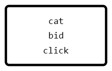 | [SVG](data/working_svg_bip_39_3_word.svg) · [PNG](data/working_svg_bip_39_3_word.png) · [Preview](data/working_svg_bip_39_3_word_300.png) |
| **Schematic** Electrical symbol for the part. | 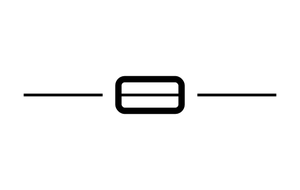 | [SVG](data/working_svg_schematic.svg) · [PNG](data/working_svg_schematic.png) · [Preview](data/working_svg_schematic_300.png) |
| **Schematic pinout** Electrical symbol with pin labels. | 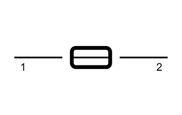 | [SVG](data/working_svg_schematic_pins.svg) · [PNG](data/working_svg_schematic_pins.png) · [Preview](data/working_svg_schematic_pins_300.png) |
| **Schematic with part ID** Symbol labelled with the OOMP catalogue ID. | 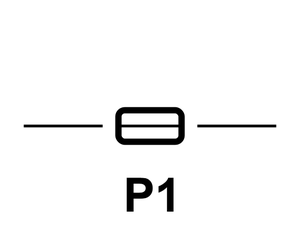 | [SVG](data/working_svg_schematic_part_id.svg) · [PNG](data/working_svg_schematic_part_id.png) · [Preview](data/working_svg_schematic_part_id_300.png) |
| **Schematic with MD5 alpha** Symbol labelled with the short OOMP code. | 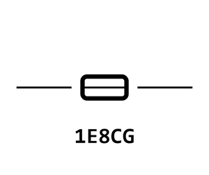 | [SVG](data/working_svg_schematic_md5_6_alpha.svg) · [PNG](data/working_svg_schematic_md5_6_alpha.png) · [Preview](data/working_svg_schematic_md5_6_alpha_300.png) |
| **Schematic with BIP 39 words** Symbol labelled with the three-word identifier. | 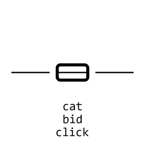 | [SVG](data/working_svg_schematic_bip_39_3_word.svg) · [PNG](data/working_svg_schematic_bip_39_3_word.png) · [Preview](data/working_svg_schematic_bip_39_3_word_300.png) |
| **Diagram contact sheet** Component drawings together in one image. | 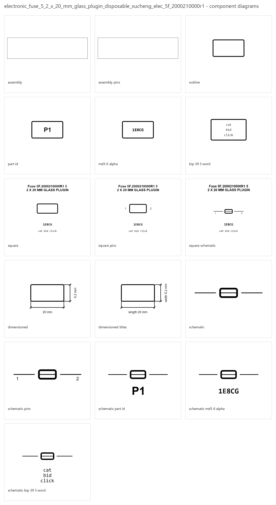 | [PNG](data/working_svg_contact_sheet.png) |
| **KiCad asset licence** | — | [MD](data/kicad/LICENSE.md) |
| **KiCad library guide** | — | [MD](data/kicad/README.md) |
| **KiCad symbol and footprint overview** | 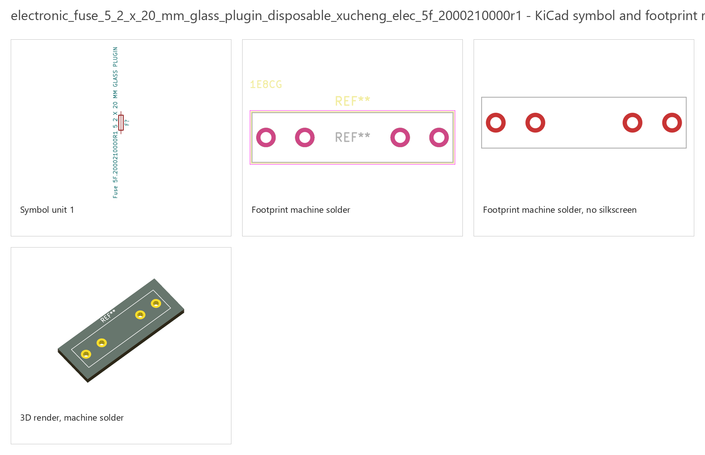 | [PNG](data/kicad/contact_sheet.png) |
| **KiCad symbol library** | — | [KICAD_SYM](data/kicad/electronic_fuse_5_2_x_20_mm_glass_plugin_disposable_xucheng_elec_5f_2000210000r1.kicad_sym) |
| **Hand-solder footprint guide** | — | [MD](data/kicad/hand_solder/README.md) |
| **Machine-solder footprint drawing** | 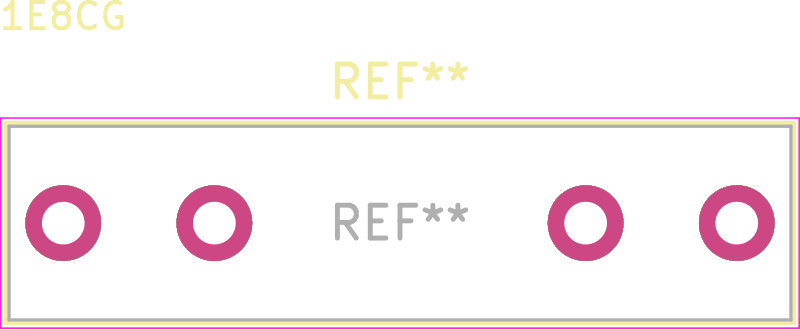 | [SVG](data/kicad/kicad_footprint_machine_solder.svg) · [PNG](data/kicad/kicad_footprint_machine_solder.png) · [STEP](data/kicad/kicad_footprint_machine_solder.step) |
| **Machine-solder footprint (3D view)** | 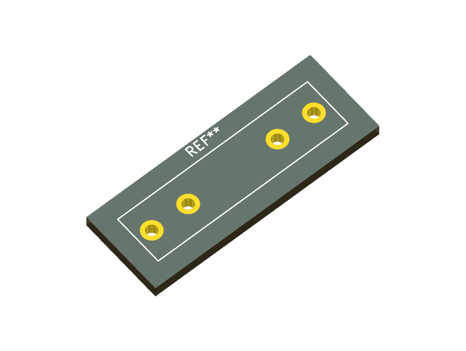 | [PNG](data/kicad/kicad_footprint_machine_solder_3d.png) |
| **Machine-solder footprint (without silkscreen)** |  | [SVG](data/kicad/kicad_footprint_machine_solder_bare.svg) · [PNG](data/kicad/kicad_footprint_machine_solder_bare.png) |
| **Machine-solder footprint (without silkscreen, square view)** | 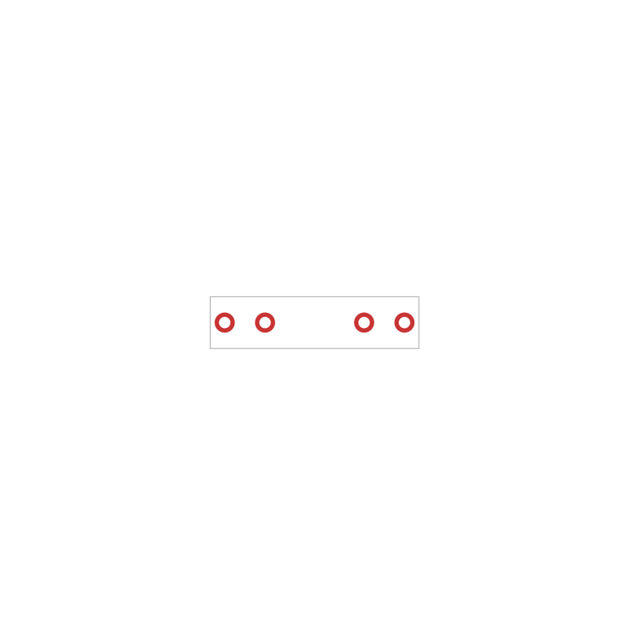 | [SVG](data/kicad/kicad_footprint_machine_solder_bare_square.svg) · [PNG](data/kicad/kicad_footprint_machine_solder_bare_square.png) |
| **Machine-solder footprint (square view)** |  | [SVG](data/kicad/kicad_footprint_machine_solder_square.svg) · [PNG](data/kicad/kicad_footprint_machine_solder_square.png) |
| **KiCad symbol, unit 1** |  | [SVG](data/kicad/kicad_symbol_unit_1.svg) · [PNG](data/kicad/kicad_symbol_unit_1.png) |
| **KiCad symbol, unit 1 (square view)** | 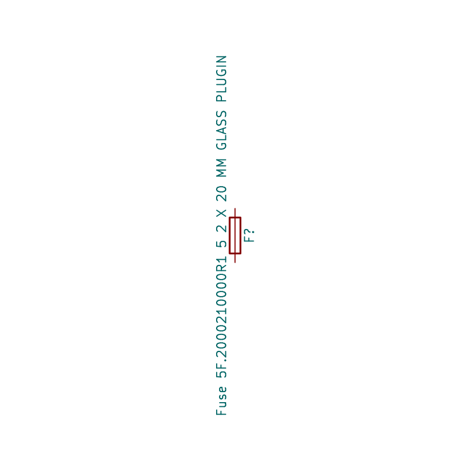 | [SVG](data/kicad/kicad_symbol_unit_1_square.svg) · [PNG](data/kicad/kicad_symbol_unit_1_square.png) |
| **Machine-solder footprint guide** | — | [MD](data/kicad/machine_solder/README.md) |
| **Machine-solder footprint** | — | [KICAD_MOD](data/kicad/machine_solder/electronic_fuse_5_2_x_20_mm_glass_plugin_disposable_xucheng_elec_5f_2000210000r1.kicad_mod) |
| **KiCad availability and source masters** | — | [JSON](data/kicad/manifest.json) · [YAML](data/kicad/manifest.yaml) |
| **Studio render sources and recipe** | — | [JSON](data/display_render/manifest.json) |
| **Manufacturer or supplier datasheet** | — | [PDF](data/datasheet.pdf) |
| **Drawer label data** | — | [YAML](data/label_drawer.yaml) |
| **Generator label** |  | [SVG](generator_label.svg) · [JSON](generator_label.json) |
| **Small drawer label** |  | [SVG](label_drawer_1_5x1.svg) |
| **Large drawer label** | 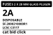 | [SVG](label_drawer_3x2.svg) |
| **Web catalogue file index** | — | [YAML](web.yaml) |
| **Part definition and build recipe** | — | [YAML](working.yaml) |

<!-- /oomp-part-file-table -->

[View this part on GitHub](https://github.com/oomlout/oomp_electronic_version_5/tree/main/parts/electronic_fuse_5_2_x_20_mm_glass_plugin_disposable_xucheng_elec_5f_2000210000r1)

[Browse this category](../../navigation/electronic/fuse/5_2_x_20_mm_glass_plugin/disposable/xucheng_elec/README.md)

---

This page is generated from the OOMP part definition by a Roboclick Jinja template. Edit the source taxonomy or template rather than this generated file.