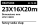
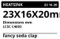

# Heatsink 23X16X20mm 23 16 20

`electronic_heatsink_23_16_20_xsd_23_16_20`

Heatsink 23X16X20mm 23 16 20 is an OOMP electronic heatsink definition. It uses the 23 16 20 package or form factor. Its nominal drawing size is 10.0 &#x00D7; 5.0 mm.

## At a glance

| Detail | Value |
| --- | --- |
| OOMP ID | `electronic_heatsink_23_16_20_xsd_23_16_20` |
| Type | Heatsink |
| Package / style | 23 16 20 |
| Nominal size | 10.0 &#x00D7; 5.0 mm |

## Classification

| Level | Value |
| --- | --- |
| 1 | `electronic` |
| 2 | `heatsink` |
| 3 | `23_16_20` |
| 14 | `xsd` |
| 15 | `23_16_20` |

## Nominal dimensions

| Measurement | Value |
| --- | ---: |
| Length | 10.0 mm |
| Width | 5.0 mm |

## Identifiers

| Identifier | Value |
| --- | --- |
| Manufacturer part number | `23X16X20mm` |
| LCSC | [`C4693`](https://www.lcsc.com/product-detail/C4693.html) |
| JLCPCB | [`C4693`](https://jlcpcb.com/partdetail/XSD-23X16X20mm/C4693) |

## Used in projects

[Browse confirmed project usage](https://oomlout.github.io/oomp_electronic_project_version_5/usage/index.html#electronic_heatsink_23_16_20_xsd_23_16_20)

## Files

<!-- oomp-part-file-table -->

| Image type | Image | Link |
| --- | :---: | --- |
| **Drawer label data** | — | [YAML](data/label_drawer.yaml) |
| **Small drawer label** |  | [SVG](label_drawer_1_5x1.svg) |
| **Large drawer label** |  | [SVG](label_drawer_3x2.svg) |
| **Part definition and build recipe** | — | [YAML](working.yaml) |

<!-- /oomp-part-file-table -->

[View this part on GitHub](https://github.com/oomlout/oomp_electronic_version_5/tree/main/parts/electronic_heatsink_23_16_20_xsd_23_16_20)

[Browse this category](../../navigation/electronic/heatsink/23_16_20/xsd/README.md)

---

This page is generated from the OOMP part definition by a Roboclick Jinja template. Edit the source taxonomy or template rather than this generated file.