# IC LM324DT SOIC 14

`electronic_ic_amplifier_operational_amplifier_quad_soic_14_stmicroelectronics_lm324dt`

IC LM324DT SOIC 14 is an OOMP electronic ic definition. It uses the soic 14 package or form factor. Its nominal drawing size is 8.69 &#x00D7; 3.9 mm.

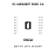

## At a glance

| Detail | Value |
| --- | --- |
| OOMP ID | `electronic_ic_amplifier_operational_amplifier_quad_soic_14_stmicroelectronics_lm324dt` |
| Type | Ic |
| Package / style | soic 14 |
| Nominal size | 8.69 &#x00D7; 3.9 mm |

## Classification

| Level | Value |
| --- | --- |
| 1 | `electronic` |
| 2 | `ic` |
| 3 | `amplifier` |
| 4 | `operational_amplifier_quad` |
| 5 | `soic_14` |
| 14 | `stmicroelectronics` |
| 15 | `lm324dt` |

## Nominal dimensions

| Measurement | Value |
| --- | ---: |
| Length | 8.69 mm |
| Width | 3.9 mm |

## Identifiers

| Identifier | Value |
| --- | --- |
| Manufacturer part number | `LM324DT` |
| LCSC | [`C71035`](https://www.lcsc.com/product-detail/C71035.html) |
| JLCPCB | [`C71035`](https://jlcpcb.com/partdetail/STMicroelectronics-LM324DT/C71035) |

## Used in projects

[Browse confirmed project usage](https://oomlout.github.io/oomp_electronic_project_version_5/usage/index.html#electronic_ic_amplifier_operational_amplifier_quad_soic_14_stmicroelectronics_lm324dt)

## Files

[KiCad symbol, machine-solder and hand-solder footprints](data/kicad/README.md) · [Availability and source masters](data/kicad/manifest.yaml)

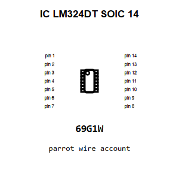

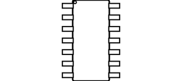

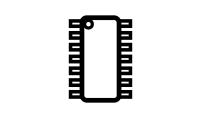

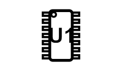

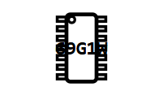

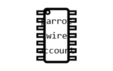

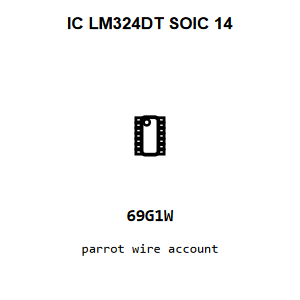

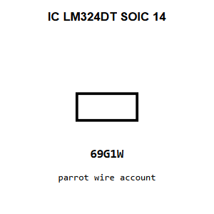

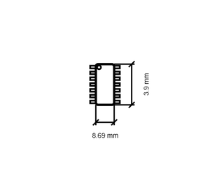

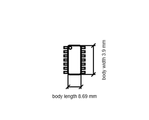

[View this part on GitHub](https://github.com/oomlout/oomp_electronic_version_5/tree/main/parts/electronic_ic_amplifier_operational_amplifier_quad_soic_14_stmicroelectronics_lm324dt)

[Browse this category](../../navigation/electronic/ic/amplifier/operational_amplifier_quad/soic_14/stmicroelectronics/README.md)

---

This page is generated from the OOMP part definition by a Roboclick Jinja template. Edit the source taxonomy or template rather than this generated file.