# IC Amplifier Thermocouple Amplifier Texas Instruments MSOP_8

`electronic_ic_amplifier_thermocouple_amplifier_msop_8_texas_instruments_ad8495armz`

IC Amplifier Thermocouple Amplifier Texas Instruments MSOP_8 is an OOMP electronic ic definition. It uses the msop 8 package or form factor. Its nominal drawing size is 3.0 &#x00D7; 3.0 mm. The definition includes 8 documented pins.

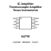

## At a glance

| Detail | Value |
| --- | --- |
| OOMP ID | `electronic_ic_amplifier_thermocouple_amplifier_msop_8_texas_instruments_ad8495armz` |
| Type | Ic |
| Package / style | msop 8 |
| Nominal size | 3.0 &#x00D7; 3.0 mm |
| Documented pins | 8 |

## Classification

| Level | Value |
| --- | --- |
| 1 | `electronic` |
| 2 | `ic` |
| 3 | `amplifier` |
| 4 | `thermocouple_amplifier` |
| 5 | `msop_8` |
| 14 | `texas_instruments` |
| 15 | `ad8495armz` |

## Nominal dimensions

| Measurement | Value |
| --- | ---: |
| Height | 1.1 mm |
| Length | 3.0 mm |
| Width | 3.0 mm |

## Pins

| Pin | Name | Type |
| ---: | --- | --- |
| 1 | NC | no_connect |
| 2 | -IN | signal |
| 3 | +IN | signal |
| 4 | V- | signal |
| 5 | V+ | signal |
| 6 | OUT | signal |
| 7 | NC | no_connect |
| 8 | REF | signal |

## Used in projects

[Browse confirmed project usage](https://oomlout.github.io/oomp_electronic_project_version_5/usage/index.html#electronic_ic_amplifier_thermocouple_amplifier_msop_8_texas_instruments_ad8495armz)

## Files

[KiCad symbol, machine-solder and hand-solder footprints](data/kicad/README.md) · [Availability and source masters](data/kicad/manifest.yaml)

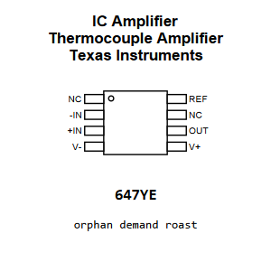

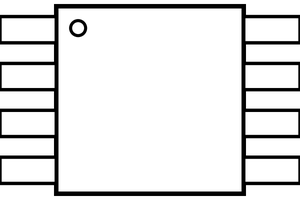

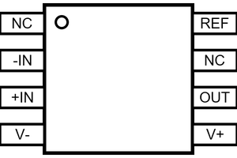

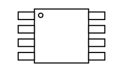

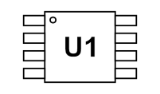

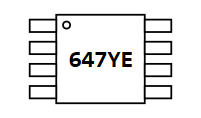

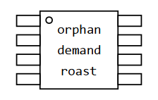

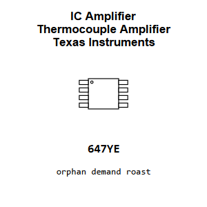

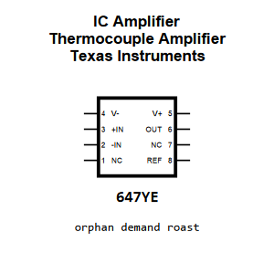

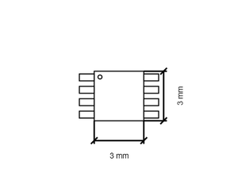

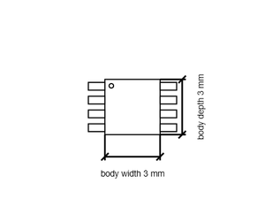

[View this part on GitHub](https://github.com/oomlout/oomp_electronic_version_5/tree/main/parts/electronic_ic_amplifier_thermocouple_amplifier_msop_8_texas_instruments_ad8495armz)

[Browse this category](../../navigation/electronic/ic/amplifier/thermocouple_amplifier/msop_8/texas_instruments/README.md)

---

This page is generated from the OOMP part definition by a Roboclick Jinja template. Edit the source taxonomy or template rather than this generated file.