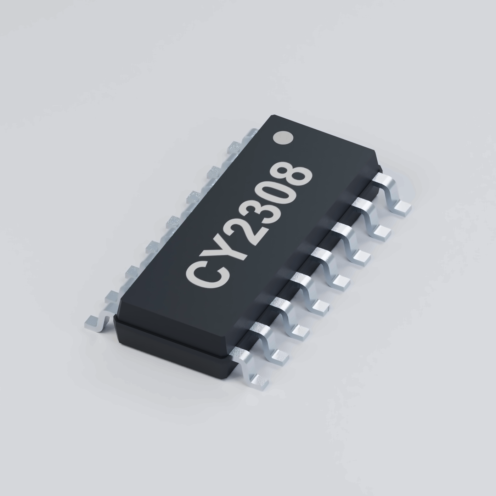
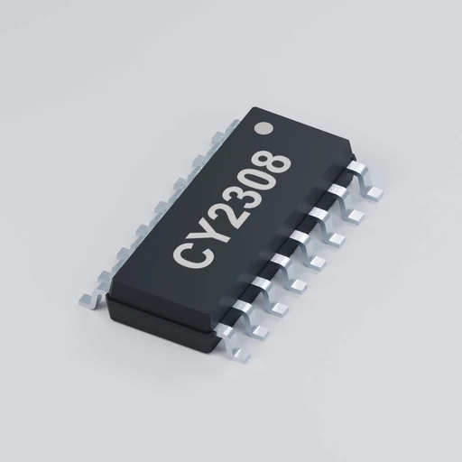
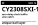
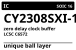

# IC CY2308SXI-1 SOIC 16

`electronic_ic_clock_management_zero_delay_clock_buffer_soic_16_infineon_cypress_semicon_cy2308sxi_1`

IC CY2308SXI-1 SOIC 16 is an OOMP electronic ic definition. It uses the soic 16 package or form factor. Its nominal drawing size is 9.9 &#x00D7; 3.9 mm.

Illustrative KiCad SOIC-16 model scaled from 1.75 mm to 1.70 mm height, within manufacturer 1.549&#x2013;1.727 mm range. Catalogue lists 9.9 x 3.9 mm without height or footprint. Not a verified mechanical model or footprint. CY2308 is an illustrative partial identifier; exact physical marking is not confirmed. Typeface, orientation, placement and variable lot/date details are illustrative.

[Render recipe and provenance](data/display_render/manifest.json) · [KiCad model](https://gitlab.com/kicad/libraries/kicad-packages3D/-/blob/master/Package_SO.3dshapes/SOIC-16_3.9x9.9mm_P1.27mm.step)

Model credit: 2025 KiCAD. CC-BY-SA-4.0 with KiCad library exception; see original STEP header.

## At a glance

| Detail | Value |
| --- | --- |
| OOMP ID | `electronic_ic_clock_management_zero_delay_clock_buffer_soic_16_infineon_cypress_semicon_cy2308sxi_1` |
| Type | Ic |
| Package / style | soic 16 |
| Nominal size | 9.9 &#x00D7; 3.9 mm |

## Classification

| Level | Value |
| --- | --- |
| 1 | `electronic` |
| 2 | `ic` |
| 3 | `clock_management` |
| 4 | `zero_delay_clock_buffer` |
| 5 | `soic_16` |
| 14 | `infineon_cypress_semicon` |
| 15 | `cy2308sxi_1` |

## Nominal dimensions

| Measurement | Value |
| --- | ---: |
| Length | 9.9 mm |
| Width | 3.9 mm |

## Identifiers

| Identifier | Value |
| --- | --- |
| Manufacturer part number | `CY2308SXI-1` |
| LCSC | [`C6572`](https://www.lcsc.com/product-detail/C6572.html) |
| JLCPCB | [`C6572`](https://jlcpcb.com/partdetail/Infineon_CypressSemicon-CY2308SXI1/C6572) |

## Used in projects

[Browse confirmed project usage](https://oomlout.github.io/oomp_electronic_project_version_5/usage/index.html#electronic_ic_clock_management_zero_delay_clock_buffer_soic_16_infineon_cypress_semicon_cy2308sxi_1)

## Files

<!-- oomp-part-file-table -->

| Image type | Image | Link |
| --- | :---: | --- |
| **Studio render** |  | [PNG](data/display_render/render.png) · [Preview](data/display_render/preview.webp) |
| **Studio render sources and recipe** | — | [JSON](data/display_render/manifest.json) |
| **Drawer label data** | — | [YAML](data/label_drawer.yaml) |
| **Small drawer label** |  | [SVG](label_drawer_1_5x1.svg) |
| **Large drawer label** |  | [SVG](label_drawer_3x2.svg) |
| **Web catalogue file index** | — | [YAML](web.yaml) |
| **Part definition and build recipe** | — | [YAML](working.yaml) |

<!-- /oomp-part-file-table -->

[View this part on GitHub](https://github.com/oomlout/oomp_electronic_version_5/tree/main/parts/electronic_ic_clock_management_zero_delay_clock_buffer_soic_16_infineon_cypress_semicon_cy2308sxi_1)

[Browse this category](../../navigation/electronic/ic/clock_management/zero_delay_clock_buffer/soic_16/infineon_cypress_semicon/README.md)

---

This page is generated from the OOMP part definition by a Roboclick Jinja template. Edit the source taxonomy or template rather than this generated file.