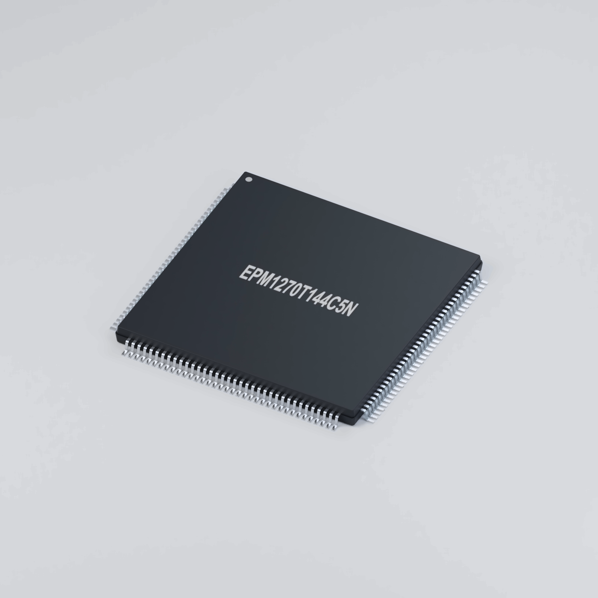
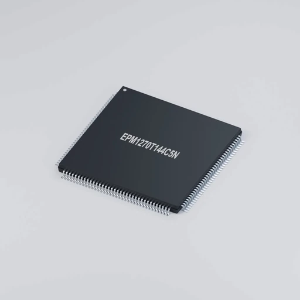
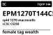

# IC EPM1270T144C5N TQFP 144

`electronic_ic_cpld_cpld_1270_macrocells_tqfp_144_intel_altera_epm1270t144c5n`

IC EPM1270T144C5N TQFP 144 is an OOMP electronic ic definition. It uses the tqfp 144 package or form factor. Its nominal drawing size is 10.0 &#x00D7; 5.0 mm.

KiCad TQFP-144 display has 22 x 22 mm overall span. Its 1.10 mm source height is vertically scaled to 1.54 mm, giving 1.40 mm body thickness and 0.14 mm clearance; the catalogue 10 x 5 mm dimensions are generic. Altera drawing was not visually confirmed. Display is not a verified footprint or mechanical model. EPM1270T144C5N is an illustrative identifier; exact physical marking is unverified. Typeface, orientation, placement and omitted logo and production codes are illustrative.

[Render recipe and provenance](data/display_render/manifest.json) · [KiCad model](https://gitlab.com/kicad/libraries/kicad-packages3D/-/blob/master/Package_QFP.3dshapes/TQFP-144_20x20mm_P0.5mm.step)

Model credit: 2025 KiCAD. CC-BY-SA-4.0 with KiCad library exception; see original STEP header.

## At a glance

| Detail | Value |
| --- | --- |
| OOMP ID | `electronic_ic_cpld_cpld_1270_macrocells_tqfp_144_intel_altera_epm1270t144c5n` |
| Type | Ic |
| Package / style | tqfp 144 |
| Nominal size | 10.0 &#x00D7; 5.0 mm |

## Classification

| Level | Value |
| --- | --- |
| 1 | `electronic` |
| 2 | `ic` |
| 3 | `cpld` |
| 4 | `cpld_1270_macrocells` |
| 5 | `tqfp_144` |
| 14 | `intel_altera` |
| 15 | `epm1270t144c5n` |

## Nominal dimensions

| Measurement | Value |
| --- | ---: |
| Length | 10.0 mm |
| Width | 5.0 mm |

## Identifiers

| Identifier | Value |
| --- | --- |
| Manufacturer part number | `EPM1270T144C5N` |
| LCSC | [`C5358`](https://www.lcsc.com/product-detail/C5358.html) |
| JLCPCB | [`C5358`](https://jlcpcb.com/partdetail/IntelAltera-EPM1270T144C5N/C5358) |

## Used in projects

[Browse confirmed project usage](https://oomlout.github.io/oomp_electronic_project_version_5/usage/index.html#electronic_ic_cpld_cpld_1270_macrocells_tqfp_144_intel_altera_epm1270t144c5n)

## Files

<!-- oomp-part-file-table -->

| Image type | Image | Link |
| --- | :---: | --- |
| **Studio render** |  | [PNG](data/display_render/render.png) · [Preview](data/display_render/preview.webp) |
| **Studio render sources and recipe** | — | [JSON](data/display_render/manifest.json) |
| **Drawer label data** | — | [YAML](data/label_drawer.yaml) |
| **Small drawer label** |  | [SVG](label_drawer_1_5x1.svg) |
| **Large drawer label** |  | [SVG](label_drawer_3x2.svg) |
| **Web catalogue file index** | — | [YAML](web.yaml) |
| **Part definition and build recipe** | — | [YAML](working.yaml) |

<!-- /oomp-part-file-table -->

[View this part on GitHub](https://github.com/oomlout/oomp_electronic_version_5/tree/main/parts/electronic_ic_cpld_cpld_1270_macrocells_tqfp_144_intel_altera_epm1270t144c5n)

[Browse this category](../../navigation/electronic/ic/cpld/cpld_1270_macrocells/tqfp_144/intel_altera/README.md)

---

This page is generated from the OOMP part definition by a Roboclick Jinja template. Edit the source taxonomy or template rather than this generated file.