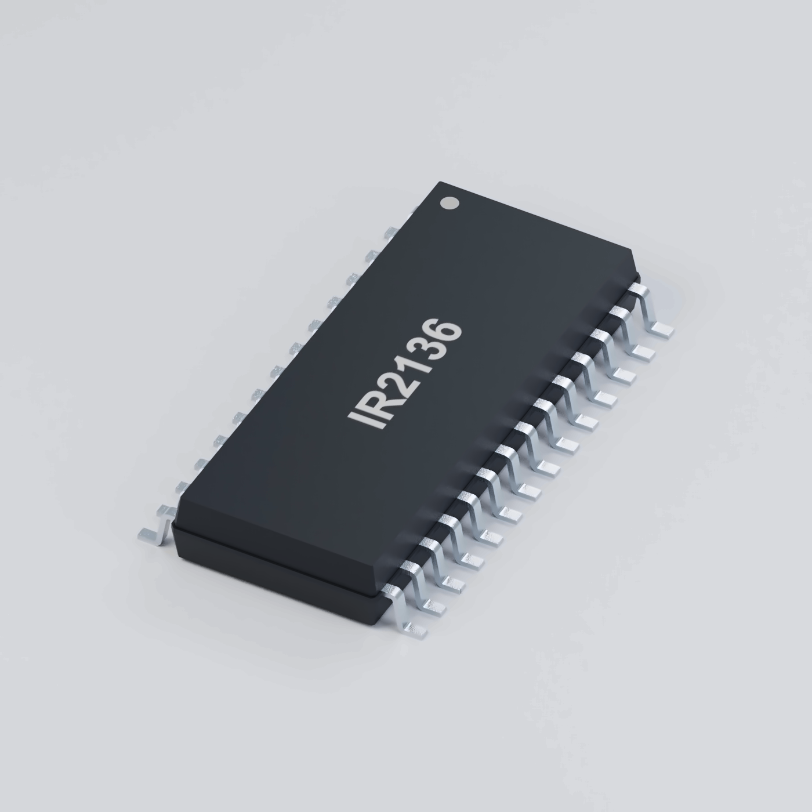
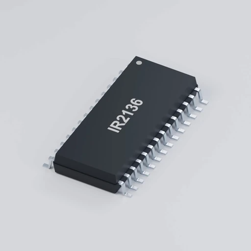
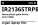
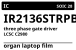

# IC IR2136STRPBF SOIC 28

`electronic_ic_driver_three_phase_gate_driver_soic_28_infineon_ir2136strpbf`

IC IR2136STRPBF SOIC 28 is an OOMP electronic ic definition. It uses the soic 28 package or form factor. Its nominal drawing size is 10.0 &#x00D7; 5.0 mm.

Illustrative KiCad SOIC-28W model scaled from 2.75 to 2.65 mm overall; Infineon specifies a 17.7&#x2013;18.1 x 7.4&#x2013;7.6 mm body and 2.65 mm maximum height. Catalogue lists generic 10 x 5 mm, conflicting with manufacturer body size, and omits height and footprint. Scaling is an approximation, not a verified mechanical model or footprint. IR2136 is an illustrative partial identifier; exact physical marking is not confirmed. Typeface, orientation, placement and variable lot/date details are illustrative.

[Render recipe and provenance](data/display_render/manifest.json) · [KiCad model](https://gitlab.com/kicad/libraries/kicad-packages3D/-/blob/master/Package_SO.3dshapes/SOIC-28W_7.5x17.9mm_P1.27mm.step)

Model credit: 2025 KiCAD. CC-BY-SA-4.0 with KiCad library exception; see original STEP header.

## At a glance

| Detail | Value |
| --- | --- |
| OOMP ID | `electronic_ic_driver_three_phase_gate_driver_soic_28_infineon_ir2136strpbf` |
| Type | Ic |
| Package / style | soic 28 |
| Nominal size | 10.0 &#x00D7; 5.0 mm |

## Classification

| Level | Value |
| --- | --- |
| 1 | `electronic` |
| 2 | `ic` |
| 3 | `driver` |
| 4 | `three_phase_gate_driver` |
| 5 | `soic_28` |
| 14 | `infineon` |
| 15 | `ir2136strpbf` |

## Nominal dimensions

| Measurement | Value |
| --- | ---: |
| Length | 10.0 mm |
| Width | 5.0 mm |

## Identifiers

| Identifier | Value |
| --- | --- |
| Manufacturer part number | `IR2136STRPBF` |
| LCSC | [`C2980`](https://www.lcsc.com/product-detail/C2980.html) |
| JLCPCB | [`C2980`](https://jlcpcb.com/partdetail/InfineonTechnologies-IR2136STRPBF/C2980) |

## Used in projects

[Browse confirmed project usage](https://oomlout.github.io/oomp_electronic_project_version_5/usage/index.html#electronic_ic_driver_three_phase_gate_driver_soic_28_infineon_ir2136strpbf)

## Files

<!-- oomp-part-file-table -->

| Image type | Image | Link |
| --- | :---: | --- |
| **Studio render** |  | [PNG](data/display_render/render.png) · [Preview](data/display_render/preview.webp) |
| **Studio render sources and recipe** | — | [JSON](data/display_render/manifest.json) |
| **Drawer label data** | — | [YAML](data/label_drawer.yaml) |
| **Small drawer label** |  | [SVG](label_drawer_1_5x1.svg) |
| **Large drawer label** |  | [SVG](label_drawer_3x2.svg) |
| **Web catalogue file index** | — | [YAML](web.yaml) |
| **Part definition and build recipe** | — | [YAML](working.yaml) |

<!-- /oomp-part-file-table -->

[View this part on GitHub](https://github.com/oomlout/oomp_electronic_version_5/tree/main/parts/electronic_ic_driver_three_phase_gate_driver_soic_28_infineon_ir2136strpbf)

[Browse this category](../../navigation/electronic/ic/driver/three_phase_gate_driver/soic_28/infineon/README.md)

---

This page is generated from the OOMP part definition by a Roboclick Jinja template. Edit the source taxonomy or template rather than this generated file.