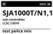

# IC SJA1000T/N1,118 SOIC 28

`electronic_ic_interface_can_controller_soic_28_nxp_semiconductors_sja1000t_n1_118`

IC SJA1000T/N1,118 SOIC 28 is an OOMP electronic ic definition. It uses the soic 28 package or form factor. Its nominal drawing size is 10.0 &#x00D7; 5.0 mm.

## At a glance

| Detail | Value |
| --- | --- |
| OOMP ID | `electronic_ic_interface_can_controller_soic_28_nxp_semiconductors_sja1000t_n1_118` |
| Type | Ic |
| Package / style | soic 28 |
| Nominal size | 10.0 &#x00D7; 5.0 mm |

## Classification

| Level | Value |
| --- | --- |
| 1 | `electronic` |
| 2 | `ic` |
| 3 | `interface` |
| 4 | `can_controller` |
| 5 | `soic_28` |
| 14 | `nxp_semiconductors` |
| 15 | `sja1000t_n1_118` |

## Nominal dimensions

| Measurement | Value |
| --- | ---: |
| Length | 10.0 mm |
| Width | 5.0 mm |

## Identifiers

| Identifier | Value |
| --- | --- |
| Manufacturer part number | `SJA1000T/N1,118` |
| LCSC | [`C6910`](https://www.lcsc.com/product-detail/C6910.html) |
| JLCPCB | [`C6910`](https://jlcpcb.com/partdetail/NXPSemicon-SJA1000T_N1118/C6910) |

## Used in projects

[Browse confirmed project usage](https://oomlout.github.io/oomp_electronic_project_version_5/usage/index.html#electronic_ic_interface_can_controller_soic_28_nxp_semiconductors_sja1000t_n1_118)

## Files

<!-- oomp-part-file-table -->

| Image type | Image | Link |
| --- | :---: | --- |
| **Drawer label data** | — | [YAML](data/label_drawer.yaml) |
| **Small drawer label** |  | [SVG](label_drawer_1_5x1.svg) |
| **Large drawer label** |  | [SVG](label_drawer_3x2.svg) |
| **Part definition and build recipe** | — | [YAML](working.yaml) |

<!-- /oomp-part-file-table -->

[View this part on GitHub](https://github.com/oomlout/oomp_electronic_version_5/tree/main/parts/electronic_ic_interface_can_controller_soic_28_nxp_semiconductors_sja1000t_n1_118)

[Browse this category](../../navigation/electronic/ic/interface/can_controller/soic_28/nxp_semiconductors/README.md)

---

This page is generated from the OOMP part definition by a Roboclick Jinja template. Edit the source taxonomy or template rather than this generated file.