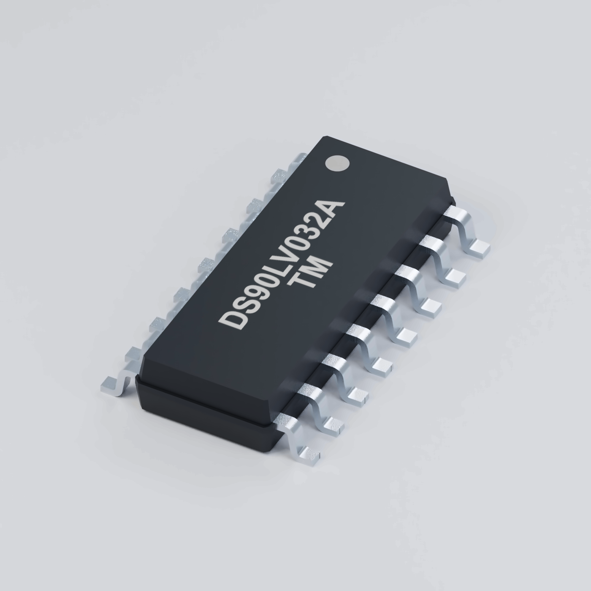
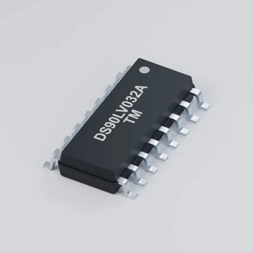
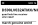
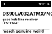

# IC DS90LV032ATMX/NOPB SOIC 16

`electronic_ic_interface_quad_lvds_line_receiver_soic_16_texas_instruments_ds90lv032atmx_nopb`

IC DS90LV032ATMX/NOPB SOIC 16 is an OOMP electronic ic definition. It uses the soic 16 package or form factor. Its nominal drawing size is 9.9 &#x00D7; 3.9 mm.

Illustrative KiCad SOIC-16 model selected from Texas Instruments D0016A package evidence. The catalogue omits package height and machine-solder footprint; Texas Instruments specifies 1.75 mm maximum height. This image is not a verified PCB footprint. TI lists DS90LV032A followed by TM as a marking entry. The display uses an illustrative two-line break; the physical line layout, typeface, placement and variable lot/date details are not established. Marking composited in linear light from shared path-traced material passes; indirect reflections are approximate.

[Render recipe and provenance](data/display_render/manifest.json) · [KiCad model](https://gitlab.com/kicad/libraries/kicad-packages3D/-/blob/master/Package_SO.3dshapes/SOIC-16_3.9x9.9mm_P1.27mm.step)

Model credit: 2025 KiCAD. CC-BY-SA-4.0 with KiCad library exception; see original STEP header.

## At a glance

| Detail | Value |
| --- | --- |
| OOMP ID | `electronic_ic_interface_quad_lvds_line_receiver_soic_16_texas_instruments_ds90lv032atmx_nopb` |
| Type | Ic |
| Package / style | soic 16 |
| Nominal size | 9.9 &#x00D7; 3.9 mm |

## Classification

| Level | Value |
| --- | --- |
| 1 | `electronic` |
| 2 | `ic` |
| 3 | `interface` |
| 4 | `quad_lvds_line_receiver` |
| 5 | `soic_16` |
| 14 | `texas_instruments` |
| 15 | `ds90lv032atmx_nopb` |

## Nominal dimensions

| Measurement | Value |
| --- | ---: |
| Length | 9.9 mm |
| Width | 3.9 mm |

## Identifiers

| Identifier | Value |
| --- | --- |
| Manufacturer part number | `DS90LV032ATMX/NOPB` |
| LCSC | [`C6647`](https://www.lcsc.com/product-detail/C6647.html) |
| JLCPCB | [`C6647`](https://jlcpcb.com/partdetail/TexasInstruments-DS90LV032ATMXNOPB/C6647) |

## Used in projects

[Browse confirmed project usage](https://oomlout.github.io/oomp_electronic_project_version_5/usage/index.html#electronic_ic_interface_quad_lvds_line_receiver_soic_16_texas_instruments_ds90lv032atmx_nopb)

## Files

<!-- oomp-part-file-table -->

| Image type | Image | Link |
| --- | :---: | --- |
| **Studio render** |  | [PNG](data/display_render/render.png) · [Preview](data/display_render/preview.webp) |
| **Studio render sources and recipe** | — | [JSON](data/display_render/manifest.json) |
| **Drawer label data** | — | [YAML](data/label_drawer.yaml) |
| **Small drawer label** |  | [SVG](label_drawer_1_5x1.svg) |
| **Large drawer label** |  | [SVG](label_drawer_3x2.svg) |
| **Web catalogue file index** | — | [YAML](web.yaml) |
| **Part definition and build recipe** | — | [YAML](working.yaml) |

<!-- /oomp-part-file-table -->

[View this part on GitHub](https://github.com/oomlout/oomp_electronic_version_5/tree/main/parts/electronic_ic_interface_quad_lvds_line_receiver_soic_16_texas_instruments_ds90lv032atmx_nopb)

[Browse this category](../../navigation/electronic/ic/interface/quad_lvds_line_receiver/soic_16/texas_instruments/README.md)

---

This page is generated from the OOMP part definition by a Roboclick Jinja template. Edit the source taxonomy or template rather than this generated file.