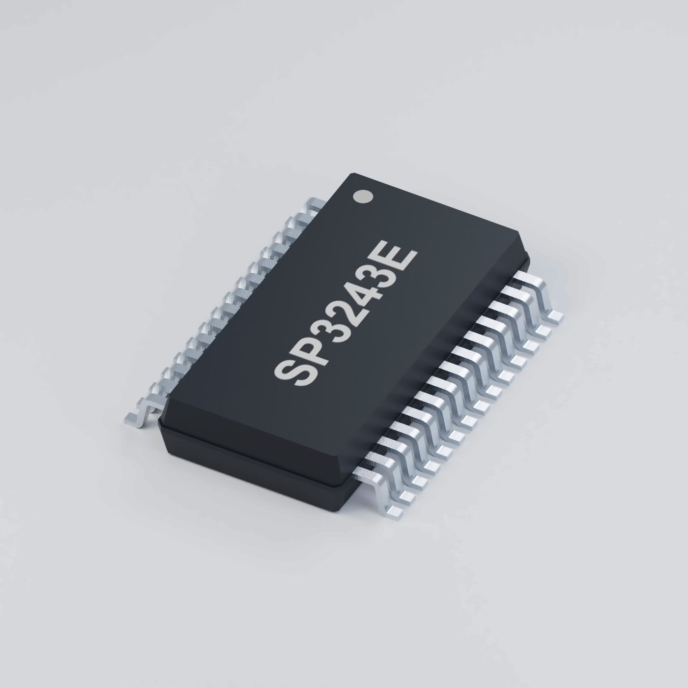
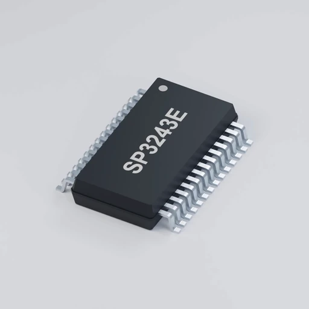
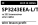

# IC SP3243EEA-L/TR SSOP 28 208MIL

`electronic_ic_interface_rs_232_transceiver_ssop_28_208mil_maxlinear_sp3243eea_l_tr`

IC SP3243EEA-L/TR SSOP 28 208MIL is an OOMP electronic ic definition. It uses the ssop 28 208mil package or form factor. Its nominal drawing size is 10.0 &#x00D7; 5.0 mm.

The KiCad SSOP-28 model has 7.8 x 10.2 x 2.1 mm source bounds; it is scaled vertically to 1.9 mm for display because MaxLinear specifies a 2.0 mm maximum. Source lists generic 10 x 5 mm without a dimension reference. Not a verified mechanical model or footprint. SP3243E is an illustrative family identifier; exact physical top marking is unverified. Typeface, orientation, placement and variable lot/date details are illustrative.

[Render recipe and provenance](data/display_render/manifest.json) · [KiCad model](https://gitlab.com/kicad/libraries/kicad-packages3D/-/blob/master/Package_SO.3dshapes/SSOP-28_5.3x10.2mm_P0.65mm.step)

Model credit: 2025 KiCAD. CC-BY-SA-4.0 with KiCad library exception; see original STEP header.

## At a glance

| Detail | Value |
| --- | --- |
| OOMP ID | `electronic_ic_interface_rs_232_transceiver_ssop_28_208mil_maxlinear_sp3243eea_l_tr` |
| Type | Ic |
| Package / style | ssop 28 208mil |
| Nominal size | 10.0 &#x00D7; 5.0 mm |

## Classification

| Level | Value |
| --- | --- |
| 1 | `electronic` |
| 2 | `ic` |
| 3 | `interface` |
| 4 | `rs_232_transceiver` |
| 5 | `ssop_28_208mil` |
| 14 | `maxlinear` |
| 15 | `sp3243eea_l_tr` |

## Nominal dimensions

| Measurement | Value |
| --- | ---: |
| Length | 10.0 mm |
| Width | 5.0 mm |

## Identifiers

| Identifier | Value |
| --- | --- |
| Manufacturer part number | `SP3243EEA-L/TR` |
| LCSC | [`C6853`](https://www.lcsc.com/product-detail/C6853.html) |
| JLCPCB | [`C6853`](https://jlcpcb.com/partdetail/MaxLinear-SP3243EEA_LTR/C6853) |

## Used in projects

[Browse confirmed project usage](https://oomlout.github.io/oomp_electronic_project_version_5/usage/index.html#electronic_ic_interface_rs_232_transceiver_ssop_28_208mil_maxlinear_sp3243eea_l_tr)

## Files

<!-- oomp-part-file-table -->

| Image type | Image | Link |
| --- | :---: | --- |
| **Studio render** |  | [PNG](data/display_render/render.png) · [Preview](data/display_render/preview.webp) |
| **Studio render sources and recipe** | — | [JSON](data/display_render/manifest.json) |
| **Drawer label data** | — | [YAML](data/label_drawer.yaml) |
| **Small drawer label** |  | [SVG](label_drawer_1_5x1.svg) |
| **Large drawer label** |  | [SVG](label_drawer_3x2.svg) |
| **Web catalogue file index** | — | [YAML](web.yaml) |
| **Part definition and build recipe** | — | [YAML](working.yaml) |

<!-- /oomp-part-file-table -->

[View this part on GitHub](https://github.com/oomlout/oomp_electronic_version_5/tree/main/parts/electronic_ic_interface_rs_232_transceiver_ssop_28_208mil_maxlinear_sp3243eea_l_tr)

[Browse this category](../../navigation/electronic/ic/interface/rs_232_transceiver/ssop_28_208mil/maxlinear/README.md)

---

This page is generated from the OOMP part definition by a Roboclick Jinja template. Edit the source taxonomy or template rather than this generated file.