# IC SP3232EEY-L/TR TSSOP 16

`electronic_ic_interface_rs_232_transceiver_tssop_16_maxlinear_sp3232eey_l_tr`

IC SP3232EEY-L/TR TSSOP 16 is an OOMP electronic ic definition. It uses the tssop 16 package or form factor. Its nominal drawing size is 5.0 &#x00D7; 4.4 mm.

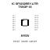

## At a glance

| Detail | Value |
| --- | --- |
| OOMP ID | `electronic_ic_interface_rs_232_transceiver_tssop_16_maxlinear_sp3232eey_l_tr` |
| Type | Ic |
| Package / style | tssop 16 |
| Nominal size | 5.0 &#x00D7; 4.4 mm |

## Classification

| Level | Value |
| --- | --- |
| 1 | `electronic` |
| 2 | `ic` |
| 3 | `interface` |
| 4 | `rs_232_transceiver` |
| 5 | `tssop_16` |
| 14 | `maxlinear` |
| 15 | `sp3232eey_l_tr` |

## Nominal dimensions

| Measurement | Value |
| --- | ---: |
| Length | 5.0 mm |
| Width | 4.4 mm |

## Identifiers

| Identifier | Value |
| --- | --- |
| Manufacturer part number | `SP3232EEY-L/TR` |
| LCSC | [`C13482`](https://www.lcsc.com/product-detail/C13482.html) |
| JLCPCB | [`C13482`](https://jlcpcb.com/partdetail/MaxLinear-SP3232EEY_LTR/C13482) |

## Used in projects

[Browse confirmed project usage](https://oomlout.github.io/oomp_electronic_project_version_5/usage/index.html#electronic_ic_interface_rs_232_transceiver_tssop_16_maxlinear_sp3232eey_l_tr)

## Files

[KiCad symbol, machine-solder and hand-solder footprints](data/kicad/README.md) · [Availability and source masters](data/kicad/manifest.yaml)

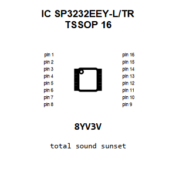

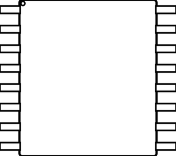

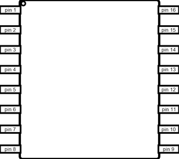

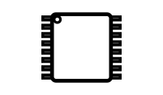

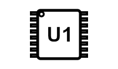

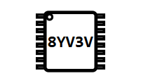

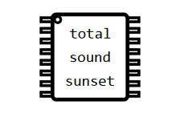

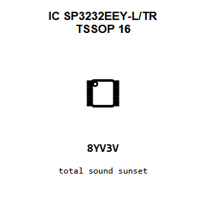

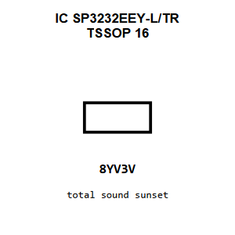

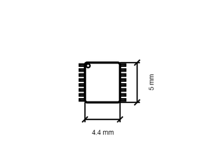

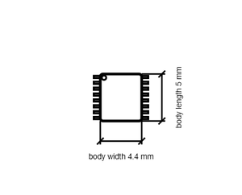

[View this part on GitHub](https://github.com/oomlout/oomp_electronic_version_5/tree/main/parts/electronic_ic_interface_rs_232_transceiver_tssop_16_maxlinear_sp3232eey_l_tr)

[Browse this category](../../navigation/electronic/ic/interface/rs_232_transceiver/tssop_16/maxlinear/README.md)

---

This page is generated from the OOMP part definition by a Roboclick Jinja template. Edit the source taxonomy or template rather than this generated file.