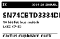

# IC SN74CBTD3384DBR SSOP 24 208MIL

`electronic_ic_logic_10_bit_fet_bus_switch_ssop_24_208mil_texas_instruments_sn74cbtd3384dbr`

IC SN74CBTD3384DBR SSOP 24 208MIL is an OOMP electronic ic definition. It uses the ssop 24 208mil package or form factor. Its nominal drawing size is 10.0 &#x00D7; 5.0 mm.

## At a glance

| Detail | Value |
| --- | --- |
| OOMP ID | `electronic_ic_logic_10_bit_fet_bus_switch_ssop_24_208mil_texas_instruments_sn74cbtd3384dbr` |
| Type | Ic |
| Package / style | ssop 24 208mil |
| Nominal size | 10.0 &#x00D7; 5.0 mm |

## Classification

| Level | Value |
| --- | --- |
| 1 | `electronic` |
| 2 | `ic` |
| 3 | `logic` |
| 4 | `10_bit_fet_bus_switch` |
| 5 | `ssop_24_208mil` |
| 14 | `texas_instruments` |
| 15 | `sn74cbtd3384dbr` |

## Nominal dimensions

| Measurement | Value |
| --- | ---: |
| Length | 10.0 mm |
| Width | 5.0 mm |

## Identifiers

| Identifier | Value |
| --- | --- |
| Manufacturer part number | `SN74CBTD3384DBR` |
| LCSC | [`C7153`](https://www.lcsc.com/product-detail/C7153.html) |
| JLCPCB | [`C7153`](https://jlcpcb.com/partdetail/TexasInstruments-SN74CBTD3384DBR/C7153) |

## Used in projects

[Browse confirmed project usage](https://oomlout.github.io/oomp_electronic_project_version_5/usage/index.html#electronic_ic_logic_10_bit_fet_bus_switch_ssop_24_208mil_texas_instruments_sn74cbtd3384dbr)

## Files

<!-- oomp-part-file-table -->

| Image type | Image | Link |
| --- | :---: | --- |
| **Drawer label data** | — | [YAML](data/label_drawer.yaml) |
| **Small drawer label** |  | [SVG](label_drawer_1_5x1.svg) |
| **Large drawer label** |  | [SVG](label_drawer_3x2.svg) |
| **Part definition and build recipe** | — | [YAML](working.yaml) |

<!-- /oomp-part-file-table -->

[View this part on GitHub](https://github.com/oomlout/oomp_electronic_version_5/tree/main/parts/electronic_ic_logic_10_bit_fet_bus_switch_ssop_24_208mil_texas_instruments_sn74cbtd3384dbr)

[Browse this category](../../navigation/electronic/ic/logic/10_bit_fet_bus_switch/ssop_24_208mil/texas_instruments/README.md)

---

This page is generated from the OOMP part definition by a Roboclick Jinja template. Edit the source taxonomy or template rather than this generated file.