# IC 74HCT4067PW,118 TSSOP 24

`electronic_ic_logic_16_channel_analog_multiplexer_tssop_24_nexperia_74hct4067pw118`

IC 74HCT4067PW,118 TSSOP 24 is an OOMP electronic ic definition. It uses the tssop 24 package or form factor. Its nominal drawing size is 7.8 &#x00D7; 4.4 mm. The definition includes 24 documented pins.

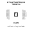

## At a glance

| Detail | Value |
| --- | --- |
| OOMP ID | `electronic_ic_logic_16_channel_analog_multiplexer_tssop_24_nexperia_74hct4067pw118` |
| Type | Ic |
| Package / style | tssop 24 |
| Nominal size | 7.8 &#x00D7; 4.4 mm |
| Documented pins | 24 |

## Classification

| Level | Value |
| --- | --- |
| 1 | `electronic` |
| 2 | `ic` |
| 3 | `logic` |
| 4 | `16_channel_analog_multiplexer` |
| 5 | `tssop_24` |
| 14 | `nexperia` |
| 15 | `74hct4067pw118` |

## Nominal dimensions

| Measurement | Value |
| --- | ---: |
| Length | 7.8 mm |
| Width | 4.4 mm |

## Identifiers

| Identifier | Value |
| --- | --- |
| Manufacturer part number | `74HCT4067PW,118` |
| LCSC | [`C547734`](https://www.lcsc.com/product-detail/C547734.html) |

## Pins

| Pin | Name | Type |
| ---: | --- | --- |
| 1 | common | signal |
| 2 | channel_7 | signal |
| 3 | channel_6 | signal |
| 4 | channel_5 | signal |
| 5 | channel_4 | signal |
| 6 | channel_3 | signal |
| 7 | channel_2 | signal |
| 8 | channel_1 | signal |
| 9 | channel_0 | signal |
| 10 | select_0 | signal |
| 11 | select_1 | signal |
| 12 | gnd | signal |
| 13 | select_3 | signal |
| 14 | select_2 | signal |
| 15 | enable | signal |
| 16 | channel_15 | signal |
| 17 | channel_14 | signal |
| 18 | channel_13 | signal |
| 19 | channel_12 | signal |
| 20 | channel_11 | signal |
| 21 | channel_10 | signal |
| 22 | channel_9 | signal |
| 23 | channel_8 | signal |
| 24 | vcc | signal |

## Datasheet

[View the datasheet](data/datasheet.pdf)

## Used in projects

[Browse confirmed project usage](https://oomlout.github.io/oomp_electronic_project_version_5/usage/index.html#electronic_ic_logic_16_channel_analog_multiplexer_tssop_24_nexperia_74hct4067pw118)

## Files

<!-- oomp-part-file-table -->

| Image type | Image | Link |
| --- | :---: | --- |
| **Pinout drawing** Pin names and positions on the part. | 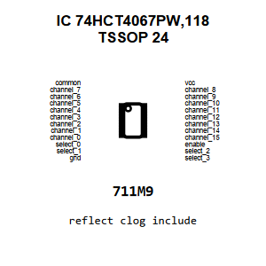 | [SVG](data/working_svg_square_pins.svg) · [PNG](data/working_svg_square_pins.png) · [Preview](data/working_svg_square_pins_300.png) |
| **Assembly** Component placement drawing. | 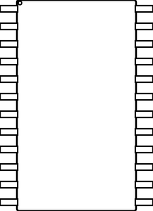 | [SVG](data/working_svg_assembly.svg) · [PNG](data/working_svg_assembly.png) · [Preview](data/working_svg_assembly_300.png) |
| **Assembly pinout** Placement drawing with the pins marked. | 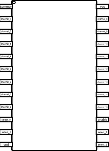 | [SVG](data/working_svg_assembly_pins.svg) · [PNG](data/working_svg_assembly_pins.png) · [Preview](data/working_svg_assembly_pins_300.png) |
| **Outline** External shape of the part. | 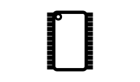 | [SVG](data/working_svg_outline.svg) · [PNG](data/working_svg_outline.png) · [Preview](data/working_svg_outline_300.png) |
| **Dimensions** Package outline with dimension arrows. | 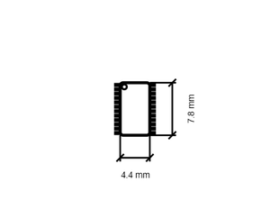 | [SVG](data/working_svg_dimensioned.svg) · [PNG](data/working_svg_dimensioned.png) · [Preview](data/working_svg_dimensioned_300.png) |
| **Dimensions with labels** Labelled package measurements. | 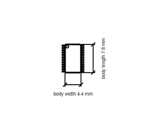 | [SVG](data/working_svg_dimensioned_titles.svg) · [PNG](data/working_svg_dimensioned_titles.png) · [Preview](data/working_svg_dimensioned_titles_300.png) |
| **Square summary** Component identification card. | 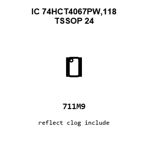 | [SVG](data/working_svg_square.svg) · [PNG](data/working_svg_square.png) · [Preview](data/working_svg_square_300.png) |
| **Square schematic** Schematic symbol on an identification card. | 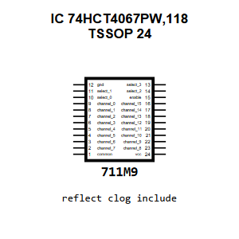 | [SVG](data/working_svg_square_schematic.svg) · [PNG](data/working_svg_square_schematic.png) · [Preview](data/working_svg_square_schematic_300.png) |
| **Part ID** Drawing labelled with the OOMP catalogue ID. | 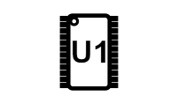 | [SVG](data/working_svg_part_id.svg) · [PNG](data/working_svg_part_id.png) · [Preview](data/working_svg_part_id_300.png) |
| **MD5 alpha** Drawing labelled with the short OOMP code. | 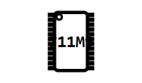 | [SVG](data/working_svg_md5_6_alpha.svg) · [PNG](data/working_svg_md5_6_alpha.png) · [Preview](data/working_svg_md5_6_alpha_300.png) |
| **BIP 39 words** Drawing labelled with the three-word identifier. | 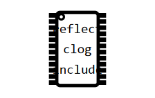 | [SVG](data/working_svg_bip_39_3_word.svg) · [PNG](data/working_svg_bip_39_3_word.png) · [Preview](data/working_svg_bip_39_3_word_300.png) |
| **Schematic** Electrical symbol for the part. | 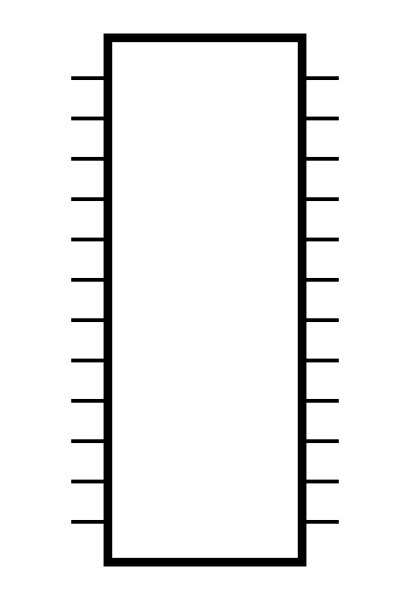 | [SVG](data/working_svg_schematic.svg) · [PNG](data/working_svg_schematic.png) |
| **Schematic pinout** Electrical symbol with pin labels. | 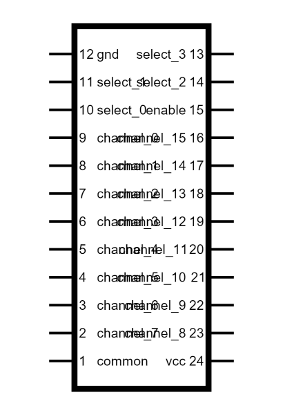 | [SVG](data/working_svg_schematic_pins.svg) · [PNG](data/working_svg_schematic_pins.png) |
| **Schematic with part ID** Symbol labelled with the OOMP catalogue ID. | 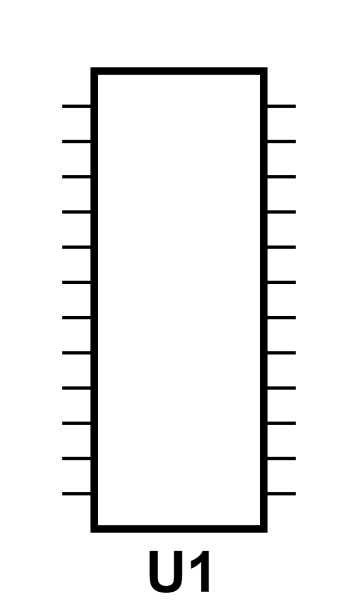 | [SVG](data/working_svg_schematic_part_id.svg) · [PNG](data/working_svg_schematic_part_id.png) |
| **Schematic with MD5 alpha** Symbol labelled with the short OOMP code. | 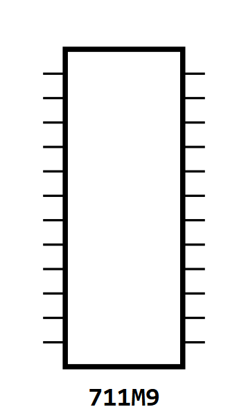 | [SVG](data/working_svg_schematic_md5_6_alpha.svg) · [PNG](data/working_svg_schematic_md5_6_alpha.png) |
| **Schematic with BIP 39 words** Symbol labelled with the three-word identifier. | 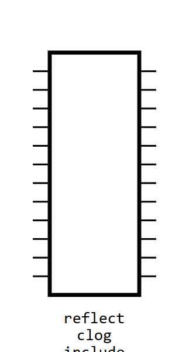 | [SVG](data/working_svg_schematic_bip_39_3_word.svg) · [PNG](data/working_svg_schematic_bip_39_3_word.png) |
| **KiCad asset licence** | — | [MD](data/kicad/LICENSE.md) |
| **KiCad library guide** | — | [MD](data/kicad/README.md) |
| **KiCad symbol library** | — | [KICAD_SYM](data/kicad/electronic_ic_logic_16_channel_analog_multiplexer_tssop_24_nexperia_74hct4067pw118.kicad_sym) |
| **Hand-solder footprint guide** | — | [MD](data/kicad/hand_solder/README.md) |
| **Machine-solder footprint guide** | — | [MD](data/kicad/machine_solder/README.md) |
| **Machine-solder footprint** | — | [KICAD_MOD](data/kicad/machine_solder/electronic_ic_logic_16_channel_analog_multiplexer_tssop_24_nexperia_74hct4067pw118.kicad_mod) |
| **KiCad availability and source masters** | — | [JSON](data/kicad/manifest.json) · [YAML](data/kicad/manifest.yaml) |
| **Manufacturer or supplier datasheet** | — | [PDF](data/datasheet.pdf) |
| **Drawer label data** | — | [YAML](data/label_drawer.yaml) |
| **Generator label** |  | [SVG](generator_label.svg) · [JSON](generator_label.json) |
| **Small drawer label** |  | [SVG](label_drawer_1_5x1.svg) |
| **Large drawer label** | 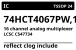 | [SVG](label_drawer_3x2.svg) |
| **Web catalogue file index** | — | [YAML](web.yaml) |
| **Part definition and build recipe** | — | [YAML](working.yaml) |

<!-- /oomp-part-file-table -->

[View this part on GitHub](https://github.com/oomlout/oomp_electronic_version_5/tree/main/parts/electronic_ic_logic_16_channel_analog_multiplexer_tssop_24_nexperia_74hct4067pw118)

[Browse this category](../../navigation/electronic/ic/logic/16_channel_analog_multiplexer/tssop_24/nexperia/README.md)

---

This page is generated from the OOMP part definition by a Roboclick Jinja template. Edit the source taxonomy or template rather than this generated file.