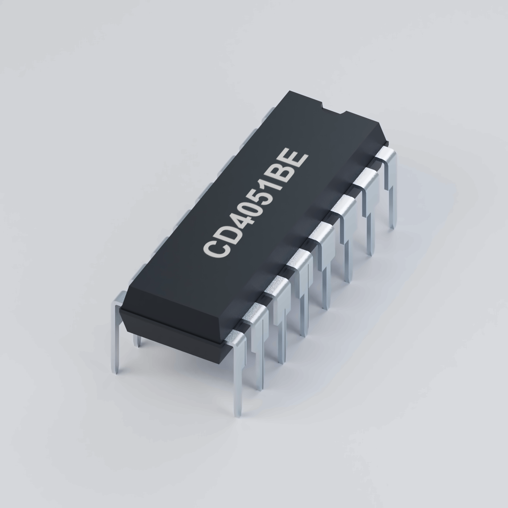
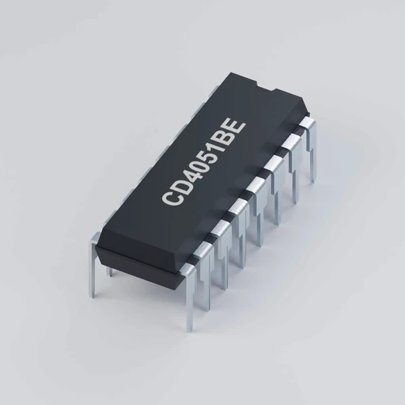
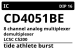

# IC CD4051BE DIP 16

`electronic_ic_logic_8_channel_analog_multiplexer_demultiplexer_dip_16_texas_instruments_cd4051be`

IC CD4051BE DIP 16 is an OOMP electronic ic definition. It uses the dip 16 package or form factor. Its nominal drawing size is 10.0 &#x00D7; 5.0 mm.

Illustrative KiCad DIP-16 model; TI N0016E body is about 19.32 x 6.35 mm. Catalogue lists 10 x 5 mm with no width reference, height or footprint. Model bounds 7.874 x 19.177 x 6.98 mm include projecting pins. This is not a verified mechanical model. Texas Instruments lists CD4051BE as the package marking. Typeface, orientation, placement and variable lot/date details are illustrative. Marking composited in linear light from shared path-traced material passes; indirect reflections are approximate.

[Render recipe and provenance](data/display_render/manifest.json) · [KiCad model](https://gitlab.com/kicad/libraries/kicad-packages3D/-/blob/master/Package_DIP.3dshapes/DIP-16_W7.62mm.step)

Model credit: 2025 KiCAD. CC-BY-SA-4.0 with KiCad library exception; see original STEP header.

## At a glance

| Detail | Value |
| --- | --- |
| OOMP ID | `electronic_ic_logic_8_channel_analog_multiplexer_demultiplexer_dip_16_texas_instruments_cd4051be` |
| Type | Ic |
| Package / style | dip 16 |
| Nominal size | 10.0 &#x00D7; 5.0 mm |

## Classification

| Level | Value |
| --- | --- |
| 1 | `electronic` |
| 2 | `ic` |
| 3 | `logic` |
| 4 | `8_channel_analog_multiplexer_demultiplexer` |
| 5 | `dip_16` |
| 14 | `texas_instruments` |
| 15 | `cd4051be` |

## Nominal dimensions

| Measurement | Value |
| --- | ---: |
| Length | 10.0 mm |
| Width | 5.0 mm |

## Identifiers

| Identifier | Value |
| --- | --- |
| Manufacturer part number | `CD4051BE` |
| LCSC | [`C5200`](https://www.lcsc.com/product-detail/C5200.html) |
| JLCPCB | [`C5200`](https://jlcpcb.com/partdetail/TexasInstruments-CD4051BE/C5200) |

## Used in projects

[Browse confirmed project usage](https://oomlout.github.io/oomp_electronic_project_version_5/usage/index.html#electronic_ic_logic_8_channel_analog_multiplexer_demultiplexer_dip_16_texas_instruments_cd4051be)

## Files

<!-- oomp-part-file-table -->

| Image type | Image | Link |
| --- | :---: | --- |
| **Studio render** |  | [PNG](data/display_render/render.png) · [Preview](data/display_render/preview.webp) |
| **Studio render sources and recipe** | — | [JSON](data/display_render/manifest.json) |
| **Drawer label data** | — | [YAML](data/label_drawer.yaml) |
| **Small drawer label** |  | [SVG](label_drawer_1_5x1.svg) |
| **Large drawer label** |  | [SVG](label_drawer_3x2.svg) |
| **Web catalogue file index** | — | [YAML](web.yaml) |
| **Part definition and build recipe** | — | [YAML](working.yaml) |

<!-- /oomp-part-file-table -->

[View this part on GitHub](https://github.com/oomlout/oomp_electronic_version_5/tree/main/parts/electronic_ic_logic_8_channel_analog_multiplexer_demultiplexer_dip_16_texas_instruments_cd4051be)

[Browse this category](../../navigation/electronic/ic/logic/8_channel_analog_multiplexer_demultiplexer/dip_16/texas_instruments/README.md)

---

This page is generated from the OOMP part definition by a Roboclick Jinja template. Edit the source taxonomy or template rather than this generated file.