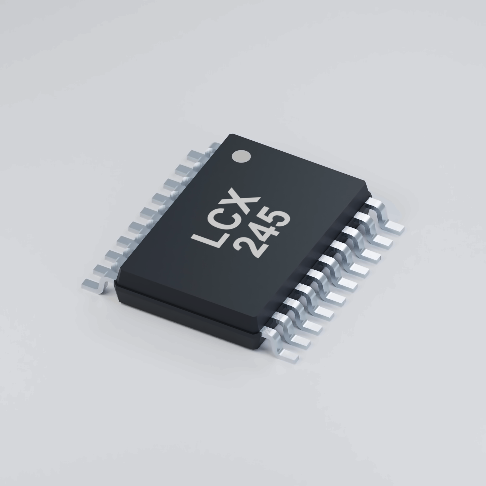
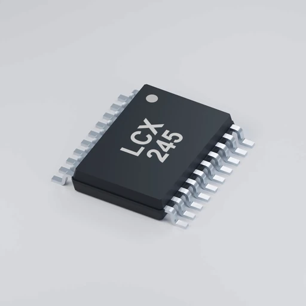

# IC 74LCX245MTCX TSSOP 20

`electronic_ic_logic_octal_bus_transceiver_tri_state_tssop_20_onsemi_74lcx245mtcx`

IC 74LCX245MTCX TSSOP 20 is an OOMP electronic ic definition. It uses the tssop 20 package or form factor. Its nominal drawing size is 6.5 &#x00D7; 4.4 mm.

Illustrative KiCad TSSOP-20 model is 1.2 mm high, matching onsemi case 948AQ maximum. Catalogue source omits height and machine-solder footprint; this is not a verified PCB footprint. onsemi lists LCX / 245 as the package marking; the two-line break is illustrative. Typeface, orientation, placement and variable lot/date details are illustrative. Marking composited in linear light from shared path-traced material passes; indirect reflections are approximate.

[Render recipe and provenance](data/display_render/manifest.json) · [KiCad model](https://gitlab.com/kicad/libraries/kicad-packages3D/-/blob/master/Package_SO.3dshapes/TSSOP-20_4.4x6.5mm_P0.65mm.step)

Model credit: 2025 KiCAD. CC-BY-SA-4.0 with KiCad library exception; see original STEP header.

## At a glance

| Detail | Value |
| --- | --- |
| OOMP ID | `electronic_ic_logic_octal_bus_transceiver_tri_state_tssop_20_onsemi_74lcx245mtcx` |
| Type | Ic |
| Package / style | tssop 20 |
| Nominal size | 6.5 &#x00D7; 4.4 mm |

## Classification

| Level | Value |
| --- | --- |
| 1 | `electronic` |
| 2 | `ic` |
| 3 | `logic` |
| 4 | `octal_bus_transceiver_tri_state` |
| 5 | `tssop_20` |
| 14 | `onsemi` |
| 15 | `74lcx245mtcx` |

## Nominal dimensions

| Measurement | Value |
| --- | ---: |
| Length | 6.5 mm |
| Width | 4.4 mm |

## Identifiers

| Identifier | Value |
| --- | --- |
| Manufacturer part number | `74LCX245MTCX` |
| LCSC | [`C6020`](https://www.lcsc.com/product-detail/C6020.html) |
| JLCPCB | [`C6020`](https://jlcpcb.com/partdetail/onsemi-74LCX245MTCX/C6020) |

## Used in projects

[Browse confirmed project usage](https://oomlout.github.io/oomp_electronic_project_version_5/usage/index.html#electronic_ic_logic_octal_bus_transceiver_tri_state_tssop_20_onsemi_74lcx245mtcx)

## Files

<!-- oomp-part-file-table -->

| Image type | Image | Link |
| --- | :---: | --- |
| **Studio render** |  | [PNG](data/display_render/render.png) · [Preview](data/display_render/preview.webp) |
| **Studio render sources and recipe** | — | [JSON](data/display_render/manifest.json) |
| **Drawer label data** | — | [YAML](data/label_drawer.yaml) |
| **Small drawer label** |  | [SVG](label_drawer_1_5x1.svg) |
| **Large drawer label** |  | [SVG](label_drawer_3x2.svg) |
| **Web catalogue file index** | — | [YAML](web.yaml) |
| **Part definition and build recipe** | — | [YAML](working.yaml) |

<!-- /oomp-part-file-table -->

[View this part on GitHub](https://github.com/oomlout/oomp_electronic_version_5/tree/main/parts/electronic_ic_logic_octal_bus_transceiver_tri_state_tssop_20_onsemi_74lcx245mtcx)

[Browse this category](../../navigation/electronic/ic/logic/octal_bus_transceiver_tri_state/tssop_20/onsemi/README.md)

---

This page is generated from the OOMP part definition by a Roboclick Jinja template. Edit the source taxonomy or template rather than this generated file.