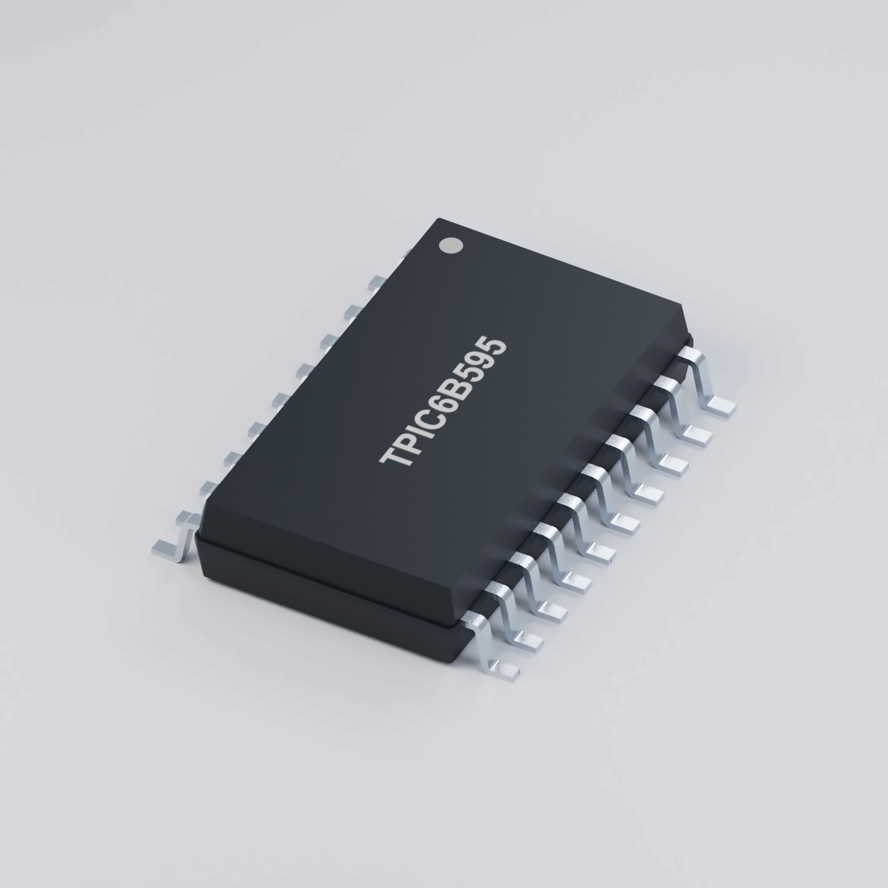
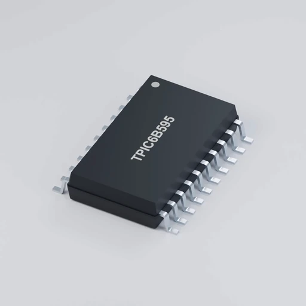
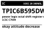

# IC TPIC6B595DWR SOIC 20 300MIL

`electronic_ic_logic_power_logic_octal_shift_register_driver_soic_20_300mil_texas_instruments_tpic6b595dwr`

IC TPIC6B595DWR SOIC 20 300MIL is an OOMP electronic ic definition. It uses the soic 20 300mil package or form factor. Its nominal drawing size is 10.0 &#x00D7; 5.0 mm.

Illustrative KiCad SOIC-20W model; the 2.75 mm source model is scaled vertically to the Texas Instruments 2.65 mm maximum height as a display-only approximation. Catalogue lists 10 x 5 mm without width reference, height or footprint, inconsistent with TI nominal 12.8 x 7.5 mm body. Not a verified mechanical model. Typeface and placement are illustrative. Texas Instruments lists TPIC6B595 as the package marking. Typeface, orientation, placement and variable lot/date details are illustrative. Marking composited in linear light from shared path-traced material passes; indirect reflections are approximate.

[Render recipe and provenance](data/display_render/manifest.json) · [KiCad model](https://gitlab.com/kicad/libraries/kicad-packages3D/-/blob/master/Package_SO.3dshapes/SOIC-20W_7.5x12.8mm_P1.27mm.step)

Model credit: 2025 KiCAD. CC-BY-SA-4.0 with KiCad library exception; see original STEP header.

## At a glance

| Detail | Value |
| --- | --- |
| OOMP ID | `electronic_ic_logic_power_logic_octal_shift_register_driver_soic_20_300mil_texas_instruments_tpic6b595dwr` |
| Type | Ic |
| Package / style | soic 20 300mil |
| Nominal size | 10.0 &#x00D7; 5.0 mm |

## Classification

| Level | Value |
| --- | --- |
| 1 | `electronic` |
| 2 | `ic` |
| 3 | `logic` |
| 4 | `power_logic_octal_shift_register_driver` |
| 5 | `soic_20_300mil` |
| 14 | `texas_instruments` |
| 15 | `tpic6b595dwr` |

## Nominal dimensions

| Measurement | Value |
| --- | ---: |
| Length | 10.0 mm |
| Width | 5.0 mm |

## Identifiers

| Identifier | Value |
| --- | --- |
| Manufacturer part number | `TPIC6B595DWR` |
| LCSC | [`C7094`](https://www.lcsc.com/product-detail/C7094.html) |
| JLCPCB | [`C7094`](https://jlcpcb.com/partdetail/TexasInstruments-TPIC6B595DWR/C7094) |

## Used in projects

[Browse confirmed project usage](https://oomlout.github.io/oomp_electronic_project_version_5/usage/index.html#electronic_ic_logic_power_logic_octal_shift_register_driver_soic_20_300mil_texas_instruments_tpic6b595dwr)

## Files

<!-- oomp-part-file-table -->

| Image type | Image | Link |
| --- | :---: | --- |
| **Studio render** |  | [PNG](data/display_render/render.png) · [Preview](data/display_render/preview.webp) |
| **Studio render sources and recipe** | — | [JSON](data/display_render/manifest.json) |
| **Drawer label data** | — | [YAML](data/label_drawer.yaml) |
| **Small drawer label** |  | [SVG](label_drawer_1_5x1.svg) |
| **Large drawer label** |  | [SVG](label_drawer_3x2.svg) |
| **Web catalogue file index** | — | [YAML](web.yaml) |
| **Part definition and build recipe** | — | [YAML](working.yaml) |

<!-- /oomp-part-file-table -->

[View this part on GitHub](https://github.com/oomlout/oomp_electronic_version_5/tree/main/parts/electronic_ic_logic_power_logic_octal_shift_register_driver_soic_20_300mil_texas_instruments_tpic6b595dwr)

[Browse this category](../../navigation/electronic/ic/logic/power_logic_octal_shift_register_driver/soic_20_300mil/texas_instruments/README.md)

---

This page is generated from the OOMP part definition by a Roboclick Jinja template. Edit the source taxonomy or template rather than this generated file.